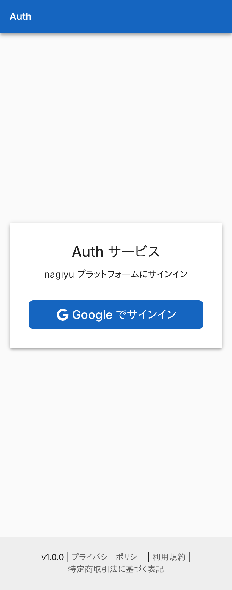
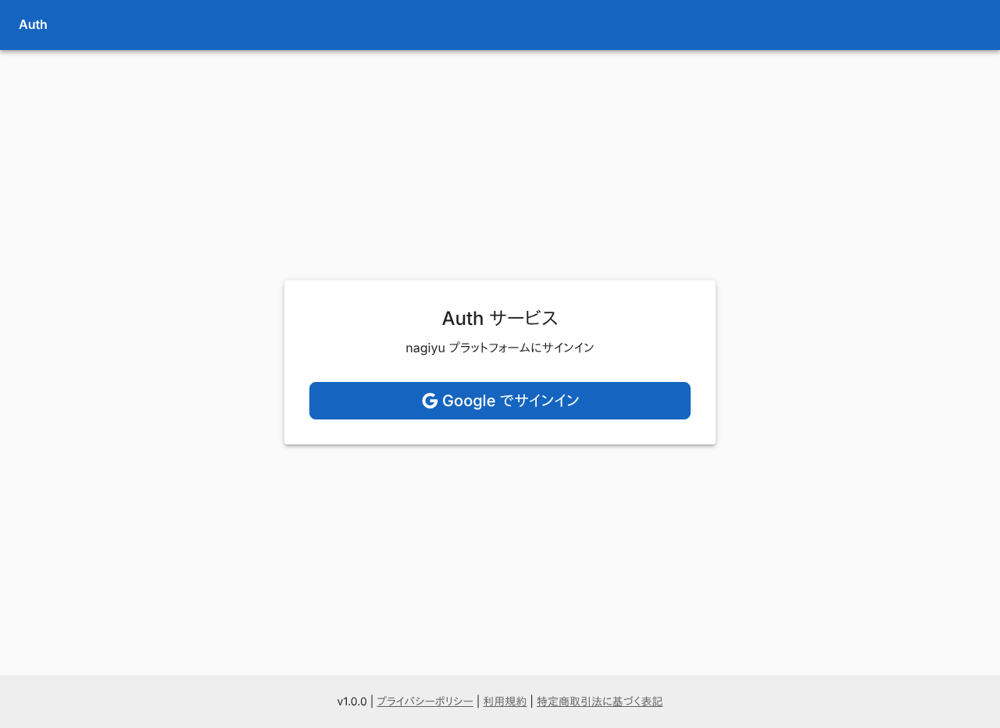
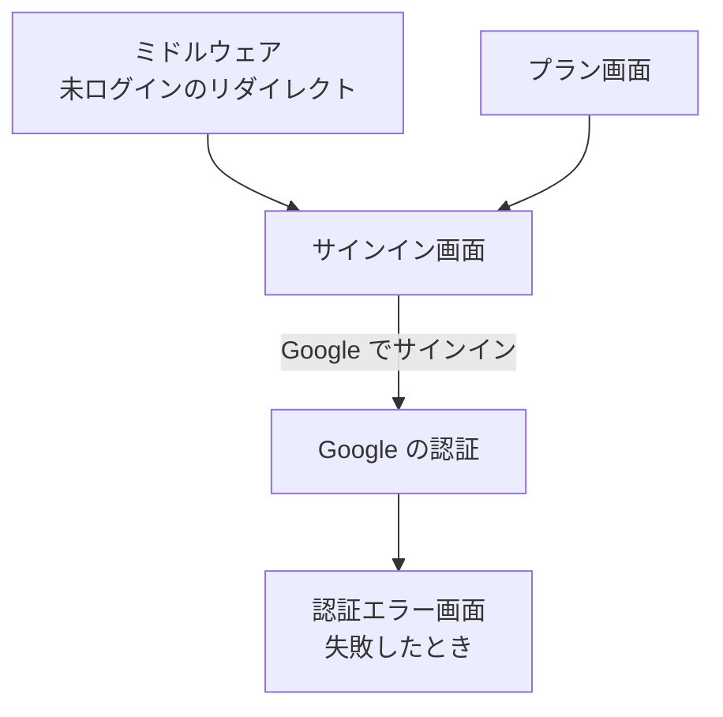

# サインイン画面

Google アカウントでサインインするためのボタンを 1 つ置いた画面。他のサービスも、未ログインの利用者をここへ送る。

## 入口

- パスは `/signin`。`callbackUrl` に[戻り先](../term/callback-url.md)を付けられる (付けなければ `/dashboard`)
- 次のところから来る
    - ログインが要る画面を未ログインで開いたとき (Auth 自身も他のサービスも、ミドルウェアが `/signin?callbackUrl=...` へリダイレクトする)
    - ダッシュボードを未ログインで開いたとき (戻り先は付かない)
    - [プラン画面](./plans.md)の「ログインして申し込む」
- ミドルウェアは `/signin`、`/plans`、`/legal` 配下、`/api`、`/auth` 配下を、ログインなしで通す
- ログイン済みの利用者がこの画面を開いたときは、ボタンを出さずに別の画面へ移す (下の「ログイン済みのとき」)

## 表示するもの

| 部分 | 内容 |
|---|---|
| 見出し | 「Auth サービス」と「nagiyu プラットフォームにサインイン」 |
| ボタン | 「Google でサインイン」 |

## 操作

| 操作 | 結果 |
|---|---|
| Google でサインイン | 戻り先を持って Google の認証へ進む。認証のあとの流れは[サインインの経路](../flow/sign-in.md)にある |

- 未ログインのとき、画面は戻り先を検証せずに受け渡す。許可の判定は、認証のあとに戻るときに行う
- 同じキーを重ねて配列になった `callbackUrl` は、付いていないものとして扱う

## ログイン済みのとき

セッションの Cookie があれば、画面を描かずに次の行き先へリダイレクトする。ログインの判定はセッション Cookie の有無だけで、認証のスキップ設定 (E2E や撮影で使うもの) の影響を受けない。

| 戻り先 | 移す先 |
|---|---|
| 許可された絶対 URL | その URL |
| Auth 内の相対パス | 絶対 URL にしたもの |
| 無い・許可されない値 | `/dashboard` |

- 許可の判定は[戻り先](../term/callback-url.md)の検証と同じ。画面から直接移す場合は認証ライブラリのリダイレクトの検証を通らないため、画面の中で検証する

## 画面の見た目

### 通常表示

Google でサインインするボタンだけの画面。

| スマホ | PC |
|---|---|
|  |  |

## つながり

