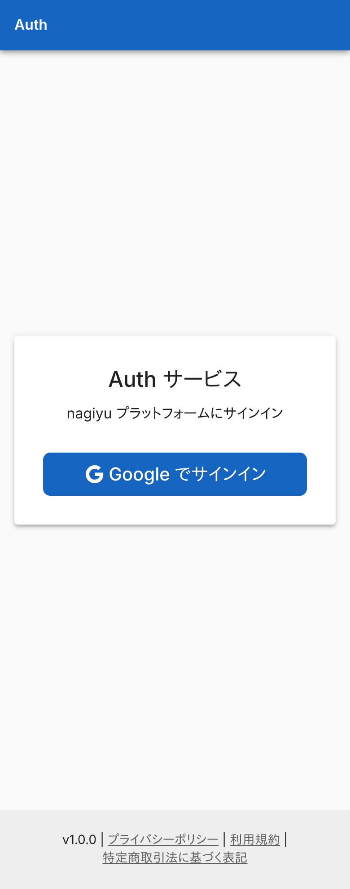
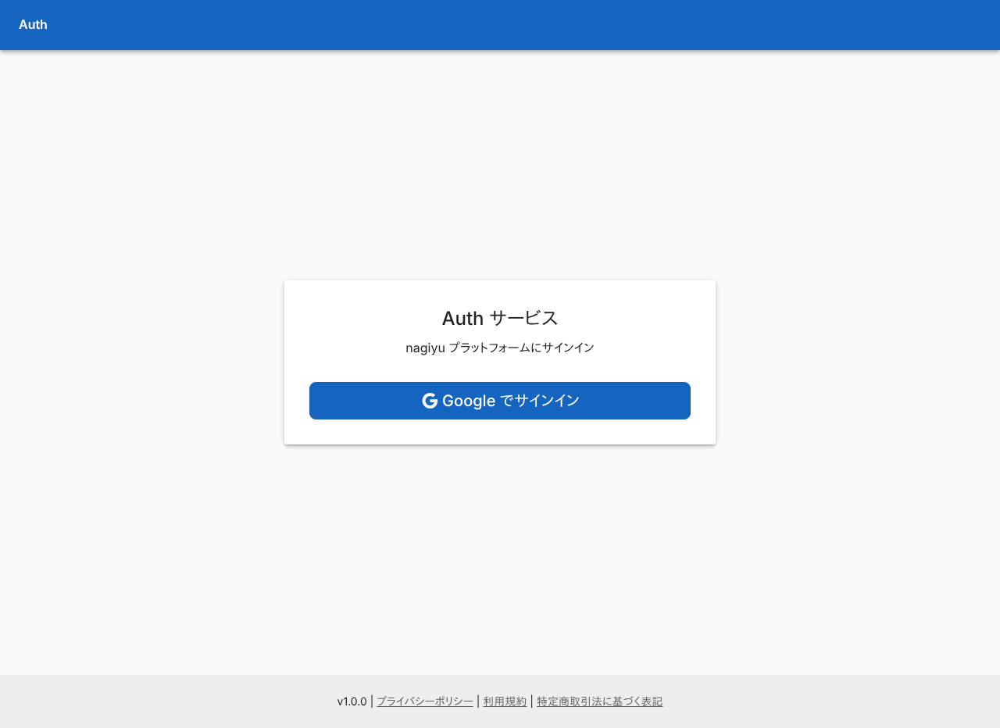
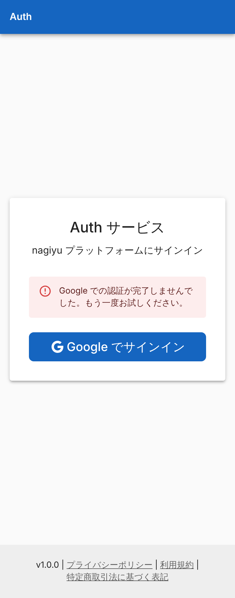
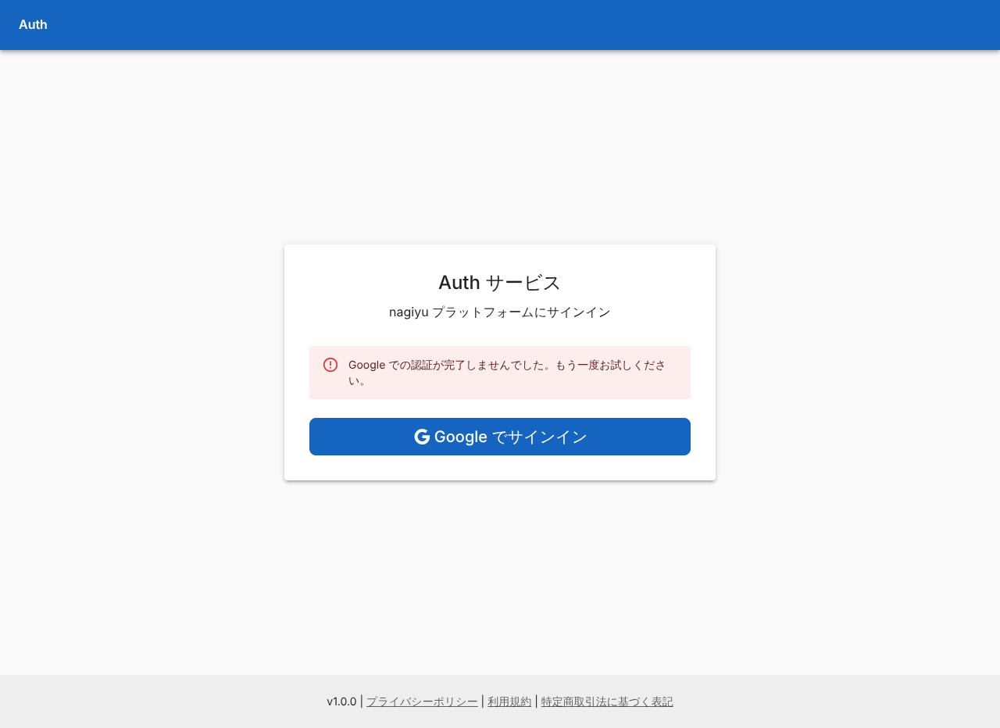
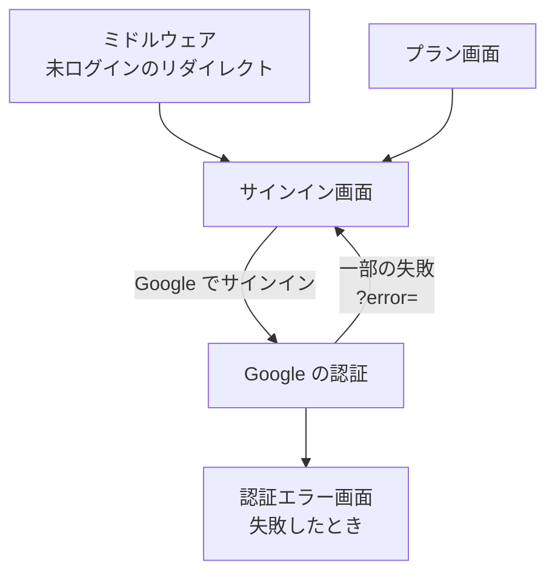

# サインイン画面

Google アカウントでサインインするためのボタンを 1 つ置いた画面。他のサービスも、未ログインの利用者をここへ送る。

## 入口

- パスは `/signin`。`callbackUrl` に[戻り先](../term/callback-url.md)を付けられる (付けなければ `/dashboard`)
- 次のところから来る
    - ログインが要る画面を未ログインで開いたとき (Auth 自身も他のサービスも、ミドルウェアが `/signin?callbackUrl=...` へリダイレクトする)
    - ダッシュボードを未ログインで開いたとき (戻り先は付かない)
    - [プラン画面](./plans.md)の「ログインして申し込む」
- ミドルウェアは `/signin`、`/plans`、`/legal` 配下、`/api`、`/auth` 配下を、ログインなしで通す
- 認証ライブラリは、サインインの途中の失敗の一部を `?error=<種類>` を付けてこの画面へ戻す (下の「失敗して戻されたとき」)。それ以外の失敗は[認証エラー画面](./auth-error.md)へ移す
- ログイン済みの利用者がこの画面を開いたときは、ボタンを出さずに別の画面へ移す (下の「ログイン済みのとき」)

## 表示するもの

| 部分 | 内容 |
|---|---|
| 見出し | 「Auth サービス」と「nagiyu プラットフォームにサインイン」 |
| エラーの帯 | `error` が付いているときだけ、見出しとボタンの間に出す (下の「失敗して戻されたとき」) |
| ボタン | 「Google でサインイン」 |

## 操作

| 操作 | 結果 |
|---|---|
| Google でサインイン | 戻り先を持って Google の認証へ進む。認証のあとの流れは[サインインの経路](../flow/sign-in.md)にある |

- 未ログインのとき、画面は戻り先を検証せずに受け渡す。許可の判定は、認証のあとに戻るときに行う
- 同じキーを重ねて配列になった `callbackUrl` は、付いていないものとして扱う

## 失敗して戻されたとき

`error` の値に応じた文をエラーの帯に出す。ボタンはそのまま押せる。

| `error` の値 | 文 | 戻されるとき |
|---|---|---|
| `OAuthCallbackError` | Google での認証が完了しませんでした。もう一度お試しください。 | Google が失敗を返した (同意画面でキャンセルしたときも) |
| `MissingCSRF` | 操作の確認に失敗しました。画面を開き直してから、もう一度お試しください。 | サインアウトの送信で CSRF トークンの照合に失敗した (この画面のボタンからのサインインは照合しない) |
| `Configuration` | サーバー設定に問題があります。管理者にお問い合わせください。 | 認証ライブラリへ直接送ったサインインで、利用者に見せない種類の失敗が起きた (中身を伏せてこの名前にする)。この画面のボタンからのサインインで起きた失敗は、ここへ戻さず例外になる |
| それ以外の値 | サインインに失敗しました。もう一度お試しください。 | |
| なし・空 | 帯を出さない | |

- 表の値の完全一致だけを拾い、`__proto__` のようなオブジェクト自身の名前を渡されても「それ以外の値」の文にする
- 同じキーを重ねて配列になった `error` は、付いていないものとして扱う
- 認証ライブラリは戻すときに `error` だけを付けるため、戻り先は引き継がれない

## ログイン済みのとき

`error` が付いているときは、ログイン済みでも移さず、エラーの帯を付けてこの画面を出す。サインアウトの CSRF 照合の失敗のように、ログインしたまま起きる失敗もこの画面へ戻されるため、移すと失敗が伝わらない。

`error` が無く、有効なセッションの Cookie (期限内で署名が正しい JWT) があれば、画面を描かずに次の行き先へリダイレクトする。期限切れや壊れた Cookie は未ログインとして扱う。この判定は認証のスキップ設定 (E2E や撮影で使うもの) の影響を受けない。

| 戻り先 | 移す先 |
|---|---|
| 許可された絶対 URL | その URL |
| Auth 内の相対パス | 絶対 URL にしたもの |
| 無い・許可されない値 | `/dashboard` |
| Auth のサインイン画面自身 | `/dashboard` (移った先でまた移り続けるのを防ぐ) |

- 許可の判定は[戻り先](../term/callback-url.md)の検証と同じ。画面から直接移す場合は認証ライブラリのリダイレクトの検証を通らないため、画面の中で検証する

## 画面の見た目

### 通常表示

Google でサインインするボタンだけの画面。

| スマホ | PC |
|---|---|
|  |  |

### `error`

失敗して戻されたとき。図は `OAuthCallbackError` の文。

| スマホ | PC |
|---|---|
|  |  |

## つながり

