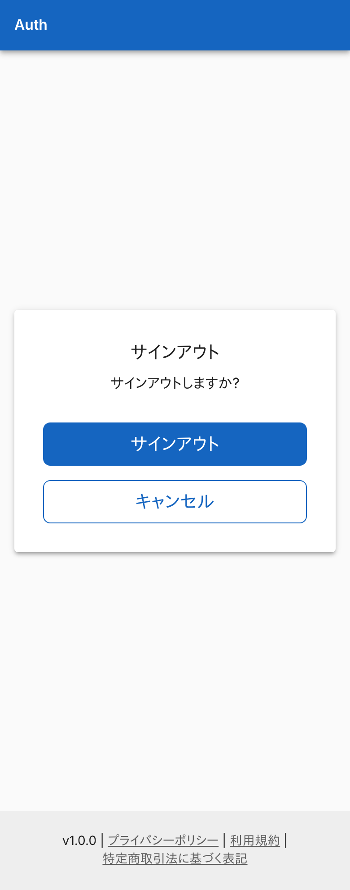
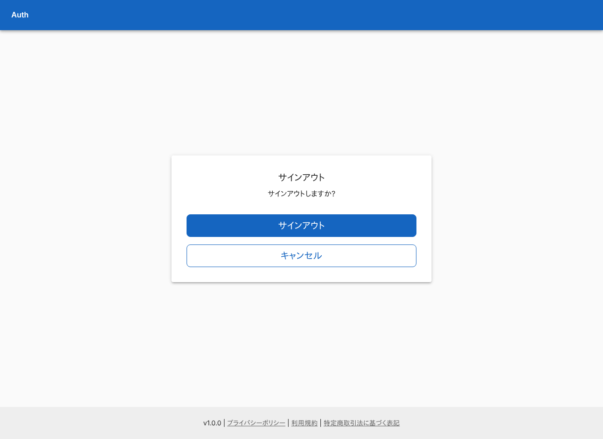
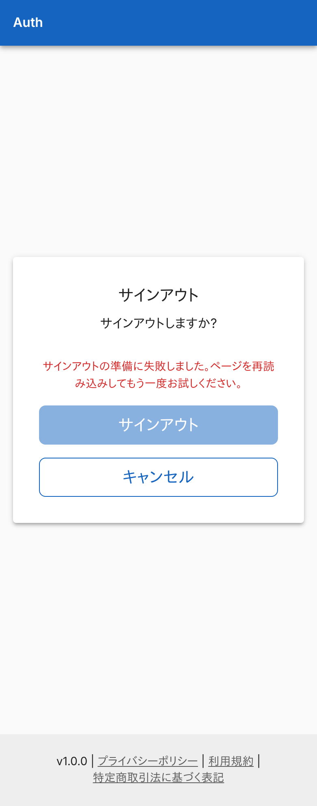
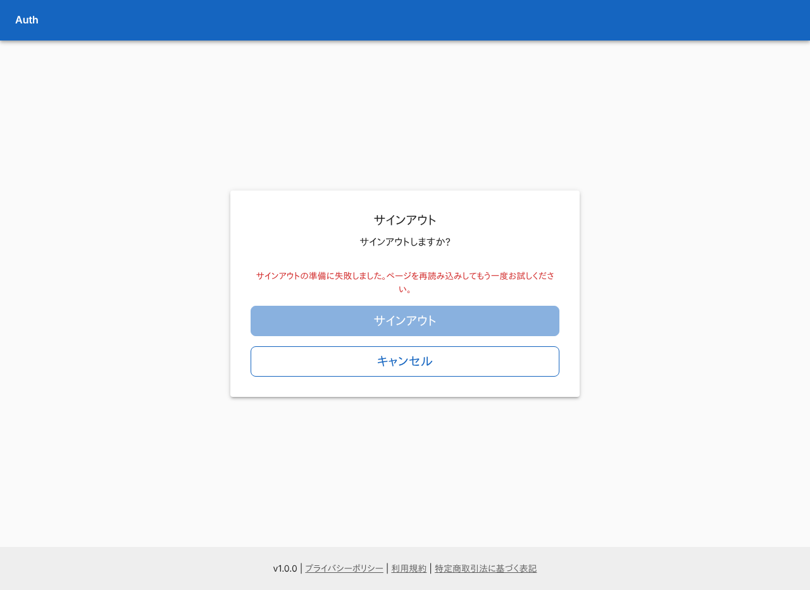
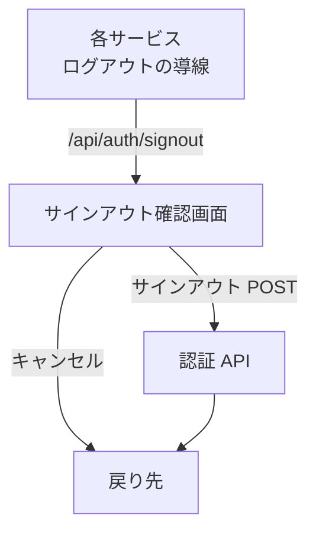

# サインアウト確認画面

全サービスのサインアウトが着地する確認画面。ボタンを押したときだけサインアウトする。

## 入口

- パスは `/auth/signout`。各サービスは `/api/auth/signout?callbackUrl=<元の画面>` へ送り、認証ライブラリが戻り先を Cookie に控えてからここへ移す
- ログインなしで開ける (ミドルウェアの対象外)

## 表示するもの

| 部分 | 内容 |
|---|---|
| 見出しと確認文 | 「サインアウト」「サインアウトしますか?」 |
| サインアウト | CSRF トークンを取れるまでは押せない |
| キャンセル | リンク。戻り先は下を参照 |

- 「キャンセル」の戻り先は、認証ライブラリが控えた戻り先の Cookie を、押す前にサーバーで読み直して決める。Cookie がない、または[許可されない URL](../term/callback-url.md) なら `/dashboard`
- 戻り先の判定の基準は、環境変数 `AUTH_URL` (なければ `NEXTAUTH_URL`) の origin。どちらもなければリクエストのヘッダーから組み立てる

## 状態

- CSRF トークンを取れなかったときは「サインアウトの準備に失敗しました。ページを再読み込みしてもう一度お試しください。」を出し、サインアウトは押せないまま

## 操作

| 操作 | 結果 |
|---|---|
| サインアウト | CSRF トークンを付けて `/api/auth/signout` へ POST する。セッションの Cookie を消し、控えた戻り先へ移る ([システム系の API](../api/system.md)) |
| キャンセル | サインアウトせずに戻り先を開く |

## 画面の見た目

### 通常表示

CSRF トークンを取れて、サインアウトを押せる。

| スマホ | PC |
|---|---|
|  |  |

### CSRF トークンを取れなかったとき

サインアウトが押せないまま、準備に失敗した旨を出す。

| スマホ | PC |
|---|---|
|  |  |

## つながり

