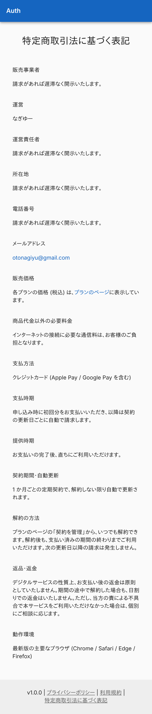
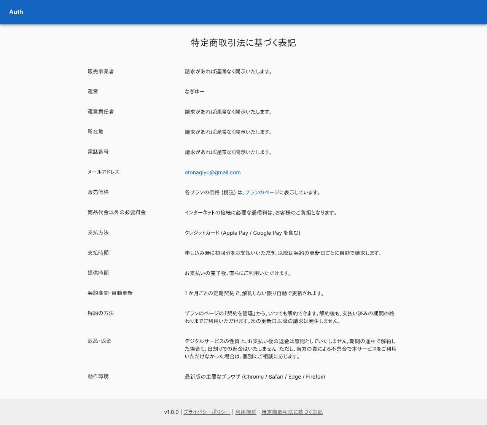
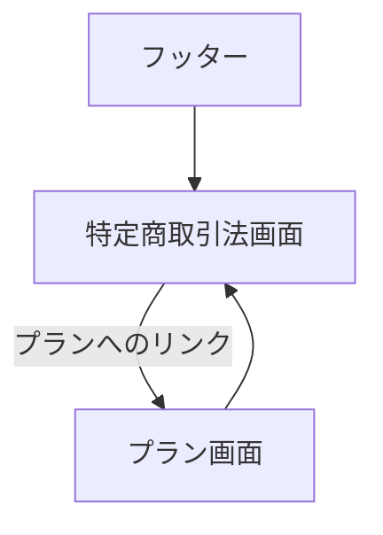

# 特定商取引法画面

有料プランの販売に必要な「特定商取引法に基づく表記」を載せた公開ページ。

## 入口

- パスは `/legal/tokushoho`。ログインなしで開ける (ミドルウェアが `/legal` 配下を通す)
- 全画面のフッターの「特定商取引法に基づく表記」と、[プラン画面](./plans.md)のリンクから来る

## 表示するもの

- 見出し「特定商取引法に基づく表記」と、項目名と内容の表。表は共通の部品 (`CommercialTransactionsTable`) で描き、項目の文面は共通ライブラリが持つ
- 表の中のプランへのリンクは `/plans`、連絡先は `mailto:` のリンク
- 狭い画面では、項目名と内容を縦に積む

## 操作

| 操作 | 結果 |
|---|---|
| プランへのリンク | [プラン画面](./plans.md)を開く |

## 画面の見た目

### 通常表示

項目名と内容の表。

| スマホ | PC |
|---|---|
|  |  |

## つながり

