# ユーザー編集画面

1 人のユーザーの手動ロールと[課金の権利](../term/role-grant.md)を編集する管理画面。変更は「保存」で 1 回にまとめて送る。

## 入口

- パスは `/dashboard/users/{userId}/edit`。[ユーザー一覧画面](./users.md)の「編集」から来る
- セッションがなければ[サインイン画面](./signin.md)へリダイレクトする

## 表示の条件

- `roles:assign` を持つ利用者だけ。権限がなければ URL を変えずに「アクセス権限がありません」を出し、ユーザーは読まない ([ロールと権限](../../platform/term/role.md))。`users:read` だけでは開けない

## 表示するもの

| 部分 | 内容 |
|---|---|
| 見出しと戻り道 | 「ユーザー編集」と「ユーザー一覧へ戻る」。読み込み中や失敗のときも出す |
| ユーザー | 名前、メール、ユーザー ID (表示のみ) |
| ロール割り当て | 手動で付けられるロール (有料ロールを除く) のチェックボックス。ロール名と説明を添える。今の手動ロールにチェックが入る。有料ロールは次の「課金の権利」から付ける |
| 課金の権利 | ロール、出どころ (手動 / Stripe)、有効期限 (日本時間の日付)、状態 (有効 / 期限切れ / 取り消し)、メモ、操作の表 |
| 権利の追加 | ロール (有料ロールだけ)、有効期限 (必須)、メモ (200 文字まで)、「追加」 |
| Stripe の顧客 | 顧客 ID と「顧客との対応を外す」。対応があるときだけ出す |
| 操作 | 「保存」と「キャンセル」 |

- 権利の操作は、手動で付けた、取り消し済みでない権利にだけ出る (Stripe 由来の権利は表示のみ)。取り消し済みの権利も一覧に残る
- 追加と期限の変更の日付は、今日 (日本時間) 以降だけ選べ、その日の終わり (日本時間) まで有効になる
- 権利の変更は、画面の中の「保存前の変更」として持つ。行に「追加予定」「期限変更予定」「取り消し予定」の札と「元に戻す」が付き、「保存」を押すまで送られない
- 期限の変更で今と同じ日にした場合は、変更として持たない。取り消しを予定すると、同じ権利の期限変更は外れる

## 状態

- 読み込み中はインラインの表示を出す
- ユーザーがいなければ「ユーザーが見つかりません」。それ以外の取得の失敗は「ユーザー情報の取得に失敗しました」、応答の形が不正なら「不正なレスポンス形式です」
- 権利が 0 件なら「課金の権利はありません」
- 入力エラーは、追加の下 (「ロールを選択してください」「有効期限の日付を入力してください」「有効期限は今日以降の日付を指定してください」「メモは 200 文字以内で入力してください」など) と、期限の変更の行に出す
- 保存や対応の解除が失敗したら、応答の `error` の文をエラーの帯で出す。保存中は入力と操作を押せなくする

## 操作

| 操作 | 結果 |
|---|---|
| 保存 | 手動ロールと権利の変更を [ユーザー API](../api/users.md) の `POST /api/users/{userId}/roles` へまとめて送る。成功すると[ユーザー一覧画面](./users.md)へ戻る |
| キャンセル、ユーザー一覧へ戻る | 変更を捨てて一覧へ戻る |
| 期限の変更、取り消し、追加 | 保存前の変更に足す (送らない) |
| 顧客との対応を外す | 確認ダイアログのあと、`DELETE /api/users/{userId}/stripe-customer` をその場で送る。「保存」とは別で、成功すると、取り消された権利と対応の有無だけを画面に反映し、保存前の変更は残す |

- 対応を外す確認の本文は、Stripe 上の契約は解約されないこと、契約が残るなら先に Stripe で解約すること、Stripe 由来の有効な権利も取り消されることを伝える

## 画面の見た目

### 通常表示

手動と Stripe の権利が、有効・期限切れ・取り消しの状態で並ぶ。Stripe の顧客との対応がある。

| スマホ | PC |
|---|---|
| 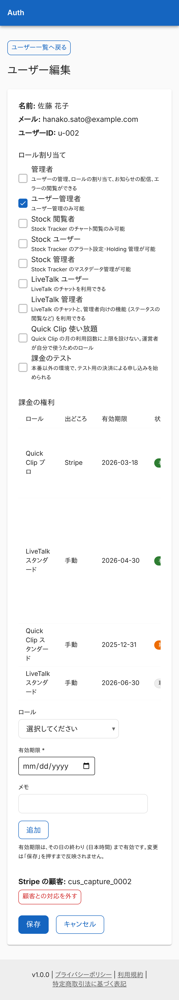 | 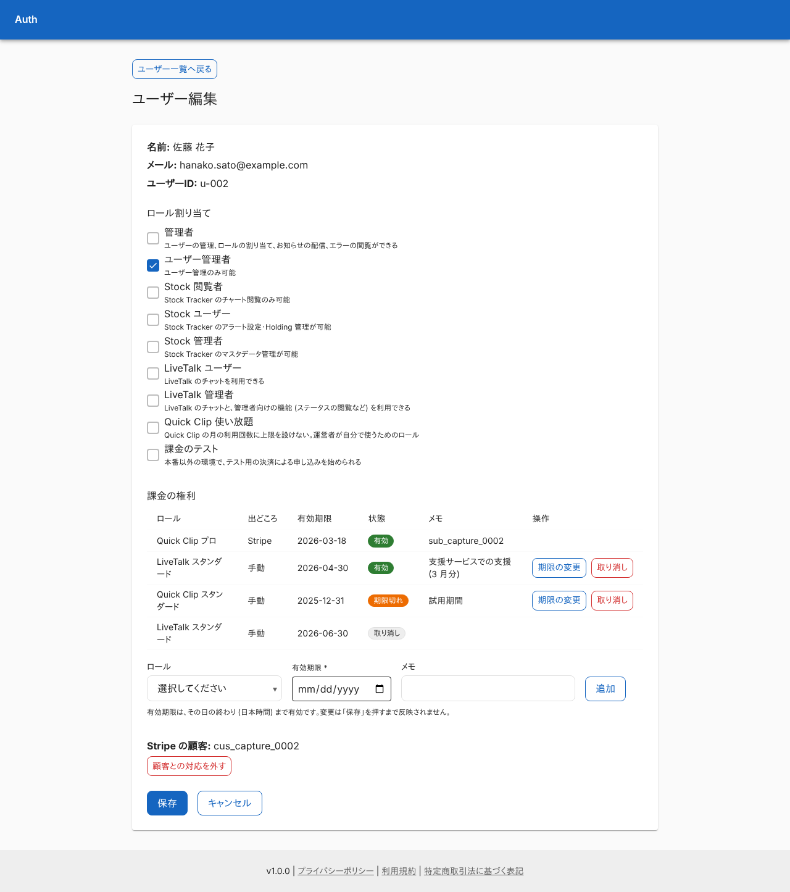 |

### 権利も Stripe の顧客もないとき

「課金の権利はありません」を出し、顧客の欄はない。

| スマホ | PC |
|---|---|
| 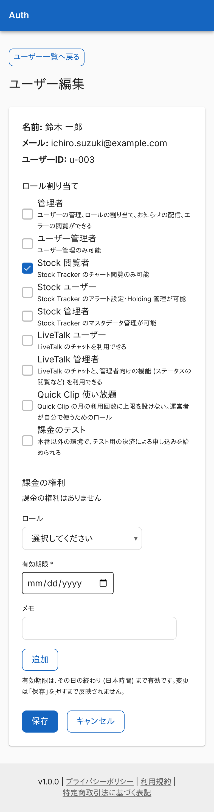 | 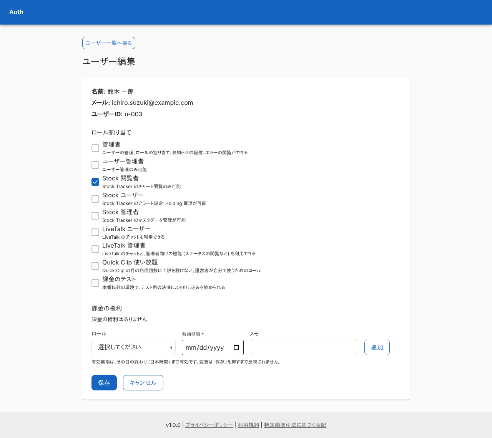 |

### 保存前の変更があるとき

期限変更予定・取り消し予定・追加予定の札が付く。

| スマホ | PC |
|---|---|
| 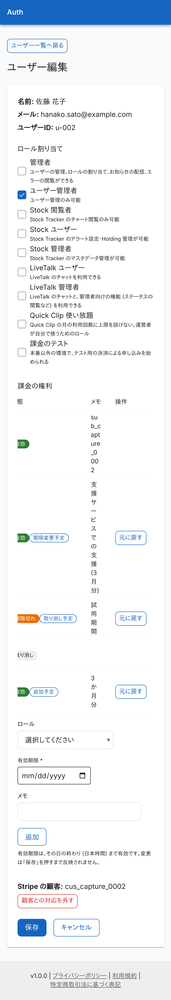 | 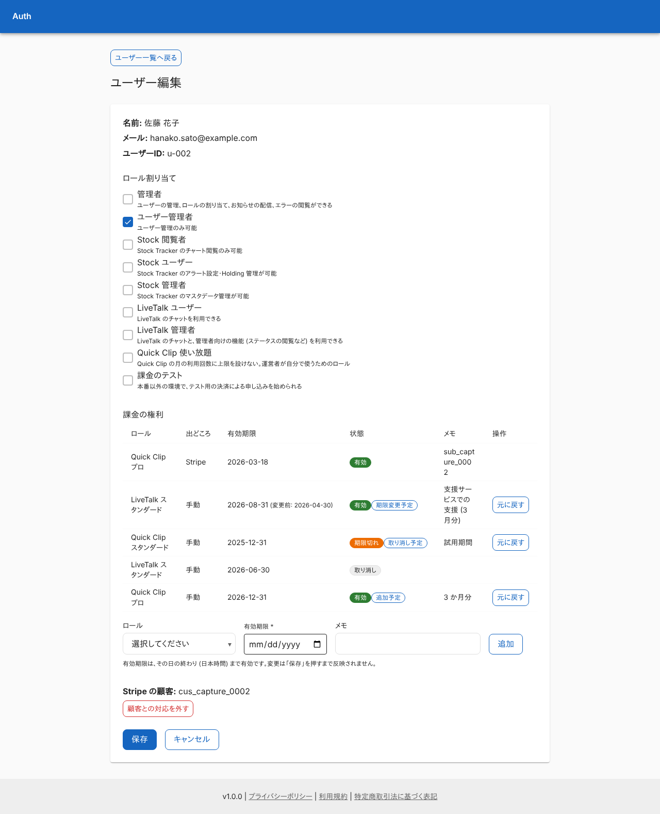 |

### 権利の追加の入力が足りないとき

ロールを選ばずに「追加」を押した。

| スマホ | PC |
|---|---|
| 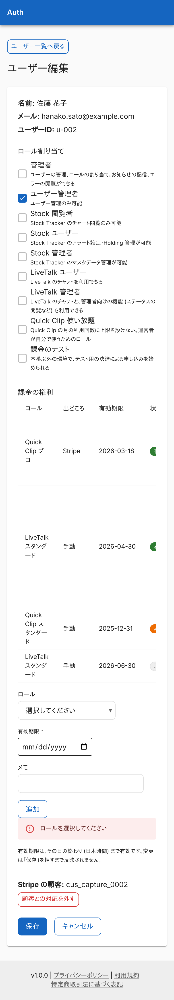 | 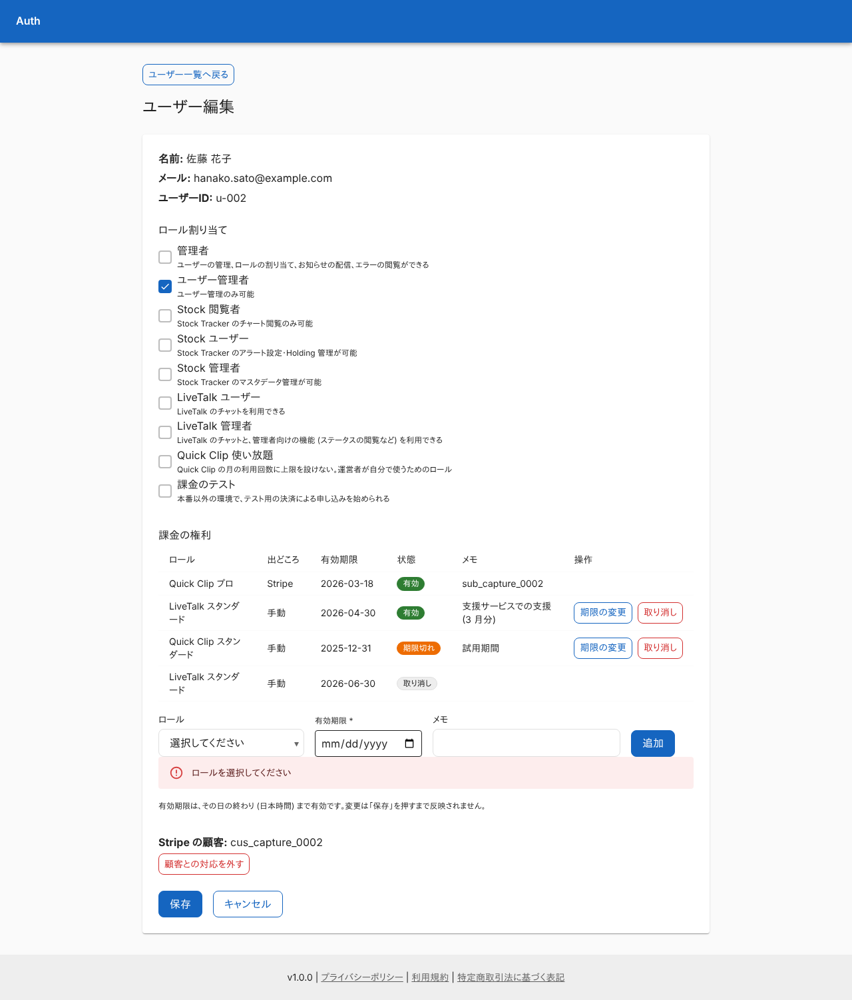 |

### 顧客との対応を外す確認

ダイアログを写している。

| スマホ | PC |
|---|---|
| 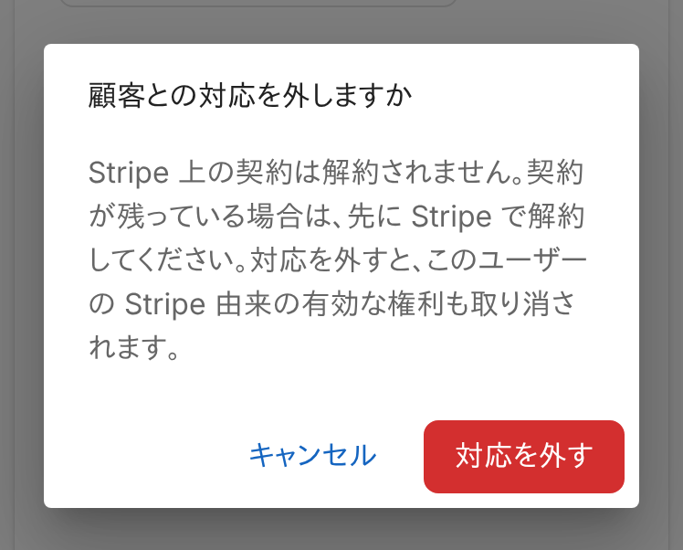 | 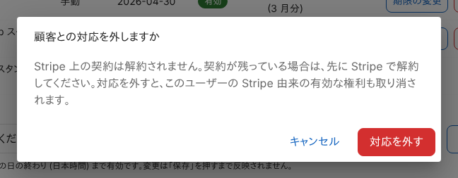 |

### 保存に失敗したとき

他の更新と競合した例。

| スマホ | PC |
|---|---|
| 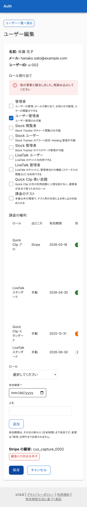 | 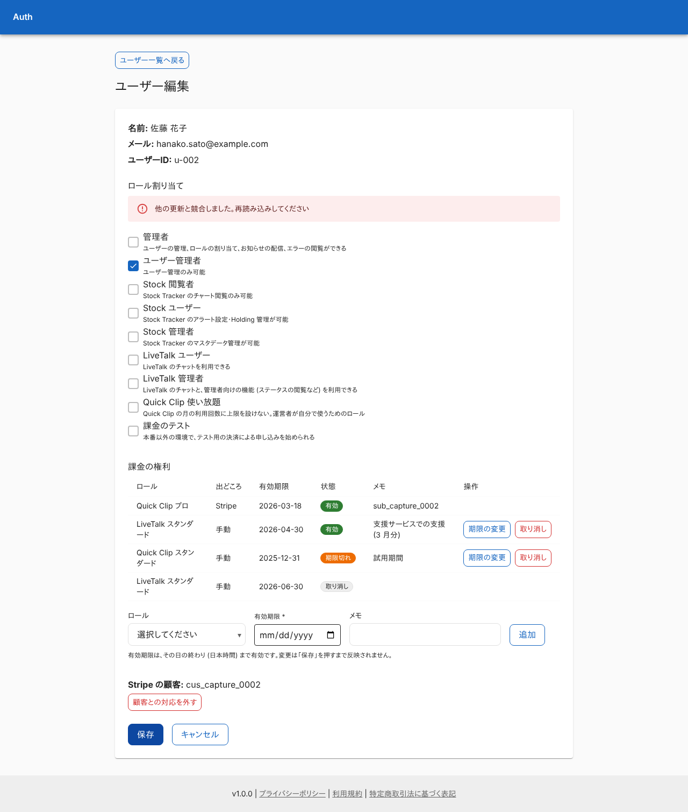 |

### ユーザーがいないとき

見出しと戻り道を残して、見つからない旨を出す。

| スマホ | PC |
|---|---|
| 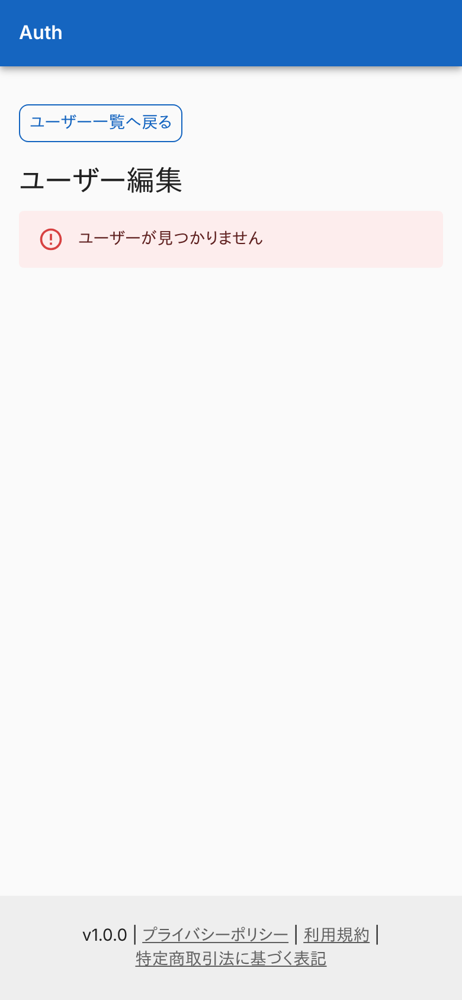 | 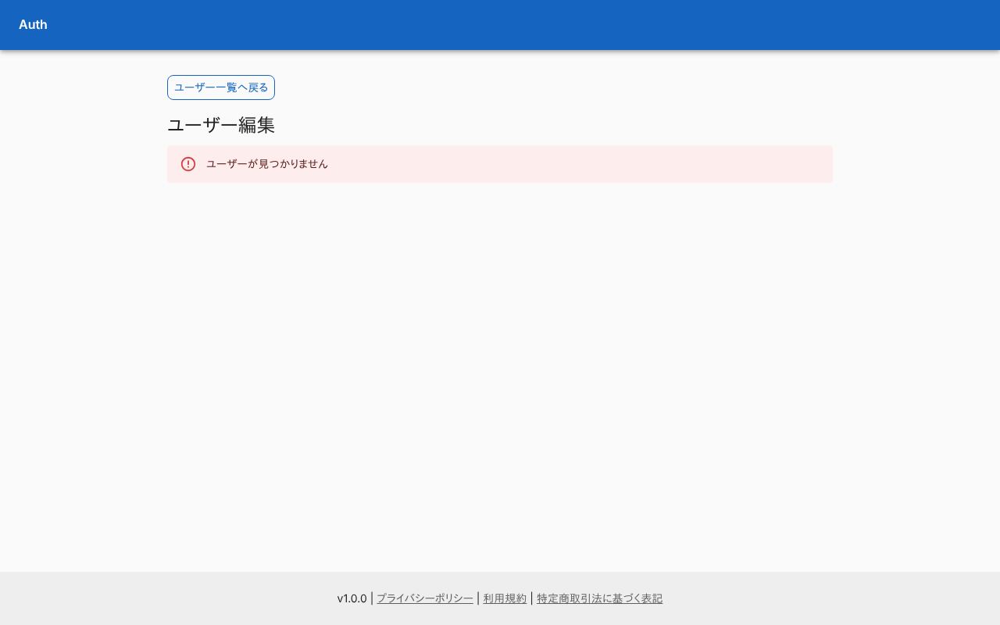 |

### 権限がないとき (`user-manager`)

`roles:assign` がないので開けない。

| スマホ | PC |
|---|---|
|  |  |

## つながり

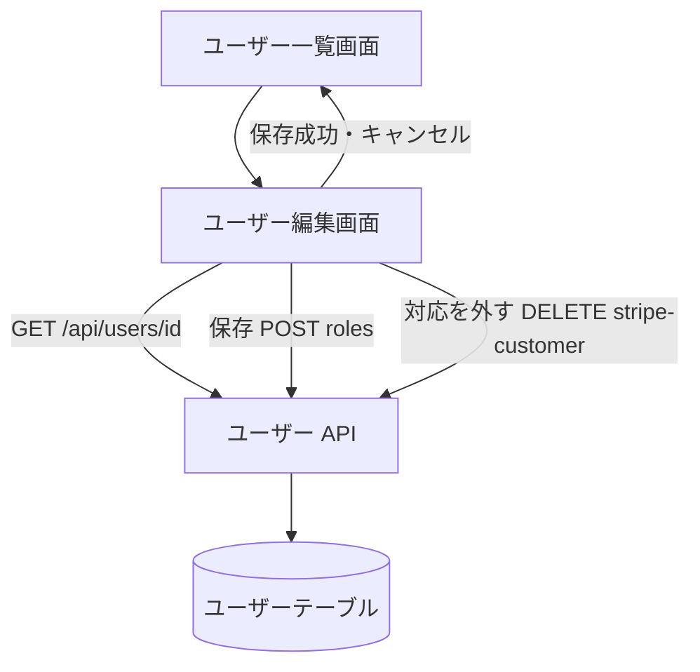
