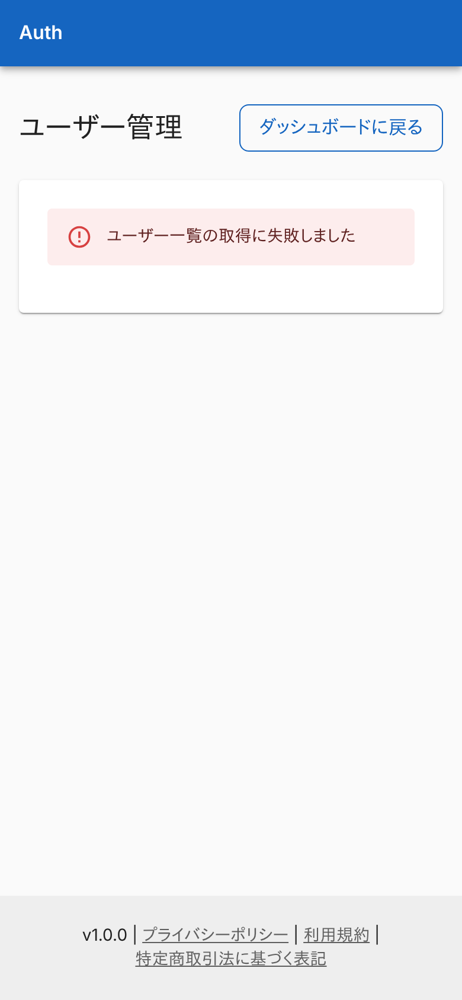
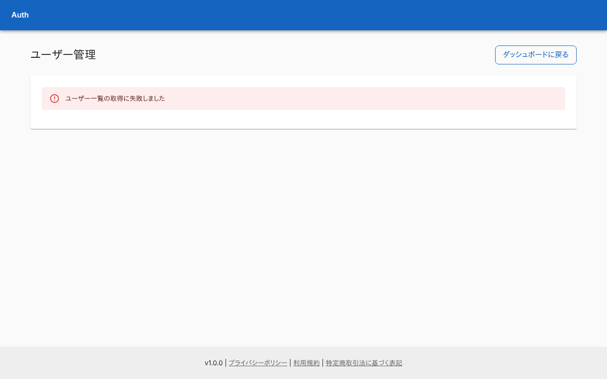
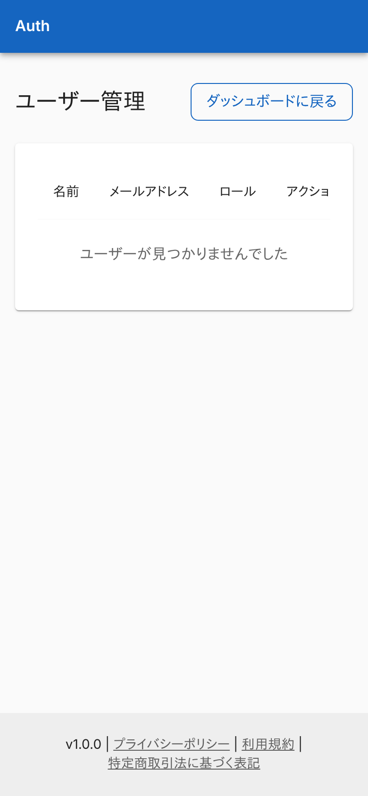
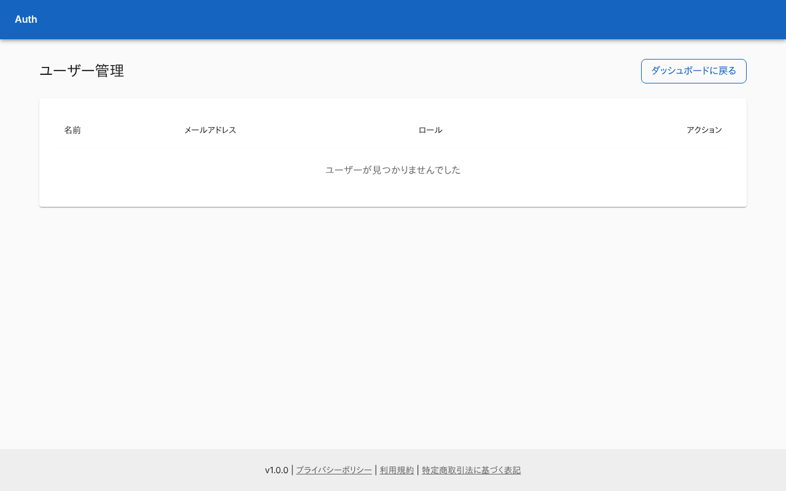
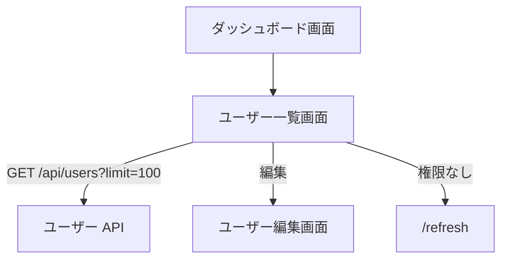

# ユーザー一覧画面

登録されているユーザーを表で一覧し、ロールの編集へ進む管理画面。

## 入口

- パスは `/dashboard/users`。[ダッシュボード](./dashboard.md)の「ユーザー管理」と、[ユーザー編集画面](./user-edit.md)の「ユーザー一覧へ戻る」から来る
- セッションがなければ[サインイン画面](./signin.md)へリダイレクトする

## 表示の条件

- `users:read` を持つ利用者だけ。権限がなければ URL を変えずに「アクセス権限がありません」を出す ([ロールと権限](../../platform/term/role.md))。画面には「アクセスを更新」(`/refresh` へ) と「再ログイン」(サインアウトへ) のボタンが付く

## 表示するもの

| 列 | 内容 |
|---|---|
| 名前 | ユーザー名 |
| メールアドレス | 長いアドレスは折り返す |
| ロール | 名前の札。ロールがなければ「なし」。定義にないロール ID は ID のまま出す |
| アクション | 「編集」。`roles:assign` を持つ利用者にだけ出す |

- 一覧は[ユーザー API](../api/users.md)から 1 回で最大 100 件まで読む。次のページを読む操作はなく、100 件を超えた分は出ない。並び順は DB の読み出し順で、画面では並べ替えない
- 画面の右上に「ダッシュボードに戻る」がある
- 画面が狭いと表が横にはみ出し、右にスクロールして続きを見る

## 状態

- 読み込み中は表の位置にインラインの表示を出す
- 0 件のときは表の下に「ユーザーが見つかりませんでした」
- 取得に失敗したときはエラーの帯を出す。文は応答の `error` ではなく、「ユーザー一覧の取得に失敗しました」(応答の形が不正なときは「不正なレスポンス形式です」)

## 操作

| 操作 | 結果 |
|---|---|
| 編集 | [ユーザー編集画面](./user-edit.md)を開く |
| ダッシュボードに戻る | [ダッシュボード](./dashboard.md)を開く |

## 画面の見た目

### 通常表示 (`admin`)

「編集」が出る。スマホでは表を右端までスクロールした状態で写している。

| スマホ | PC |
|---|---|
|  |  |

### `roles:assign` がないとき (`user-manager`)

「編集」が出ない。

| スマホ | PC |
|---|---|
|  |  |

### 取得に失敗したとき

一覧の取得に失敗した旨を出す。

| スマホ | PC |
|---|---|
|  |  |

### ユーザーがいないとき

0 件の表示。

| スマホ | PC |
|---|---|
|  |  |

### 権限がないとき (`stock-viewer`)

一覧を読まずに権限なしを出す。

| スマホ | PC |
|---|---|
|  |  |

## つながり

