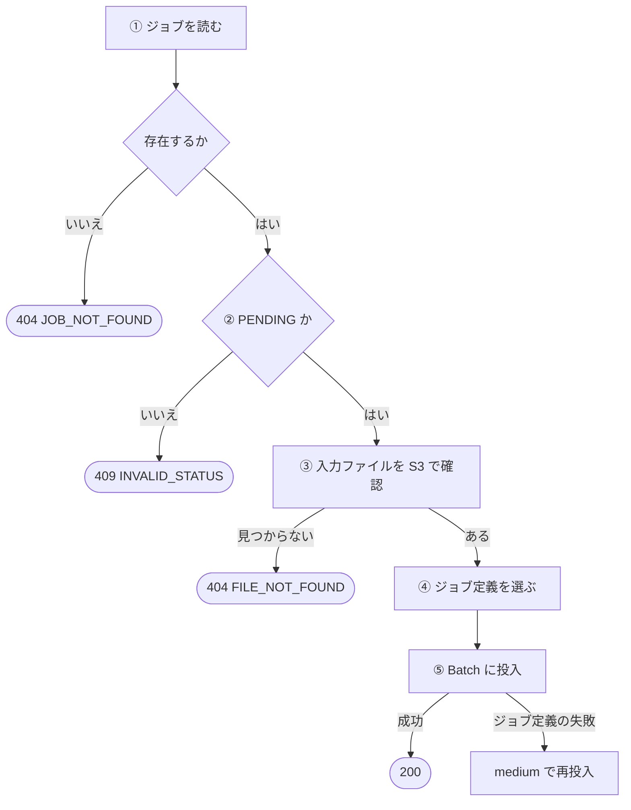
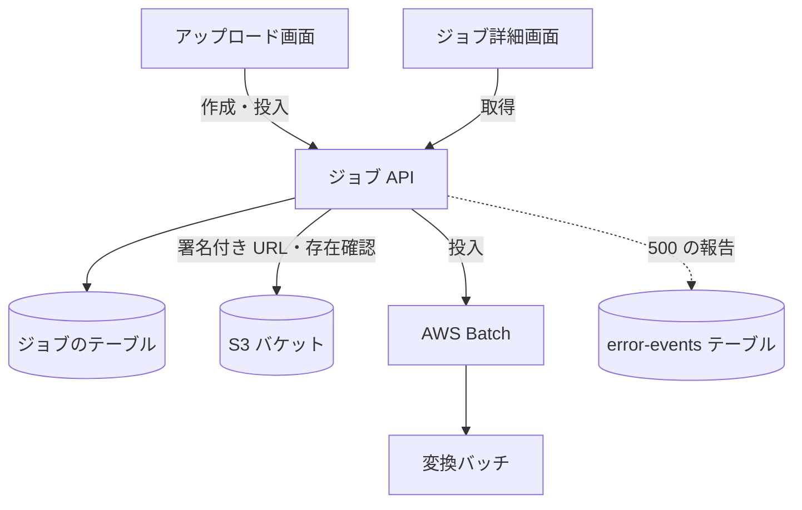

# ジョブ API

変換の[ジョブ](../term/job.md)を作り、アップロード後に Batch へ投入し、状態を読む。認証はなく、ジョブ ID を知っていれば誰でも呼べる。

## エンドポイント

| メソッド | パス | 権限 | 役割 |
|---|---|---|---|
| POST | `/api/jobs` | なし | ジョブを作り、動画をアップロードする署名付き URL を返す |
| POST | `/api/jobs/{jobId}/submit` | なし | アップロード済みの動画の変換を Batch に投入する |
| GET | `/api/jobs/{jobId}` | なし | ジョブを返す。完了していればダウンロード用の URL も返す |

## 入力と出力

作成 (`POST /api/jobs`)。本文は JSON オブジェクト。

| 項目 | 条件 |
|---|---|
| `fileName` | 必須。拡張子が `.mp4` (大文字小文字は区別しない) |
| `fileSize` | 必須。数値。1 バイト以上 524,288,000 バイト (500MB) 以下 |
| `contentType` | 必須。`video/mp4` |
| `outputCodec` | 必須。`h264`、`vp9`、`av1` ([出力コーデック](../term/output-codec.md)) |

- 出力は 201 で `{ jobId, uploadUrl, expiresIn }`。`expiresIn` は 3600 (秒)
- `jobId` は UUID v4。ジョブを `PENDING` で保存する。入力の S3 キーは `uploads/{jobId}/input.mp4`、有効期限は作成の 24 時間後
- `uploadUrl` は、このキーへの `PUT` 用の署名付き URL。`contentType` を署名に含めるので、アップロードでは同じ `Content-Type` を付ける。申告した `fileSize` だけを検証し、URL はアップロードされる実際の大きさを制限しない

投入 (`POST /api/jobs/{jobId}/submit`)。本文はない。

- 出力は 200 で `{ jobId, status: 'PENDING' }`。ステータスは書き換えない。`PROCESSING` にするのは変換バッチ

取得 (`GET /api/jobs/{jobId}`)。

- 出力は 200 で[ジョブ](../term/job.md)の全項目。`COMPLETED` で `outputFile` があるときだけ、`downloadUrl` (出力への署名付き URL、有効 86,400 秒) を足す
- `jobId` の形式は検査しない。存在しなければ 404

## 処理

投入の流れ。

| 手順 | 内容 |
|---|---|
| ③ 入力ファイルの確認 | `HeadObject` で調べる。失敗の理由 (権限や通信を含む) は区別せず、どれも `FILE_NOT_FOUND` にする。あわせて [ErrorEvent](../../platform/term/error-event.md) を報告する |
| ④ ジョブ定義 | ファイルサイズとコーデックから[サイズ](../term/job-definition-size.md)を選び、`{BATCH_JOB_DEFINITION_PREFIX}-{サイズ}` にする。選べなければ `medium` にし、報告する |
| ⑤ 投入 | ジョブ名 `codec-converter-{jobId}`、キューは `BATCH_JOB_QUEUE`。環境変数 `JOB_ID` と `OUTPUT_CODEC` だけを渡す |
| 再投入 | 失敗のメッセージに `job definition` か `JobDefinition` を含むときだけ、`{プレフィックス}-medium` で 1 回再投入し、報告する。それ以外の失敗は 500。再投入も失敗すれば 500 |

- 投入のときにジョブを書き換えないので、変換バッチが `PROCESSING` にするまでは、同じジョブをもう一度投入できる (`PENDING` の条件を通る)

## エラー

本文は `{ error, message }`。

| 条件 | 状態 | `error` | `message` |
|---|---|---|---|
| 作成: 本文が JSON オブジェクトでない (壊れた JSON、空、配列など) | 400 | `INVALID_REQUEST` | リクエストボディが不正です |
| 作成: `fileName`、`contentType`、`outputCodec` が空か未指定、または `fileSize` が数値でない | 400 | `INVALID_REQUEST` | 必須フィールドが不足しています |
| 作成: `fileName` か `contentType` が文字列でない | 400 | `INVALID_REQUEST` | リクエストボディが不正です |
| 作成: 拡張子か MIME タイプが MP4 でない | 400 | `INVALID_FILE_TYPE` | MP4ファイルのみアップロード可能です |
| 作成: `fileSize` が 0 以下 | 400 | `INVALID_FILE_SIZE` | ファイルサイズが不正です |
| 作成: `fileSize` が 500MB を超える | 400 | `INVALID_FILE_SIZE` | ファイルサイズは500MB以下である必要があります |
| 作成: `outputCodec` が許可外 | 400 | `INVALID_CODEC` | 無効なコーデックが指定されました |
| 取得、投入: ジョブがない (作成から 24 時間後に消えたものを含む) | 404 | `JOB_NOT_FOUND` | 指定されたジョブが見つかりません |
| 投入: ジョブが `PENDING` でない | 409 | `INVALID_STATUS` | ジョブは既に実行中または完了しています |
| 投入: 入力ファイルが S3 にない | 404 | `FILE_NOT_FOUND` | 入力ファイルが見つかりません |
| 想定外の例外 (保存データが読めない、Batch の失敗など) | 500 | `INTERNAL_SERVER_ERROR` | 作成は「ジョブの作成に失敗しました」、取得は「ジョブの取得に失敗しました」、投入は「ジョブの投入に失敗しました」 |

- 検査は、本文の形、必須項目、型、ファイル (拡張子、MIME タイプ、サイズの順)、コーデックの順。最初に外れたものを返す
- 想定外の 500 は、例外の内容を本文に出さず、Admin のエラー履歴へ報告する ([エラー報告の経路](../flow/error-reporting.md))。各ルートが自分で返す 400、404、409 は報告しない。ただし、入力ファイルが S3 にないときの 404 だけは報告する

## つながり

