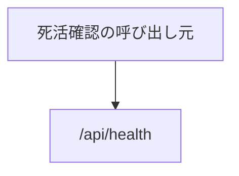

# システム系の API

業務の機能ではない API。死活確認だけがある。

## エンドポイント

| メソッド | パス | 権限 |
|---|---|---|
| GET | `/api/health` | なし |

## 入力と出力

- `{ status: 'ok', service: 'codec-converter', version, timestamp }` を返す。`version` は環境変数 `APP_VERSION`、なければ `1.0.0`。`timestamp` は ISO 8601
- 入力はない。DynamoDB、S3、Batch への接続は確かめず、サーバーが応答できるかだけを示す

## エラー

- ここで返すエラーを決めていない

## つながり

