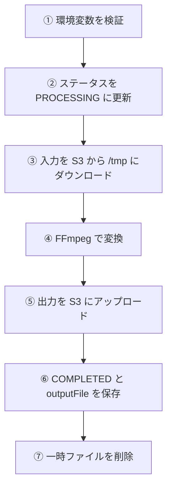
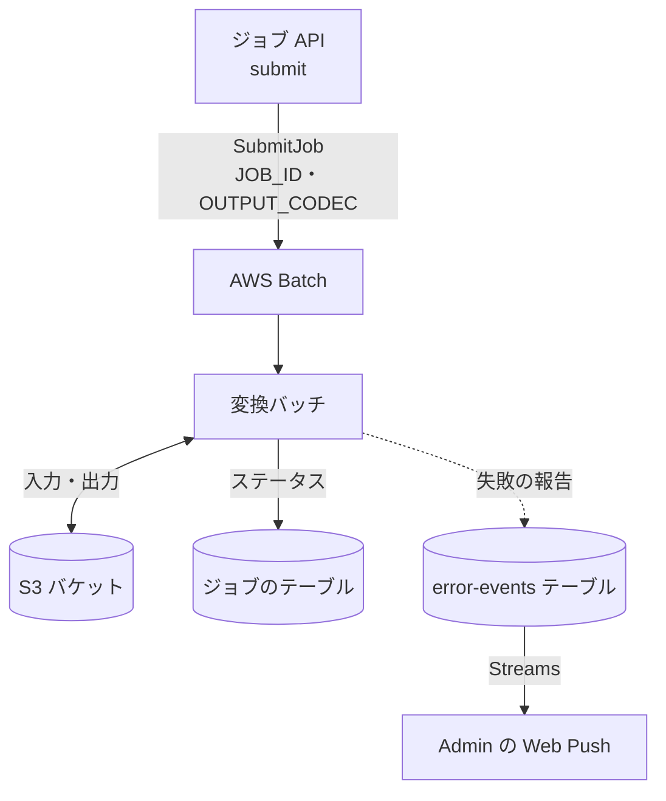

# 変換バッチ (convert)

S3 に置かれた動画を FFmpeg で[出力コーデック](../term/output-codec.md)へ変換し、結果を S3 に書いて[ジョブ](../term/job.md)のステータスを更新するコンテナ。1 回の起動で 1 ジョブを処理する。

## 起点

- スケジュールはない。[ジョブ API](../api/jobs.md) の投入 (`POST /api/jobs/{jobId}/submit`) が、AWS Batch にジョブを 1 件投入して起動する
- 起動ごとに渡す値は、環境変数 `JOB_ID` と `OUTPUT_CODEC` の 2 つだけ。ほかは[ジョブ定義](../term/job-definition-size.md)が持つ

| 環境変数 | 出どころ | 内容 |
|---|---|---|
| `JOB_ID`、`OUTPUT_CODEC` | 投入時の指定 | 前後の空白を除いて読む。どちらかが空なら起動時に例外。コーデックが許可外でも例外 |
| `S3_BUCKET`、`DYNAMODB_TABLE_NAME`、`AWS_REGION` | ジョブ定義 | 必須。なければ起動時に例外 |
| `ERROR_EVENTS_TABLE_NAME` | ジョブ定義 | エラー履歴の報告先。なければ報告だけができない |
| `JOB_DEFINITION_NAME` | 任意 | あればログに出す。インフラのジョブ定義は設定しないので、ログでは `unknown` になる |

- 実行基盤は Fargate の Batch。ジョブ定義は 4 サイズで、イメージ、リトライ (2 回まで試行)、タイムアウト (7,200 秒) は共通
- ジョブ定義のログ出力先は CloudWatch Logs `/aws/batch/nagiyu-codec-converter-{env}` (保持 1 週間)
- 同時に動かせる大きさは、コンピュート環境の最大 16 vCPU で決まる

## 処理

| 手順 | 内容 |
|---|---|
| ③ 入力 | `uploads/{JOB_ID}/input.mp4` を `/tmp/input-{JOB_ID}.mp4` に保存する |
| ④ 変換 | `ffmpeg -i {入力} -c:v {動画} -c:a {音声} {品質の引数} -y {出力}`。コーデックごとの値は[出力コーデック](../term/output-codec.md)。標準エラー出力に `time=` を含む行があれば、進捗としてログに出す |
| ⑤ 出力 | `/tmp/output-{JOB_ID}.{拡張子}` を `outputs/{JOB_ID}/output.{mp4 か webm}` に保存する |
| ⑥ 更新 | `status` を `COMPLETED`、`outputFile` を出力のキーにする。空の `outputFile`、`errorMessage` は保存しない |

- 起動時に、ジョブ定義名と、ECS のタスクメタデータから取れた CPU とメモリの上限をログに出す。メタデータが取れなくても処理は続ける
- 更新は、更新前のステータスを条件にしない。`undefined` の項目は変更しないので、再試行で `PROCESSING` に戻しても、前の失敗の `errorMessage` は消えない

## 失敗したとき

処理 (②〜⑥) のどこかで例外になると、次を行う。

| 順 | 内容 | 報告 |
|---|---|---|
| 1 | ステータスを `FAILED`、`errorMessage` を例外のメッセージにして保存する。メッセージは段ごとに「S3からのダウンロードに失敗しました」「S3へのアップロードに失敗しました」「FFmpegの実行に失敗しました」「DynamoDBの更新に失敗しました」の前置きがつく。FFmpeg の失敗には、終了コードと標準エラー出力の全文が入る | 保存できなければ報告 (error) |
| 2 | 一時ファイルを削除する。ないファイルは無視する | 削除に失敗したら報告 (warning) |
| 3 | 例外を投げ直す | 処理の失敗を報告 (critical) |

- 例外を投げ直したあと、起動の骨格がもう一度報告 (critical) し、終了コード 1 でプロセスを終える。このため、1 回の失敗につき critical が 2 件記録される。題名は「Batchジョブが失敗しました」と「コーデック変換バッチが起動時に失敗しました」
- 起動時の検証の失敗 (環境変数の不足など) は、ステータスを更新せず、後者だけを報告して終了する。この場合ジョブは `PENDING` のまま
- 終了コードが 0 でないので、AWS Batch が 2 回まで試行する。再試行で最初から処理し直し、報告も試行ごとに増える
- ⑥ の `COMPLETED` の保存が失敗したときも、同じ失敗の扱いになる。`FAILED` の保存も失敗すれば、ステータスは `PROCESSING` のまま残る
- ⑦ の一時ファイルの削除は、処理の `try` の中にある。削除に失敗する (ないファイル以外の理由) と、`COMPLETED` にしたあとでも失敗の扱いになり、`FAILED` で上書きする
- 7,200 秒を超えると Batch がジョブを止める。ワーカーは時間を見ておらず、ステータスを更新できないので、ジョブは `PROCESSING` のまま残る。Batch の失敗を拾う EventBridge のルールや CloudWatch Alarm は、codec-converter のインフラには定義されていない ([エラー通知の経路](../../admin/flow/error-notification.md)の `batch-event` の対象にならない)
- 報告の書き込みに失敗しても、例外は伝えない。ログだけを残す

## つながり

