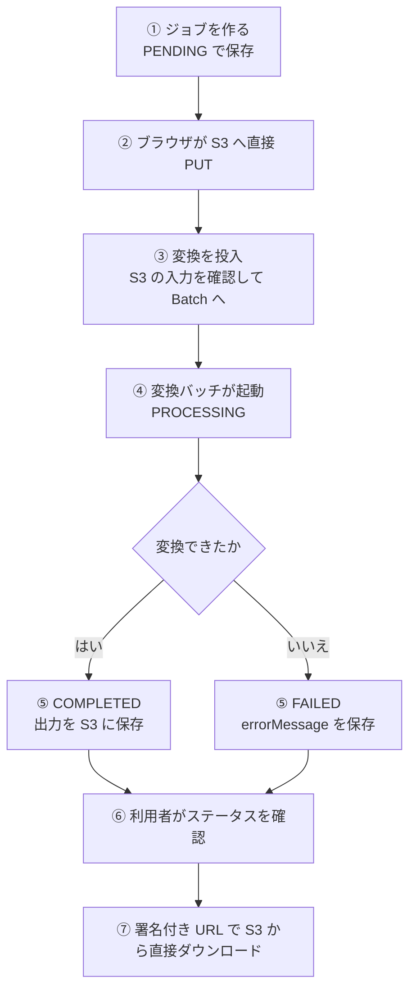
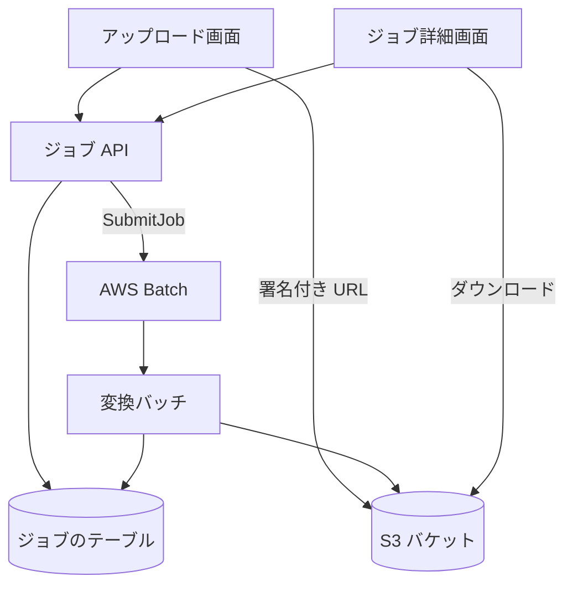

# 変換の経路

利用者が動画を選んで変換を依頼してから、変換後のファイルをダウンロードするまでの流れ。動画の転送は、サーバー (Lambda) を通さず、ブラウザと S3 の間で直接行う。

## 起点

- 利用者が[アップロード画面](../screen/upload.md)で動画 (MP4、500MB 以下) と[出力コーデック](../term/output-codec.md)を選び、「変換開始」を押す
- 結果は、利用者が[ジョブ詳細画面](../screen/job-detail.md)で確かめに来る。変換の完了を利用者に知らせる仕組みはない

## 経路

1. **作成**: 画面が `POST /api/jobs` に、ファイル名、サイズ、MIME タイプ、コーデックを送る。API は同じ検証をもう一度行い、ジョブを `PENDING` で保存して、入力用の署名付き URL (有効 3,600 秒) を返す ([ジョブ API](../api/jobs.md))
2. **アップロード**: 画面が、返された URL へ動画を `PUT` する
3. **投入**: 画面が `POST /api/jobs/{jobId}/submit` を呼ぶ。API は、ジョブが `PENDING` で、入力が S3 にあることを確かめ、サイズとコーデックから[ジョブ定義のサイズ](../term/job-definition-size.md)を選び、Batch に投入する。ステータスは `PENDING` のまま。成功すると、画面は `/jobs/{jobId}` に移る
4. **変換**: Batch がコンテナを起動する。[変換バッチ](../batch/convert.md)が `PROCESSING` にし、入力を取って FFmpeg で変換する
5. **結果**: 成功すると出力を `outputs/{jobId}/output.{mp4 か webm}` に書き、`COMPLETED` にして `outputFile` を保存する。失敗すると `FAILED` にして `errorMessage` を保存する
6. **確認**: 利用者が「ステータス確認」を押すと、画面が `GET /api/jobs/{jobId}` を呼ぶ。自動での更新 (ポーリング) はない
7. **ダウンロード**: `COMPLETED` なら、API が出力の署名付き URL (有効 86,400 秒) を返す。「ダウンロード」でその URL を新しいタブで開く

## 届く先

- **ジョブ詳細画面**: ステータスと、完了したときのダウンロード用 URL
- **S3 バケット**: 変換後のファイル。ブラウザが署名付き URL で直接ダウンロードする

## 失敗・取りこぼしのとき

- 作成のあと、アップロードか投入で失敗すると、ジョブは `PENDING` のまま残る。画面は「変換開始」を押し直すたびに新しいジョブを作るので、残ったジョブは使われない
- ジョブの状態の変わり方は[ジョブとステータス](../term/job.md)にある。変換バッチの失敗は `FAILED` になり、AWS Batch が 2 回まで試行する。タイムアウト (7,200 秒) で止められたときは、`PROCESSING` のまま残る ([変換バッチ](../batch/convert.md))
- ジョブ (DynamoDB の TTL) と S3 のファイルは、作成から 24 時間で削除の対象になる。消えたあとは、画面が「指定されたジョブが見つかりません」を出す
- 失敗は Admin のエラー履歴にも報告される ([エラー報告の経路](./error-reporting.md))

## つながり

