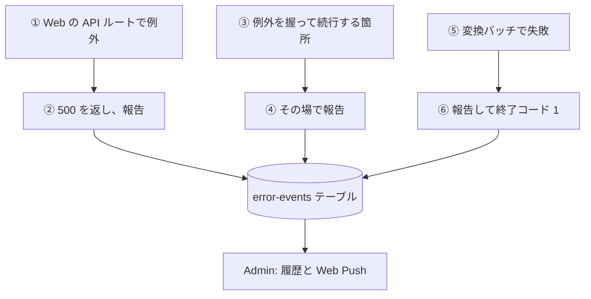
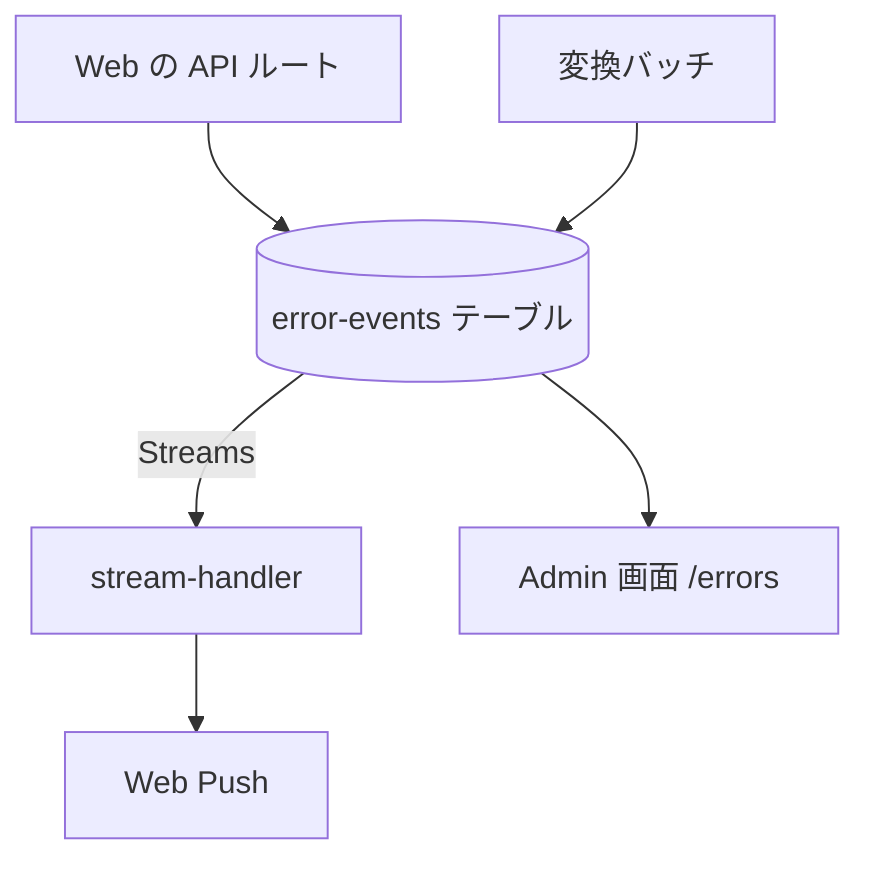

# エラー報告の経路

codec-converter の失敗が、Admin のエラー履歴に届くまでの流れ。全体の仕組み (保存、通知、画面) は[エラー通知の経路](../../admin/flow/error-notification.md)にあり、ここでは codec-converter が何を、どこから報告するかだけを書く。

## 起点

失敗を [ErrorEvent](../../platform/term/error-event.md) として報告する場所は 2 か所。どちらも `serviceId` は `codec-converter`、`source` は `application`。

| 場所 | 契機 |
|---|---|
| Web の API ルート | 想定外の例外。または、例外を握って処理を続ける箇所 |
| 変換バッチ | 変換の失敗、起動の失敗、後始末の失敗 |

## 経路

- 報告先のテーブルは、環境変数 `ERROR_EVENTS_TABLE_NAME` (`nagiyu-error-events-{env}`)。Lambda と Batch のジョブ定義に設定され、書き込み権限が付く
- 報告の書き込みに失敗しても、例外は伝えない。ログだけを残し、応答や処理は変わらない

報告の一覧。

| 場所 | 題名 | severity | 追加の context |
|---|---|---|---|
| `POST /api/jobs` の想定外の例外 | ジョブ作成に失敗しました | error | メソッドとパス |
| `GET /api/jobs/{jobId}` の想定外の例外 | Web API: ジョブ取得エラー | error | メソッドとパス |
| `POST /api/jobs/{jobId}/submit` の想定外の例外 | Batchジョブの投入に失敗しました | error | メソッドとパス |
| 投入: 入力ファイルが S3 にない (404 を返す) | 入力ファイルがS3に存在しません | error | `jobId`、`s3Key` |
| 投入: ジョブ定義を選べず `medium` で続ける | ジョブ定義の選択に失敗したため medium で続行します | error | `jobId`、`fileSize`、`outputCodec` |
| 投入: ジョブ定義の失敗で `medium` に再投入する | ジョブ定義でのBatchジョブ投入に失敗したため medium で再投入します | error | `jobId`、`jobDefinitionName` |
| 変換バッチ: 処理の失敗 | Batchジョブが失敗しました | critical | `jobId`、`outputCodec` |
| 変換バッチ: `FAILED` の保存に失敗 | ジョブステータスのFAILD更新に失敗しました | error | `jobId`、`originalError` |
| 変換バッチ: 一時ファイルの削除に失敗 | 一時ファイルのクリーンアップに失敗しました | warning | `jobId` |
| 変換バッチ: 起動の骨格 (処理の失敗も通る) | コーデック変換バッチが起動時に失敗しました | critical | 例外の情報だけ |

- どの報告にも、例外の名前、メッセージ、スタックが context に入る。本文 (`message`) は例外のメッセージ
- API ルートの入口の報告は、500 以上になる例外だけ。ルートが自分で返す 400、404、409 は想定内なので報告しない。ただし、投入で入力ファイルが S3 にないときの 404 だけは、原因を調べられるよう、その場で報告する。ルートが例外を握って続ける箇所も、例外が上に届かないので、その場で報告する
- 変換バッチは、処理の失敗で 2 件 (「Batchジョブが失敗しました」と「コーデック変換バッチが起動時に失敗しました」) を報告する。AWS Batch の再試行があれば、試行ごとに増える ([変換バッチ](../batch/convert.md))

## 届く先

- **Admin のエラー履歴**: `/errors` の一覧と詳細。見るには `errors:read` 権限が要る
- **Web Push**: Admin の購読者全員 (書き込まれた新しい履歴ごと)

## 失敗・取りこぼしのとき

- 次の失敗は報告されない
    - 画面 (ブラウザ) の例外。エラー画面は `console.error` に出すだけで、報告しない
    - 変換バッチのプロセスが即死する失敗 (メモリ不足、タイムアウトによる停止など)。codec-converter のインフラは、Batch のジョブ失敗を拾う EventBridge のルールも、CloudWatch Alarm も持たない
    - Lambda の失敗 (起動の失敗、タイムアウトなど)。アラームがない
- 報告できるのは、アプリが自分で例外を受けられたときだけ

## つながり

