# ジョブ詳細画面

[ジョブ](../term/job.md)の情報とステータスを見て、完了していれば変換後のファイルをダウンロードする画面。ログインは要らず、ジョブ ID を知っていれば開ける。

## 入口

- パスは `/jobs/{jobId}`
- [アップロード画面](./upload.md)で変換を依頼すると、自動でここに移る
- ジョブは作成の 24 時間後に消える。それ以降は「指定したジョブがないとき」になる

## 表示するもの

| 部分 | 内容 |
|---|---|
| 見出し | 「変換ジョブ詳細」 |
| ジョブ情報 | ジョブ ID (先頭 8 文字、`...`、末尾 4 文字)、ファイル名 (長いと折り返す)、ファイルサイズ (KB か MB)、[出力コーデック](../term/output-codec.md) (H.264、VP9、AV1)、作成日時 (日本時間の `YYYY/MM/DD HH:mm:ss`) |
| ステータス | バッジと説明文 |
| ボタン | ステータスによって変わる (下表) |

ステータスごとの表示。

| ステータス | バッジ | 説明文 | ボタン |
|---|---|---|---|
| `PENDING` | 🟡 待機中 (黄) | 変換処理を待っています | 「ステータス確認」 |
| `PROCESSING` | 🔵 処理中 (青) | 動画を変換しています... | 「ステータス確認」 |
| `COMPLETED` | 🟢 完了 (緑) | 変換が完了しました | 「ダウンロード」 |
| `FAILED` | 🔴 失敗 (赤) | 変換処理に失敗しました | なし |

- 「新しい動画を変換」は、どのステータスでも出る
- `FAILED` で `errorMessage` があれば、「エラー詳細」としてその文字列をそのまま出す。変換バッチが保存した内容で、FFmpeg の終了コードと標準エラー出力を含むことがある

## 状態

- 読み込み中は、見出しと「読み込み中...」だけを出す
- ジョブを取得できなかったときは、エラーと「新しい動画を変換」だけを出す

| 条件 | メッセージ |
|---|---|
| API が 404 | 指定されたジョブが見つかりません |
| それ以外の応答の失敗、通信の失敗、応答の形が想定と違う | ジョブ情報の取得に失敗しました |

- すでにジョブを表示しているときに、「ステータス確認」の再取得が失敗しても、エラーは出ない。前の表示のまま変わらない
- ステータス確認中は、ボタンがスピナーになって押せなくなる

## 操作

| 操作 | 結果 |
|---|---|
| 「ステータス確認」 | [ジョブ API](../api/jobs.md) の `GET /api/jobs/{jobId}` を呼び直し、表示を更新する。自動での更新はなく、開いたときの 1 回と、このボタンだけで取得する |
| 「ダウンロード」 | API が返したダウンロード用 URL (有効 24 時間) を新しいタブで開く。URL がなければ何も起きない |
| 「新しい動画を変換」 | `/` ([アップロード画面](./upload.md)) へ移る |

## 画面の見た目

### 待機中

「ステータス確認」と「新しい動画を変換」を出す。

| スマホ | PC |
|---|---|
| 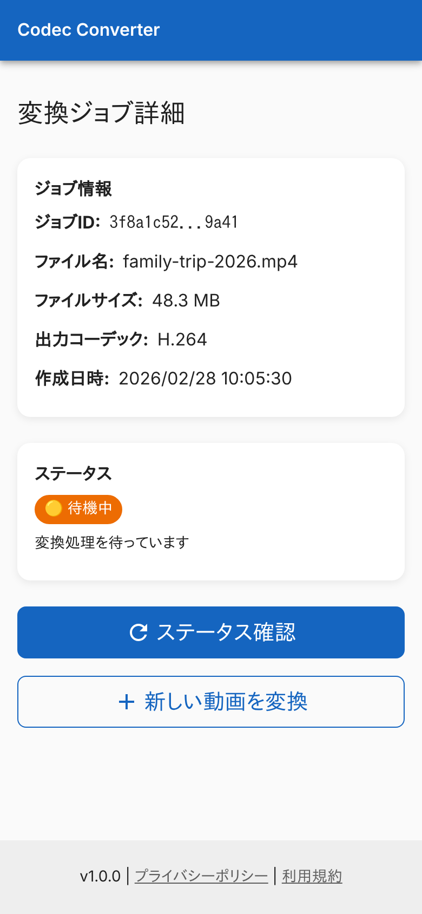 | 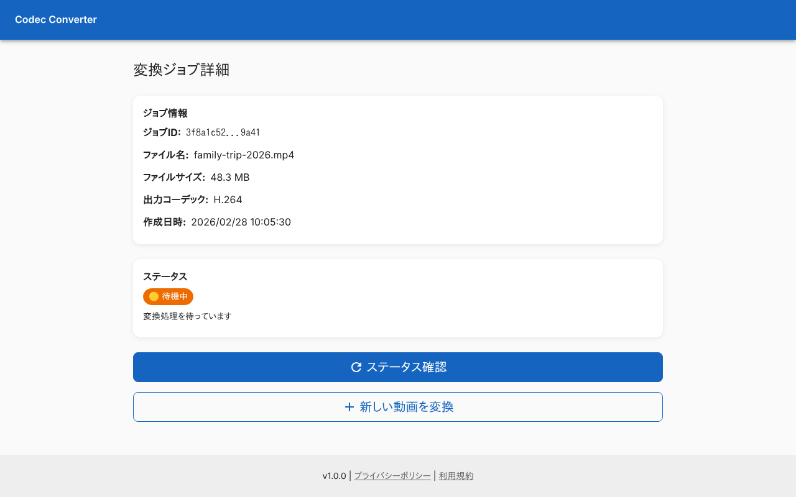 |

### 処理中

待機中と同じボタン。

| スマホ | PC |
|---|---|
| 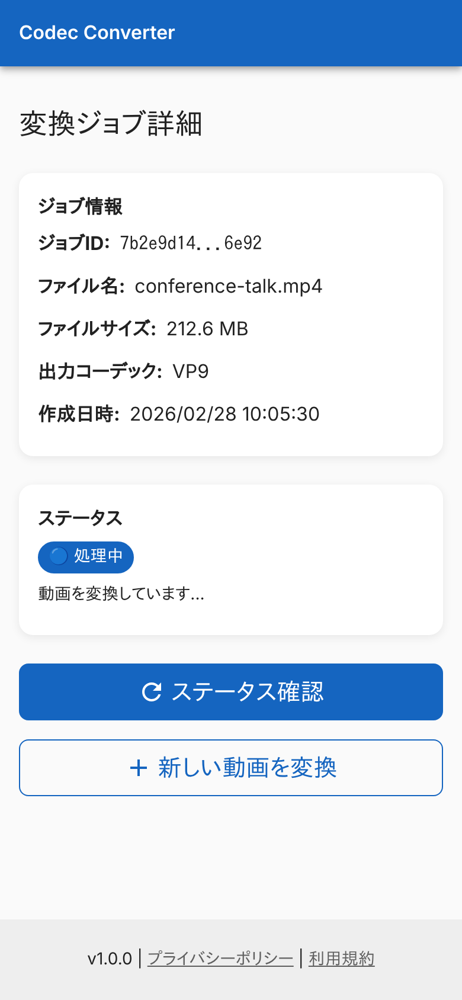 |  |

### ステータスを確認中

「ステータス確認」を押したあと、応答を待っている間。ボタンがスピナーになる。

| スマホ | PC |
|---|---|
| 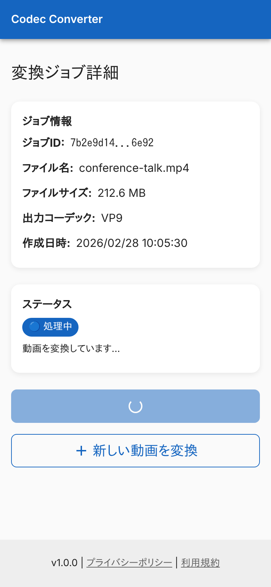 | 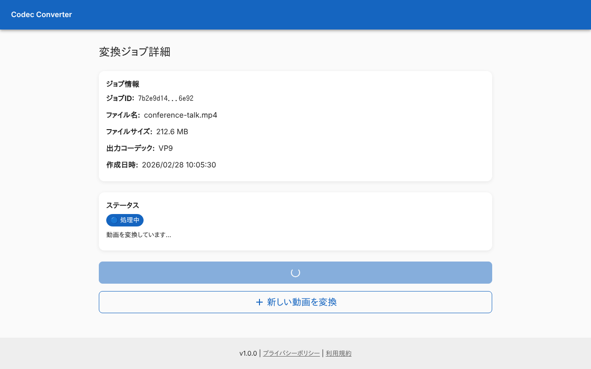 |

### 完了

「ダウンロード」を出す。

| スマホ | PC |
|---|---|
| 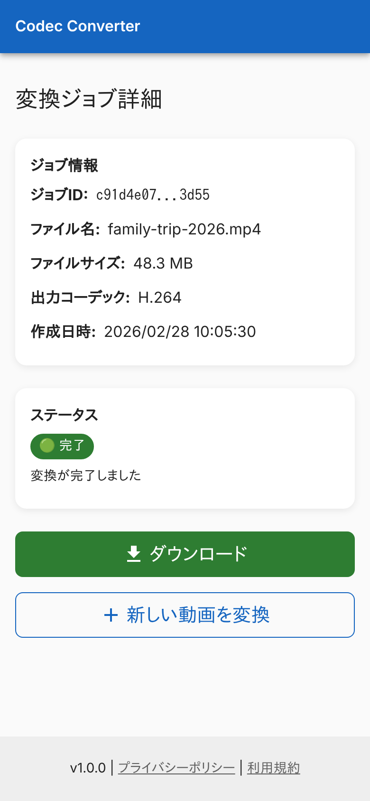 | 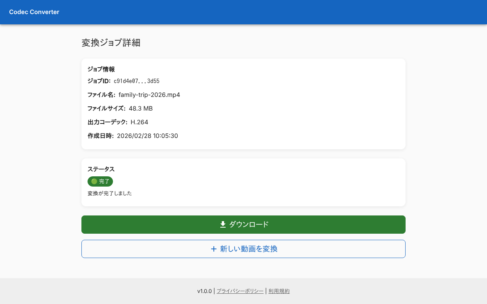 |

### 失敗

ワーカーが保存したエラーの内容を「エラー詳細」に出す。「ステータス確認」は出ない。

| スマホ | PC |
|---|---|
| 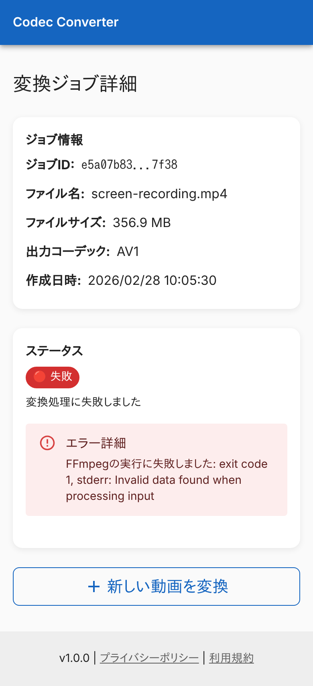 | 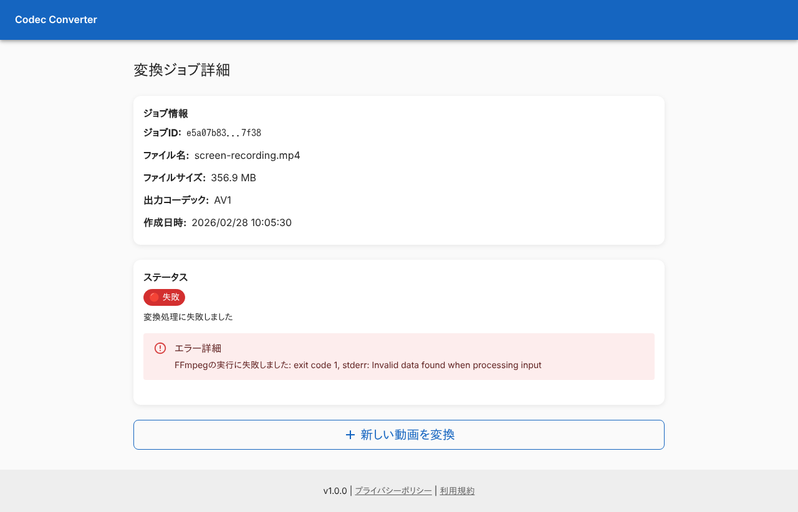 |

### 指定したジョブがないとき

期限 (24 時間) が過ぎたジョブや、存在しない ID の例。「指定されたジョブが見つかりません」を出す。

| スマホ | PC |
|---|---|
| 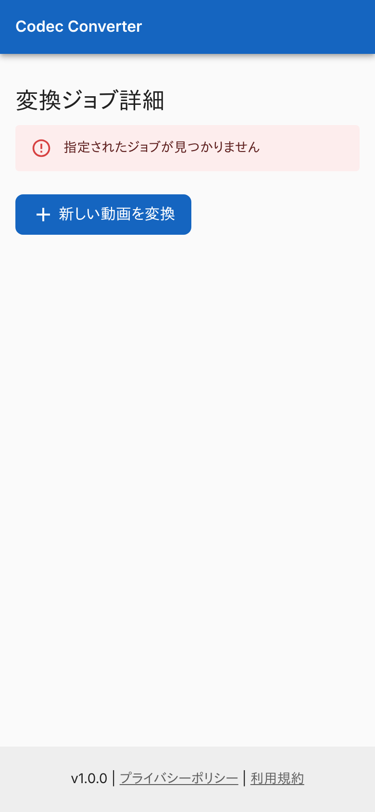 |  |

### 読み込み中

ジョブ情報の応答を待っている間。見出しと「読み込み中...」だけを出す。

| スマホ | PC |
|---|---|
| 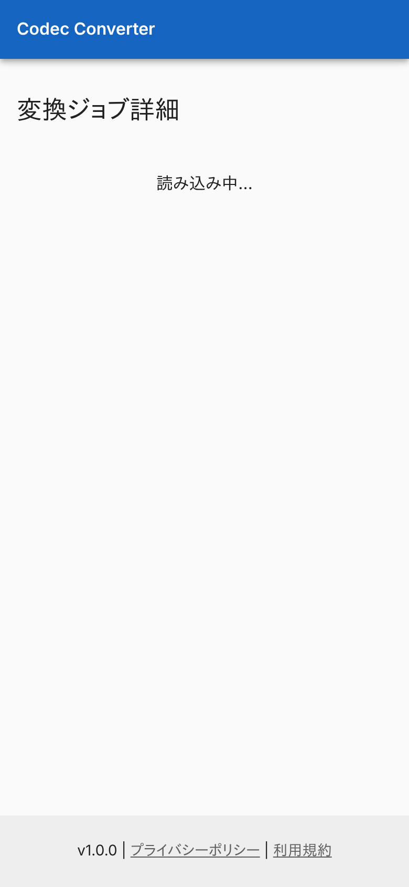 | 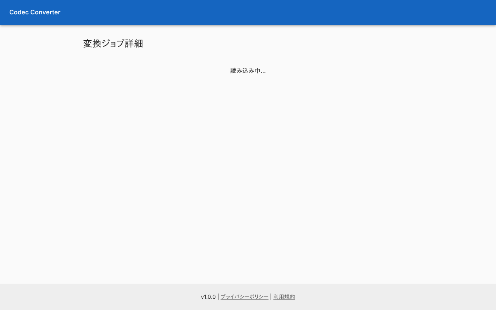 |

### 取得に失敗したとき

「ジョブ情報の取得に失敗しました」を出す。

| スマホ | PC |
|---|---|
|  | 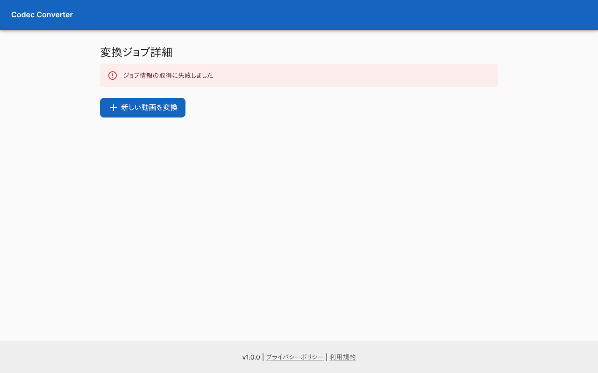 |
## つながり

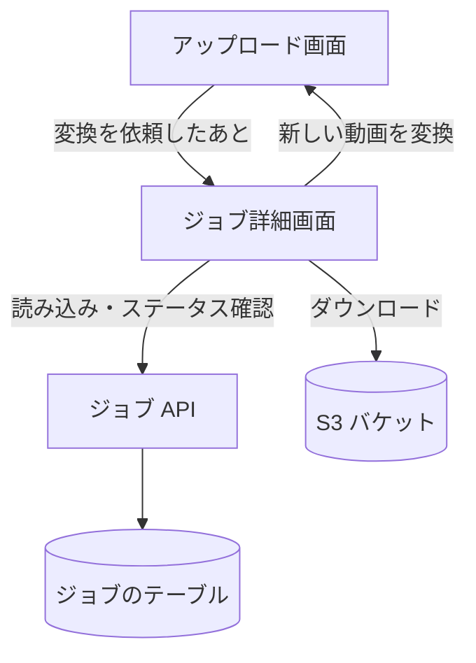
