# アップロード画面

動画 (MP4) を選び、[出力コーデック](../term/output-codec.md)を決めて、変換を依頼する画面。ログインは要らない。

## 入口

- パスは `/`
- ヘッダーのタイトル「Codec Converter」と、[ジョブ詳細画面](./job-detail.md)の「新しい動画を変換」から来る

## 表示するもの

上から次の順に並ぶ。内容は中央寄せで、最大幅は 900px (MUI の `md`)。

| 部分 | 内容 |
|---|---|
| 見出し | 「Codec Converter」と「動画ファイルのコーデックを変換します」 |
| ファイル選択欄 | 破線の枠 (高さ 200px 以上)。「ファイルをドラッグ&ドロップ または クリックして選択」と「MP4ファイルのみ、最大500MB」。クリックか、Enter・Space でファイル選択を開く。ドラッグ中は枠の色と影が変わる |
| 選択されたファイル | ファイルを選んだあとだけ。ファイル名とサイズ。サイズは 1MB 未満なら KB、それ以上なら MB で、小数 1 桁 |
| エラー | 検証や依頼に失敗したあとだけ |
| 出力コーデック | ラジオボタン。H.264 (互換性重視、MP4)、VP9 (バランス型、WebM)、AV1 (高圧縮率、WebM)。初期値は H.264 |
| 変換開始 | ファイルを選ぶまで押せない |

## 状態

- 初めはファイルもエラーもなく、「変換開始」は押せない
- 選んだファイルは、次の順に検証する。最初に外れた条件のメッセージを出す

| 順 | 条件 | メッセージ |
|---|---|---|
| 1 | 拡張子が `.mp4` (大文字小文字は区別しない) | MP4ファイルのみアップロード可能です |
| 2 | MIME タイプが `video/mp4` | MP4ファイルのみアップロード可能です |
| 3 | サイズが 1 バイト以上 | ファイルサイズが不正です |
| 4 | サイズが 524,288,000 バイト (500MB) 以下 | ファイルサイズは500MB以下である必要があります |

- 検証に外れたファイルは選択されず、前に選んでいたファイルがあればそのまま残る。エラーは、次に検証を通るファイルを選ぶか、「変換開始」を押すまで残る
- アップロード中は「変換開始」がスピナーになり、押せなくなる。ファイル選択欄とコーデックは操作できるが、進行中の依頼には影響しない
- 失敗するとエラーを出し、「変換開始」は押せる状態に戻る

## 操作

| 操作 | 結果 |
|---|---|
| ファイルを選ぶ、ドロップする | 上の順で検証し、通れば選択済みにする |
| 出力コーデックを選ぶ | 選択を切り替える。何も呼ばない |
| 「変換開始」 | 次の 3 つを順に行う。すべて成功すると `/jobs/{jobId}` に移る |

「変換開始」の 3 段。

| 段 | 呼ぶもの | 失敗したときのメッセージ |
|---|---|---|
| ① ジョブを作る | [ジョブ API](../api/jobs.md) の `POST /api/jobs` (ファイル名、サイズ、MIME タイプ、コーデックを送る) | API が返した `message`。なければ「ジョブの作成に失敗しました」 |
| ② 動画を S3 へ送る | ① が返した署名付き URL へ `PUT`。`Content-Type` はファイルの MIME タイプ | 「ファイルのアップロードに失敗しました」 |
| ③ 変換を投入する | `POST /api/jobs/{jobId}/submit` | API が返した `message`。なければ「ジョブの投入に失敗しました」 |

- 通信そのものが失敗したときは、その例外のメッセージを出す。メッセージがなければ「予期しないエラーが発生しました」
- ② や ③ で失敗しても、① で作ったジョブは `PENDING` のまま残る。もう一度「変換開始」を押すと、新しいジョブを作り直す

## 画面の見た目

### 通常表示

ファイルを選ぶ前。「変換開始」は押せない。

| スマホ | PC |
|---|---|
| 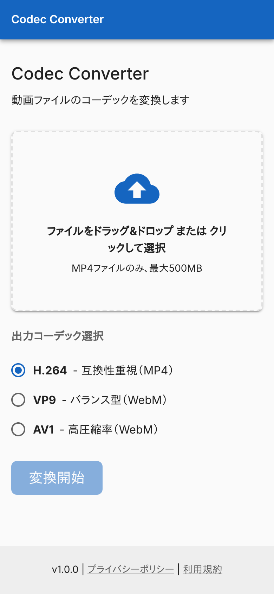 | 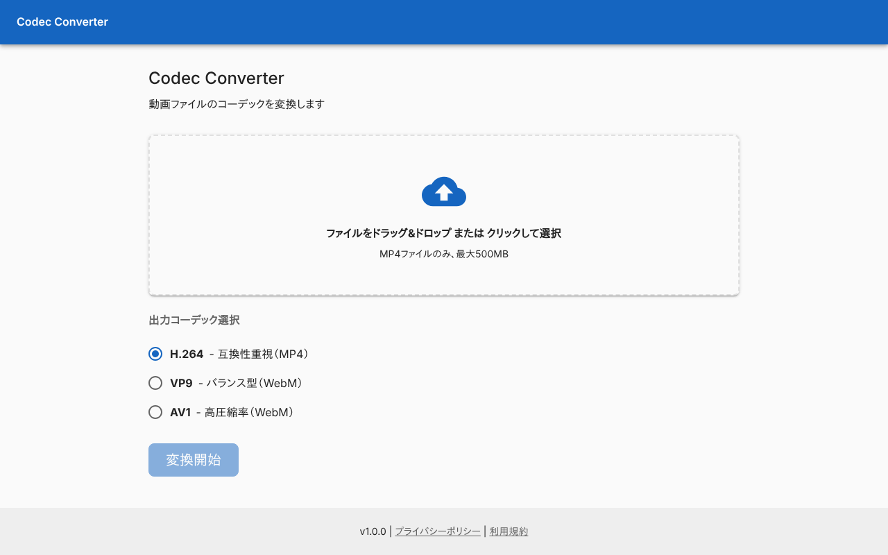 |

### ファイルを選んだ状態

ファイル名とサイズを出す。出力コーデックを AV1 にした例。

| スマホ | PC |
|---|---|
| 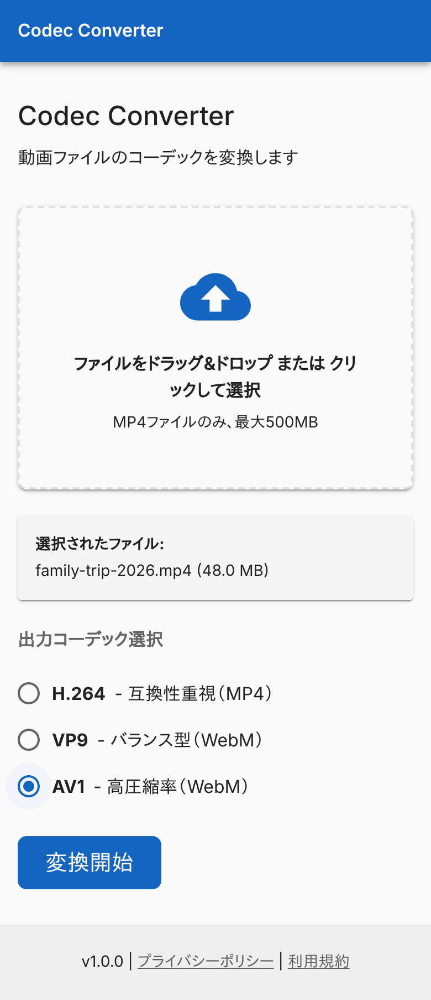 | 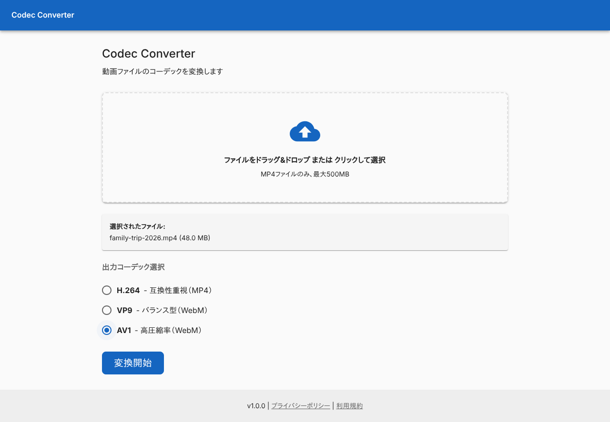 |

### MP4 でないファイルを選んだとき

「MP4ファイルのみアップロード可能です」を出す。

| スマホ | PC |
|---|---|
| 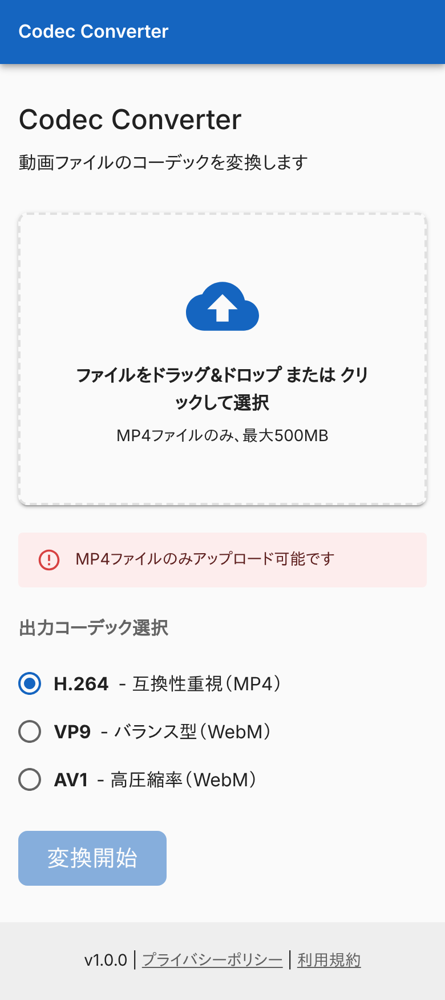 |  |

### 500MB を超えるファイルを選んだとき

「ファイルサイズは500MB以下である必要があります」を出す。

| スマホ | PC |
|---|---|
| 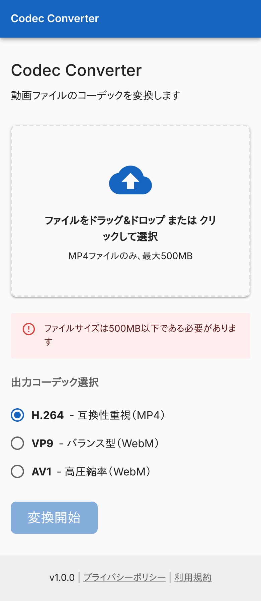 | 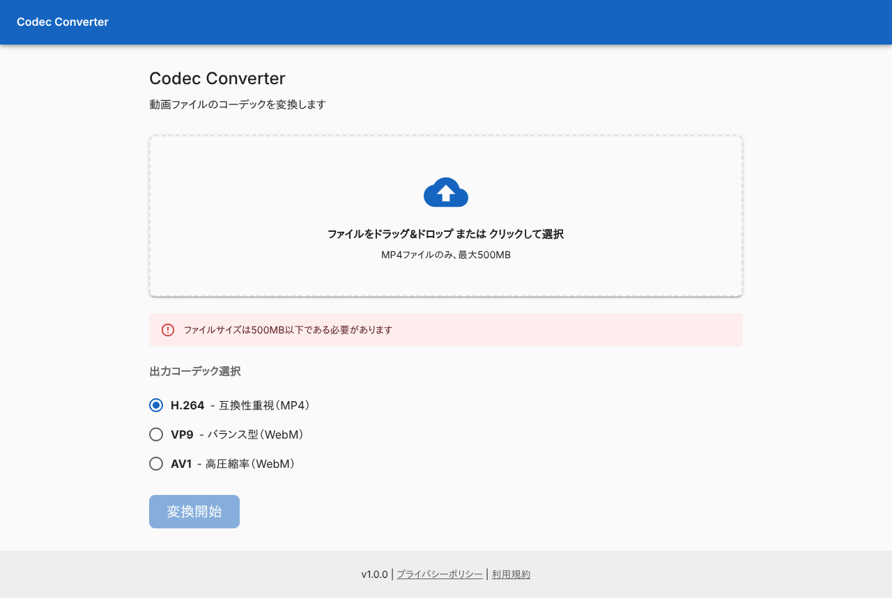 |

### アップロード中

「変換開始」がスピナーになり、押せなくなる。S3 への転送が終わらない例。

| スマホ | PC |
|---|---|
| 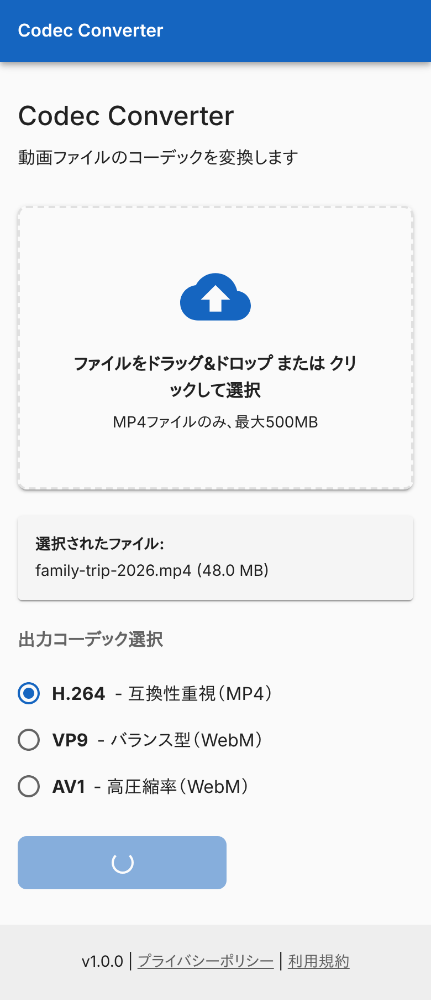 | 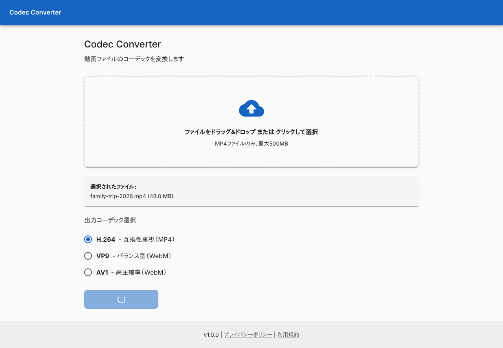 |

### ジョブの作成に失敗したとき

API が返した「ジョブの作成に失敗しました」を出す。選んだファイルは残る。

| スマホ | PC |
|---|---|
| 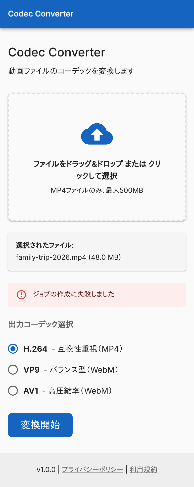 |  |

### S3 へのアップロードに失敗したとき

「ファイルのアップロードに失敗しました」を出す。

| スマホ | PC |
|---|---|
| 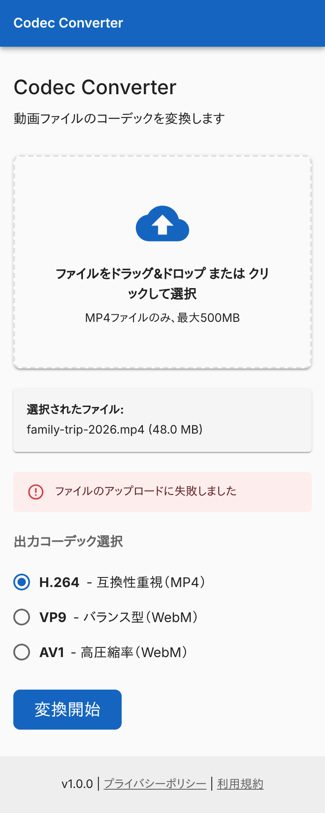 |  |

### 投入に失敗したとき

入力ファイルが S3 に見つからない例。API が返した「入力ファイルが見つかりません」を出す。

| スマホ | PC |
|---|---|
|  | 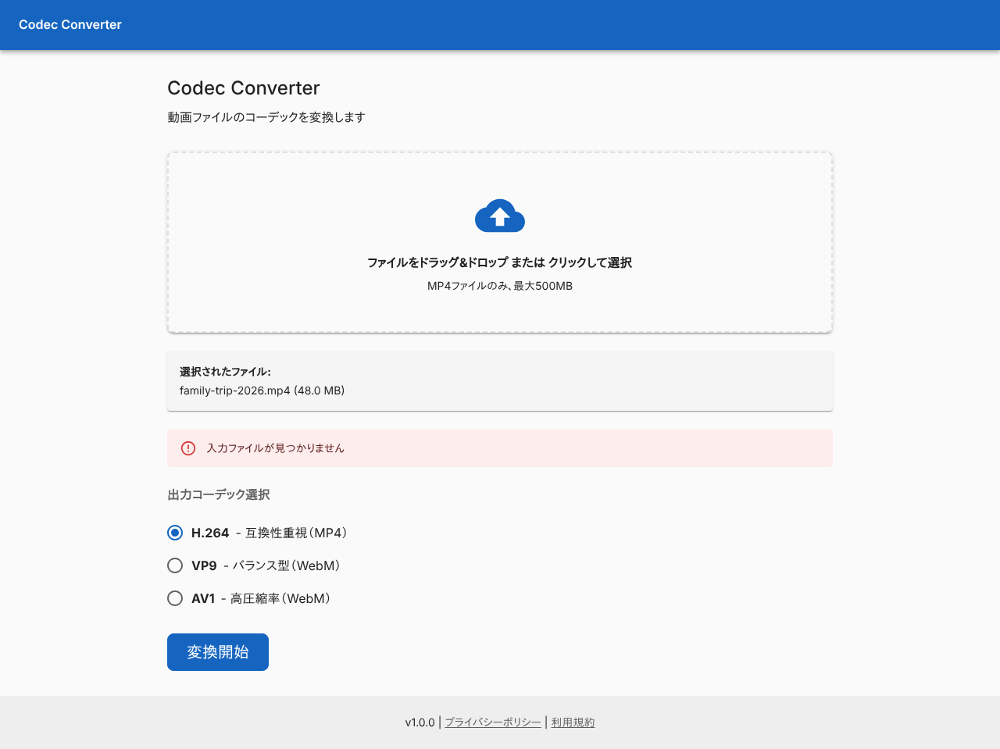 |
## つながり

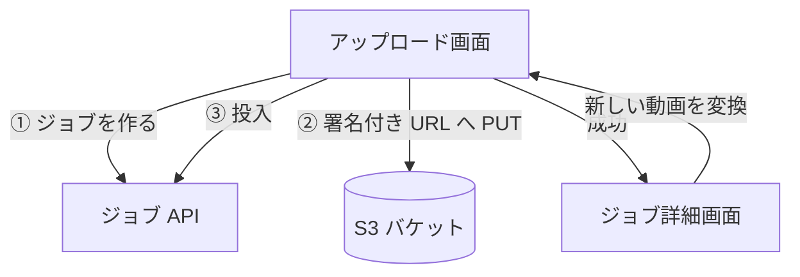
