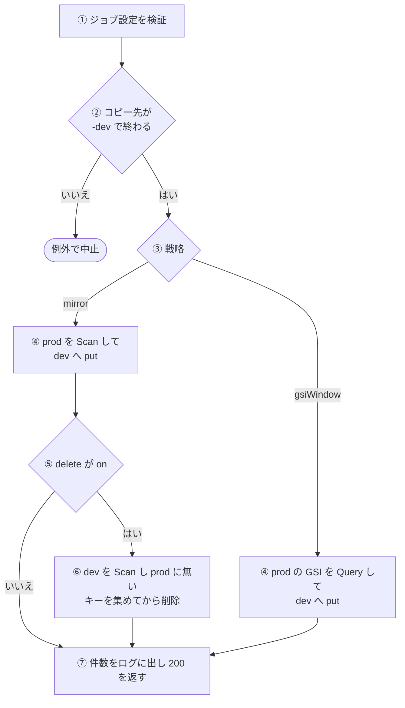
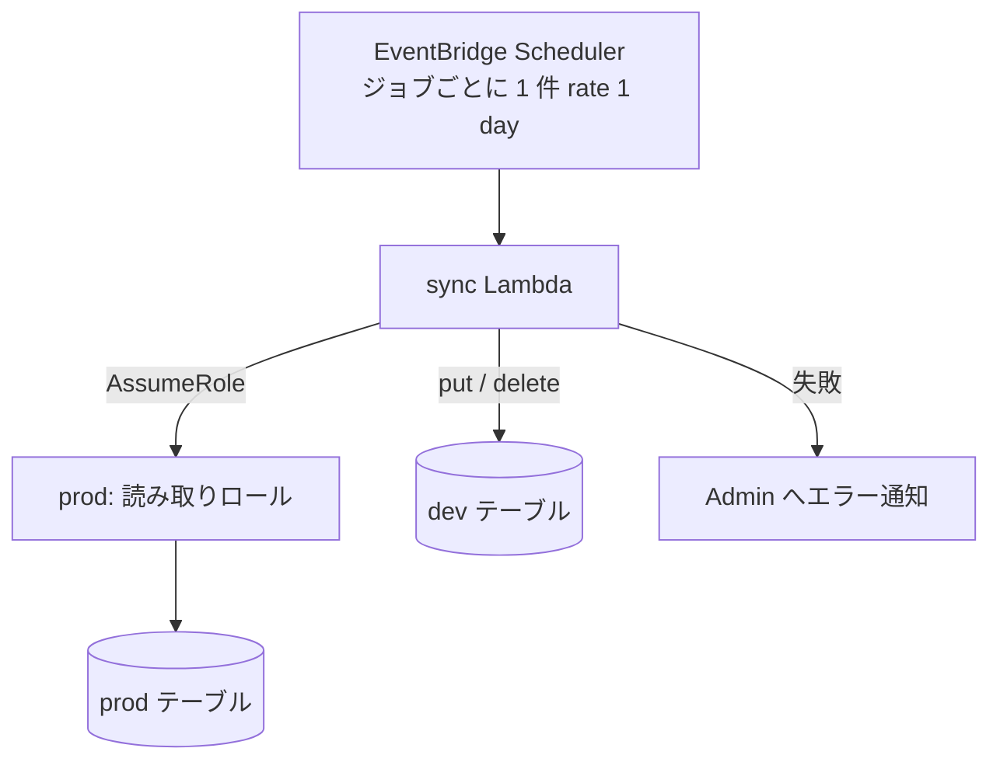

# 同期バッチ (sync)

prod アカウントの DynamoDB テーブルを、dev アカウントの `-dev` テーブルへコピーする汎用の Lambda。1 回の実行で 1 つのジョブ (コピー元・コピー先・戦略) を処理する。ジョブはマニフェストに並べ、1 件につき 1 つのスケジュールが同じ Lambda を呼ぶ。

## 起点

- ジョブごとの EventBridge Scheduler のスケジュール (`flexibleTimeWindow` は OFF、状態は ENABLED)。Lambda には、スケジュールの input に埋め込んだジョブ設定 (JSON) がそのまま渡される
- マニフェストにあるジョブは今 3 件で、いずれも `rate(1 day)`、戦略は `mirror`、差分削除は `on`

| コピー元 (prod) | コピー先 (dev) | 対象の PK |
|---|---|---|
| `nagiyu-niconico-mylist-assistant-dynamodb-prod` | `nagiyu-niconico-mylist-assistant-dynamodb-dev` | `VIDEO#` で始まる |
| `nagiyu-stock-tracker-main-prod` | `nagiyu-stock-tracker-main-dev` | `EXCHANGE#` で始まる |
| `nagiyu-stock-tracker-main-prod` | `nagiyu-stock-tracker-main-dev` | `TICKER#` で始まる |

- スケジュール名は `dev-sync-{コピー先テーブル名}-{マニフェストの添字}` (英数字・`-`・`_` 以外は `-` に置き換える)
- Lambda は `nagiyu-dev-sync-{env}` (コンテナイメージ)、メモリ 256 MB、タイムアウト 15 分。環境変数 `SOURCE_READER_ROLE_ARN` に prod の読み取りロールの ARN を渡す
- 戦略 `gsiWindow` に対応するコードはあるが、マニフェストに登録されたジョブはない

## 対象から外れる条件

コピーの対象は、ジョブ設定の `scope` (mirror) か `gsi` (gsiWindow) で決まる。

| 戦略 | 対象 |
|---|---|
| `mirror` | `scope.pkPrefix` で始まる PK のアイテム。`scope.skPrefix` があれば SK もそのプレフィックスで絞る。`pkPrefix` が空文字なら PK では絞らない |
| `gsiWindow` | 指定した GSI を、パーティションキー `gsi.pkValue` で引き、ソートキーが「今から `windowDays` 日前」以降のアイテム |

- 絞り込みは `Scan` の `FilterExpression` で行う。DynamoDB は絞り込む前に全件を読むので、読む量は対象の件数ではなくテーブル全体の大きさで決まる
- 上の範囲に入らないアイテムは、コピーも削除もしない

## 処理

| 段 | 内容 |
|---|---|
| ① | 下の検証に通らなければ例外 (`イベント入力のバリデーションに失敗しました: ...`) |
| ② | コピー先テーブル名が `-dev` で終わらなければ、読み書きの前に例外で止める。同じ検査を、戦略ごとの処理の先頭でも行う。マニフェストの合成時にも同じ検査があり、`-dev` で終わらないコピー先があると CDK の synth を中止する |
| ④ mirror | 1 ページずつ `Scan` し、アイテムを 1 件ずつ `put` で dev に書く (同じキーは上書き)。prod のキー (`PK#SK`) は覚えておく。prod は読むだけ |
| ④ gsiWindow | `#pk = :pkValue AND #sk >= :skFrom` で GSI を 1 ページずつ `Query` し、アイテムを 1 件ずつ `put` で dev に書く |
| ⑥ | 先に dev を同じ絞り込み (`pkPrefix`・`skPrefix`) で最後まで `Scan` して、prod に無いキーを集める。`Scan` が終わってから、集めたキーを 1 件ずつ `delete` する。コピー (upsert) を先に終えてから削除するので、dev が空になる時間はない |
| ⑦ | `upserted` (put した件数)、`deleted` (削除した件数。gsiWindow は常に 0)、`scanned` (prod から読んだ件数) をログに出し、`statusCode: 200` と結果を返す |

ジョブ設定の検証。

| 項目 | 条件 |
|---|---|
| `sourceTable`、`destTable` | 1 文字以上 |
| `strategy` | `mirror` か `gsiWindow` |
| `delete` | `on` か `off` |
| `mirror` のとき | `scope` が必須。`gsi` は指定できない |
| `gsiWindow` のとき | `gsi` が必須。`delete` は `on` にできない |
| `gsi` | `indexName`・`pkAttributeName`・`pkValue`・`skAttributeName` は 1 文字以上。`windowDays` は正の整数 |

`gsiWindow` のウィンドウの下限 (`skFrom`) は次のとおり。

- 今から `windowDays` 日前の日時を、`dateGranularity` が `date` なら `YYYY-MM-DD`、省略または `datetime` なら ISO 8601 の日時 (`YYYY-MM-DDTHH:mm:ss.sssZ`) にする
- その先頭に `gsi.skPrefix` (省略時は付けない) を付ける

prod の読み取りは、dev の Lambda が `SOURCE_READER_ROLE_ARN` のロールを引き受けて (`AssumeRole`) 行う。

- 引き受けるロールは prod アカウントの `nagiyu-dev-sync-source-reader`。信頼するのは、dev アカウントの実行ロール `nagiyu-dev-sync-dev-execution` だけ
- このロールが許すのは、`nagiyu-niconico-mylist-assistant-dynamodb-prod` と `nagiyu-stock-tracker-main-prod` (インデックスを含む) への `Scan`・`Query`・`GetItem` だけ。マニフェストに別の `sourceTable` を足すと、ロール側の一覧にも足してリリースするまで、読み取りは権限エラーになる
- セッション名は `nagiyu-dev-sync`。一時認証情報は期限が近づくと SDK が取り直す
- dev の書き込みは、Lambda 実行ロール自身の認証情報で行う
- 環境変数 `SOURCE_READER_ROLE_ARN` がなければ、同じアカウントのテーブルを読むような代替はせず、例外にする

Lambda の実行ロールの権限 (マニフェストの内容から決まる)。

| 対象 | 権限 |
|---|---|
| prod の読み取りロール | `sts:AssumeRole` のみ。prod のテーブルへ直接の権限はない |
| コピー先テーブル | `PutItem` (全ジョブ) |
| コピー先テーブル | `DeleteItem`・`Scan` (`delete` が `on` のジョブのコピー先だけ) |

## 失敗したとき

- 入力の検証、`-dev` の検査、`SOURCE_READER_ROLE_ARN` の欠落、AssumeRole で認証情報が得られない、DynamoDB の読み書きの失敗は、いずれも例外になる
- 共通の骨格 ([scheduled-handler](../../admin/flow/error-notification.md)) が、`バッチ失敗` をログに出し、[ErrorEvent](../../platform/term/error-event.md) を報告してから、元の例外を再送出して Lambda を失敗にする
    - 報告の `serviceId` は `dev-sync`、重大度は `error`、タイトルは `dev-sync ジョブ失敗`、メッセージは例外のメッセージ
    - `context` には、`sourceTable`・`destTable`・`strategy`・`delete` (入力から文字列として取れたもの) と例外の情報を入れる。入力が不正でも、取れた項目だけで報告する
    - 報告先のテーブル名 (`ERROR_EVENTS_TABLE_NAME`) と書き込み権限は、Lambda を作る共通部品が付ける。Admin に届くまでの経路は[エラー通知の経路](../../admin/flow/error-notification.md)
- 途中で失敗しても、それまでに書いた dev のアイテムは戻さない。mirror で削除の段に入る前に失敗したら、削除は行われない。どの段で失敗しても、次の実行で同じ処理をやり直すと同じ結果になる
- 再試行の設定は、コードでは指定していない (Lambda の `retryAttempts` も、スケジュールの再試行方針も未指定)
- この Lambda に CloudWatch Alarm は定義していない

## つながり

