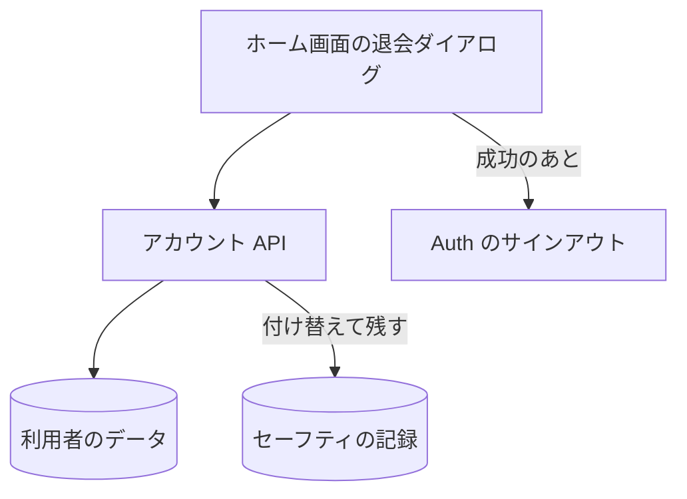

# アカウント API

退会の処理。利用者自身のリブトークのデータをすぐに削除する。

## エンドポイント

| メソッド | パス | 権限 |
|---|---|---|
| DELETE | `/api/account` | `livetalk:chat` |

## 入力と出力

- 本文は要らない。対象はセッションの利用者だけで、他の利用者のデータには触れない
- 利用者の持つ項目 (保存先で利用者の ID の配下にあるものすべて) を、25 件ずつまとめて削除する。削除しきれなかった分が残れば、成功にせず失敗にする
- [セーフティ](../term/safety.md)の検出の記録だけは消さず、利用者から切り離した匿名の持ち主に付け替えて残す。同じ回に付け替える記録は、すべて同じ匿名の持ち主になる
- 成功は `{ deleted: true }`。削除した件数や、匿名にした件数は返さない

## エラー

| 条件 | 状態 | `error` |
|---|---|---|
| 削除の失敗 | 500 | `DELETE_FAILED` |

- 権限の不足は 401 / 403。形は [API のエラー応答](../term/api-error.md)

## つながり

