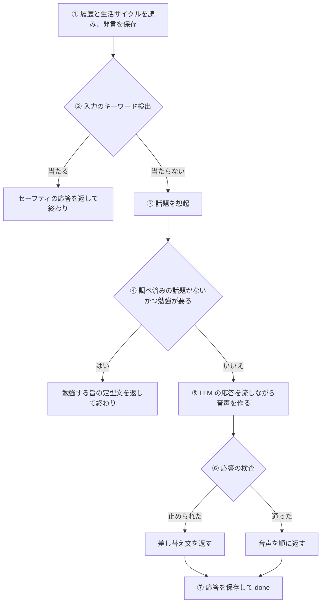
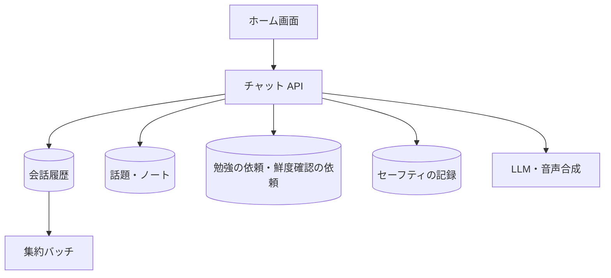

# チャット API

利用者の発言を受け取り、キャラクターの応答を[チャットのイベント](../term/chat-event.md)の流れ (NDJSON) で返す。

## エンドポイント

| メソッド | パス | 権限 |
|---|---|---|
| POST | `/api/chat` | `livetalk:chat` ([権限とロール](../term/permission.md)) |

## 入力と出力

| 項目 | 条件 |
|---|---|
| `text` | 必須。前後の空白を除いて 1〜200 文字 |
| `characterId` | 任意。登録のある[キャラクター](../term/character.md)。省略すると `hiyori` |
| `knowledgeId` | 任意の文字列。受け取るが使わない |

- 成功は 200。`Content-Type: application/x-ndjson`、`Cache-Control: no-store`。本文は 1 行 1 イベントで、`text` が先に流れ、LLM が終わったあとに `sentence` が文の順に並び、最後に `done`
- 流れが始まったあとの失敗は、状態を変えられないので `error` イベントで伝える
- 同じ利用者の同時の呼び出しは 1 本まで。ロックは 600 秒で自動的に外れる
- 呼び出しの回数は、1 分あたり 10 回、1 時間あたり 100 回まで。1 分、1 時間の順に、上限に達していなければ 1 つ数える。断った呼び出しは、どちらの窓も数えない (1 時間で断ったときは、数えた 1 分を戻す)
- 断ったときは `Retry-After` (断った窓の次の窓までの秒数) を付けて返す
- 1 分を戻せなかったときは、1 回多く数えたまま、報告する (warning、題名は「チャットの 1 分の回数を戻せませんでした (1 回分多く数えたまま)」)
- ロックとレートリミットの保存先が使えないときは、数えずに通す (障害時に会話を止めない)

## 処理

| 段階 | 内容 |
|---|---|
| ① | 履歴は、集約バッチが進めたカーソル (未集約の分) 以降。カーソルがなければ全件。ユーザー発言を保存する。就寝中かどうかを決め、通常の流れの先頭で `lifecycle` を返す |
| ② | 当たったら、LLM も想起も使わず、固定文を文字と音声で返し、`safety` (相談先つき) を返す。検出の記録を残し、応答も保存する ([セーフティ](../term/safety.md)) |
| ③ | 発言との類似度 0.4 以上の[話題](../term/topic.md)を上位 5 件。そのうち類似度 0.8 以上の関連する話題を最大 2 件足す。会話に使うのは話題ごとに新しい WEB fact 5 件まで。直接想起した話題のうち、期限切れの WEB fact を持つものは[鮮度確認の依頼](../term/freshness-check-request.md)を記録する |
| ④ | 想起した話題に WEB fact があれば、この段階を飛ばす。なければ LLM で「調べるべき外部の話題か」を判定し、必要なら[勉強の依頼](../term/study-topic.md) (優先度 10、30 日で失効、同じ話題の待ちがあれば足さない) を登録して、定型文 (3 種からひとつ) を返す |
| ⑤ | 直近 7 日に贈った[ノート](../term/note.md)を最大 3 件、想起した話題とともにプロンプトへ入れる。文の区切りごとに音声合成を並行して始める |
| ⑥ | Moderation で応答を検査する。止められたら、検出の記録を残し、`safety` (差し替え文つき) のあと、差し替え文の音声だけを返す。元の応答の音声は返さない |
| ⑦ | 応答 (止めたときは差し替え文) を保存する。新しい活動日なら親密度を加算する |

- 想起・鮮度確認の記録・知識ゲート・ノートの取得・Moderation が失敗しても、会話は続ける

## エラー

| 条件 | 状態 | `error` |
|---|---|---|
| 本文が JSON のオブジェクトでない、`text` が文字列でない、`characterId` が登録外 | 400 | `INVALID_REQUEST` |
| `text` が空 (空白のみ) | 400 | `EMPTY_TEXT` |
| `text` が 200 文字を超える | 400 | `TEXT_TOO_LONG` |
| 同じ利用者の別の呼び出しが処理中 | 429 | `CONCURRENT_REQUEST` |
| 1 分または 1 時間の上限を超えた (ロックは外す) | 429 | `RATE_LIMIT_EXCEEDED` |

- 権限の不足は 401 / 403。形は [API のエラー応答](../term/api-error.md)

## つながり

