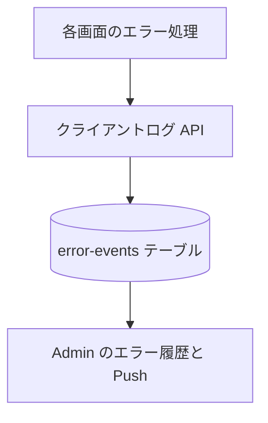

# クライアントログ API

ブラウザで起きた失敗を受け取り、[ErrorEvent](../../../platform/specs/term/error-event.md) として Admin へ報告する。

## エンドポイント

| メソッド | パス | 権限 |
|---|---|---|
| POST | `/api/client-log` | `livetalk:chat` |

## 入力と出力

| 項目 | 条件 |
|---|---|
| `severity` | 必須。`warning`、`error`、`critical` のどれか |
| `title` | 必須。1〜200 文字 |
| `message` | 必須。1〜1,000 文字 |
| `context` | 任意。オブジェクト |
| `occurredAt` | 任意。文字列 |

- 成功は本文なしの 204。報告の `serviceId` は `livetalk`。`context` には、先に利用者の ID を入れ、続けて受け取った `context` の項目を重ねる
- 画面が送るのは、チャット通信の失敗、音声の再生・デコードの失敗、捕捉されなかった例外、画面の描画中の例外。画面側の送信は、失敗しても何もしない
- 画面が送る `context` には、ブラウザの情報 (`userAgent`、ホーム画面から起動したか `standalone`) と、報告ごとの調査用の項目 (画面の名前 `screen`、音声の状態など) が入る。例外の値を持つ報告では、さらに `errorName` / `errorMessage` / `errorStack` を最後に重ねる。この 3 項目はサーバー側の報告と同じ組み立てで、Error でない値では `errorName` が値の型名になり、`errorStack` を持たない
    - 例外の値を持つ報告: 描画中の例外、捕捉されなかった例外 (例外の値が取れたときだけ)、処理されなかった Promise の拒否、チャット通信の例外、音声のデコード・再生の失敗
    - HTTP の状態での失敗と、ストリームの `error` イベントは、例外の値を持たないので 3 項目を付けない

## エラー

| 条件 | 状態 | `error` |
|---|---|---|
| 本文が JSON のオブジェクトでない、項目が条件に合わない | 400 | `INVALID_REQUEST` |

- 権限の不足は 401 / 403。形は [API のエラー応答](../term/api-error.md)

## つながり

