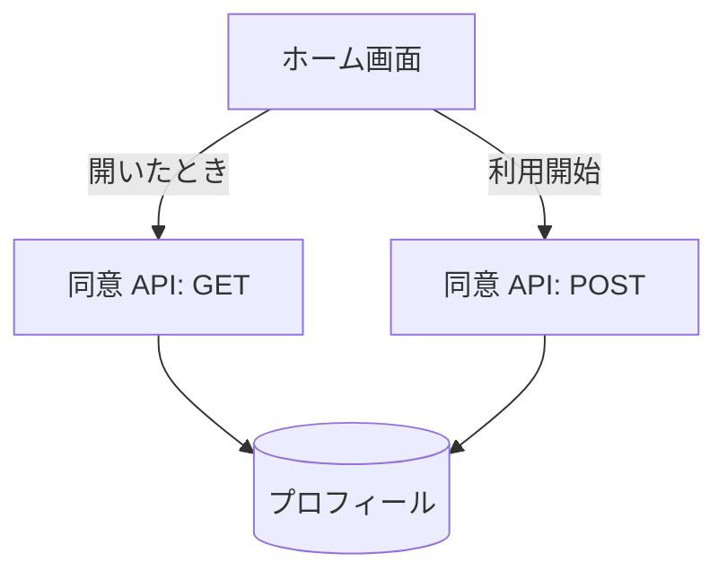

# 同意 API

利用者の[同意](../term/consent.md)の状態を返し、同意を保存する。

## エンドポイント

| メソッド | パス | 権限 |
|---|---|---|
| GET | `/api/consent` | `livetalk:chat` |
| POST | `/api/consent` | `livetalk:chat` |

## 入力と出力

- GET は `{ consented, requiredVersions: { terms, privacy }, current }` を返す。`current` は保存済みの同意の記録で、なければ null。`consented` は記録が今の版で有効なとき true
- POST は `termsAgreed`、`privacyAgreed`、`ageVerified` の 3 つの真偽値をすべて true で受ける。保存するときの版は、今の規約とプライバシーポリシーの版。成功は `{ consented: true }`
- 保存は、同意の記録とあわせて最終の利用日時を更新する

## エラー

| 条件 | 状態 | `error` |
|---|---|---|
| 本文が JSON のオブジェクトでない、3 つのどれかが真偽値でない | 400 | `INVALID_REQUEST` |
| 3 つのどれかが false | 400 | `ALL_CONSENTS_REQUIRED` |
| 保存の失敗 | 500 | `SAVE_FAILED` |
| 読み取りの失敗 | 500 | `FETCH_FAILED` |

- 権限の不足は 401 / 403。形は [API のエラー応答](../term/api-error.md)

## つながり

