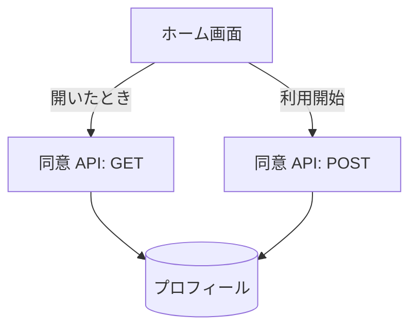

# 同意 API

利用者の[同意](../term/consent.md)の状態を返し、同意を保存する。

## エンドポイント

| メソッド | パス | 権限 |
|---|---|---|
| GET | `/api/consent` | `livetalk:chat` |
| POST | `/api/consent` | `livetalk:chat` |

## 入力と出力

- GET は `{ consented, requiredVersions: { terms, privacy }, current }` を返す。`current` は保存済みの同意の記録で、なければ null。`consented` は記録が今の版で有効なとき true
- POST は `termsAgreed`、`privacyAgreed` を true で、`ageVerified` を true か省略 (false も同じ扱い) で受ける。保存するときの版は、今の規約とプライバシーポリシーの版。今の版に同意済みの文書は、記録済みの版と日時をそのまま残し、版が違うか記録のない文書だけを今の日時で記録する。成功は `{ consented: true }`
- `ageVerified` が true のときは、18 歳以上の申告を今の日時で新しく記録する。省略か false のときは、プロフィールを読み、記録済み (`value` が true) ならその値と日時をそのまま残す。記録がなければ 400
- 保存は、同意の記録とあわせて最終の利用日時を更新する

## エラー

| 条件 | 状態 | `error` |
|---|---|---|
| 本文が JSON のオブジェクトでない、`termsAgreed`・`privacyAgreed` が真偽値でない、`ageVerified` が (あるのに) 真偽値でない | 400 | `INVALID_REQUEST` |
| `termsAgreed` か `privacyAgreed` が false、または 18 歳以上の申告が今回も記録済みにもない | 400 | `ALL_CONSENTS_REQUIRED` |
| 保存の失敗 | 500 | `SAVE_FAILED` |
| 読み取りの失敗 | 500 | `FETCH_FAILED` |

- 権限の不足は 401 / 403。形は [API のエラー応答](../term/api-error.md)

## つながり

