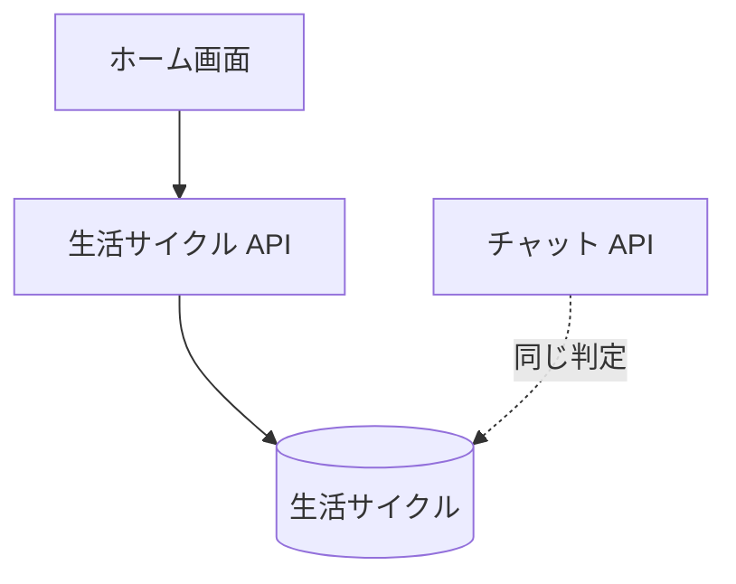

# 生活サイクル API

キャラクターが今、起きているか寝ているかを返す。ホーム画面が、最初の発話を待たずにキャラクターの表示へ反映するために読む。

## エンドポイント

| メソッド | パス | 権限 |
|---|---|---|
| GET | `/api/lifecycle` | `livetalk:chat` |

## 入力と出力

- 問い合わせ `characterId` は任意。省略または登録外のときは `hiyori`
- 出力は `{ state: 'awake' | 'sleeping' }`。[生活サイクル](../term/lifecycle.md)の就寝・起床の時刻と、今の日本時間から決める。記録がなければ既定の 01:30 から 09:30 が就寝中

## エラー

- 読み取りに失敗しても 500 にせず、`awake` を返す。失敗は Admin へ報告する ([API のエラー応答](../term/api-error.md))
- 権限の不足は 401 / 403

## つながり

