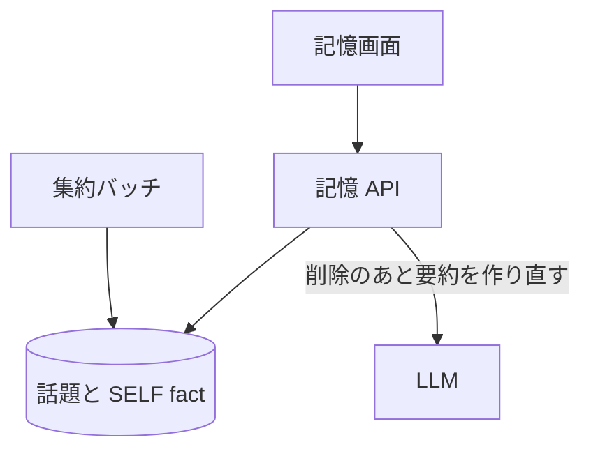

# 記憶 API

利用者についての[SELF fact](../term/self-fact.md)の一覧と、1 件ずつの削除 (忘却)。

## エンドポイント

| メソッド | パス | 権限 |
|---|---|---|
| GET | `/api/memory` | `livetalk:chat` |
| DELETE | `/api/memory/{id}` | `livetalk:chat` |

## 入力と出力

- GET の問い合わせ `characterId` は任意で、省略すると `hiyori`
- GET は `{ selfFacts: [{ id, topicId, subject, text, createdAt }] }` を、作成日時の新しい順で返す。`subject` は所属する[話題](../term/topic.md)の主題。WEB fact は含めない
- `id` は、SELF fact の保存位置 (キャラクター・話題・fact) を URL に載せられる形 (base64url) にしたもの。利用者の部分は、セッションの利用者で決めるので、他の利用者の分は指せない。DELETE のキャラクターは `id` に含まれ、問い合わせの `characterId` は読まない
- DELETE は SELF fact を物理削除し、残った fact から話題の要約を作り直す。成功は `{ deleted: true }`
- SELF fact がすでに消えていても、話題が残っていれば要約だけを作り直して成功にする (要約の作り直しに失敗した後の押し直し)

## エラー

| 条件 | 状態 | `error` |
|---|---|---|
| `characterId` が登録外 (GET) | 400 | `INVALID_CHARACTER` |
| `id` の形が違う (DELETE) | 400 | `INVALID_ID` |
| SELF fact も話題もない (DELETE) | 404 | `NOT_FOUND` |
| 読み取りの失敗 | 500 | `FETCH_FAILED` |
| 削除・要約の作り直しの失敗 | 500 | `DELETE_FAILED` |

- 権限の不足は 401 / 403。形は [API のエラー応答](../term/api-error.md)

## つながり

