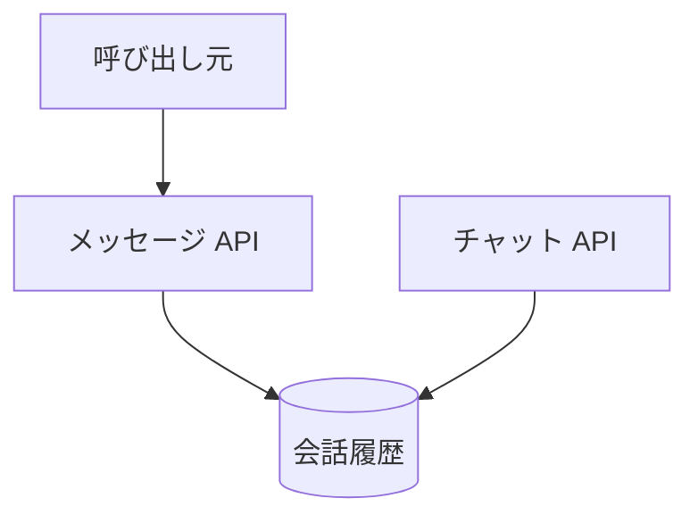

# メッセージ API

認証した利用者の、直近の会話履歴を返す。画面は呼ばない。

## エンドポイント

| メソッド | パス | 権限 |
|---|---|---|
| GET | `/api/messages` | `livetalk:chat` |

## 入力と出力

| 問い合わせ | 条件 |
|---|---|
| `characterId` | 任意。省略すると `hiyori`。登録の有無は確かめない |
| `tokenLimit` | 任意。100〜200,000 の整数。省略すると環境変数 `LLM_CONTEXT_TOKEN_LIMIT`、なければ 40,000 |

- 新しい側から `tokenLimit` に収まる分だけを取り、古い順に並べて返す
- 出力は `{ messages: [{ messageId, characterId, role, text, createdAt }], totalTokens, truncated }`。`role` は利用者かキャラクターか。`truncated` はトークンの上限か件数の上限で打ち切ったとき true
- 会話履歴は 90 日で自動削除される

## エラー

| 条件 | 状態 | `error` |
|---|---|---|
| `tokenLimit` が整数でない、または範囲外 | 400 | `INVALID_REQUEST` |
| 読み取りの失敗 | 500 | `FETCH_FAILED` |

- 権限の不足は 401 / 403。形は [API のエラー応答](../term/api-error.md)

## つながり

