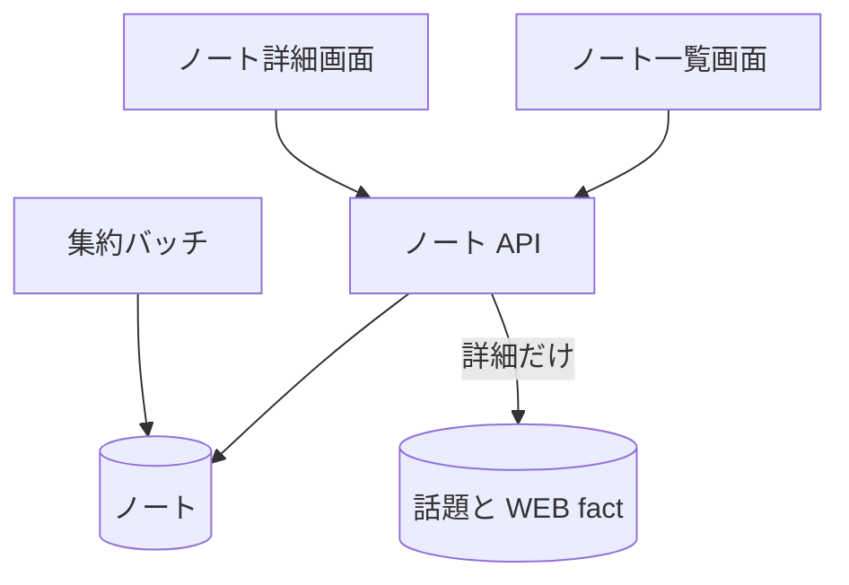

# ノート API

[ノート](../term/note.md)の一覧と、1 件の詳細。閲覧だけで、作る・変える・消す API はない。

## エンドポイント

| メソッド | パス | 権限 |
|---|---|---|
| GET | `/api/notes` | `livetalk:chat` |
| GET | `/api/notes/{id}` | `livetalk:chat` |

## 入力と出力

- 一覧の問い合わせ `characterId` は任意で、省略すると `hiyori`。出力は `{ notes: [{ id, subject, sharedAt }] }` を、贈った日時 (`sharedAt`) の新しい順で返す。本文は含めない
- 詳細は `{ note: { id, subject, sharedAt, headline, webFacts, sources } }`
    - `headline` は贈った時点の手紙の文面で、変わらない
    - `webFacts` と `sources` は、参照先の[話題](../term/topic.md)の今の [WEB fact](../term/web-fact.md)から、開くたびに作る。`sources` は重複を除き、`http` か `https` の URL だけを残す
    - 参照先の話題を読めなかったときは、`headline` だけを返す (失敗は Admin へ報告する)
- `id` は、ノートの保存位置を URL に載せられる形 (base64url) にしたもの。利用者の部分はセッションで決まる

## エラー

| 条件 | 状態 | `error` |
|---|---|---|
| `characterId` が登録外 (一覧) | 400 | `INVALID_CHARACTER` |
| `id` の形が違う (詳細) | 400 | `INVALID_ID` |
| ノートがない (詳細) | 404 | `NOT_FOUND` |
| 読み取りの失敗 | 500 | `FETCH_FAILED` |

- 権限の不足は 401 / 403。形は [API のエラー応答](../term/api-error.md)

## つながり

