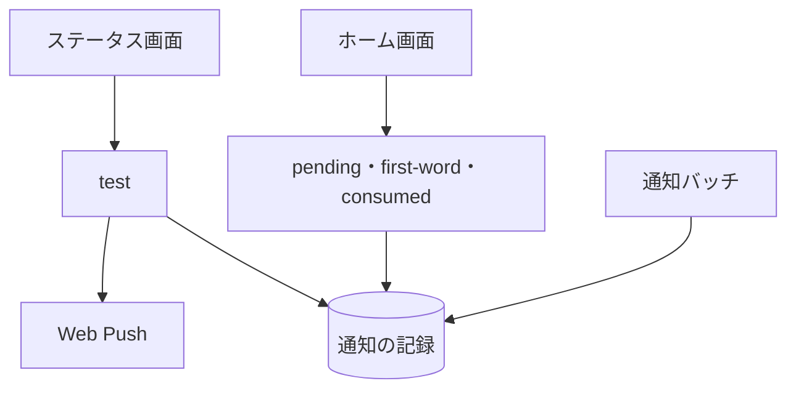

# 通知まわりの API

[通知の記録](../term/notification-event.md)を、第一声と未読の知らせとして読み、消化済みにする。管理者向けに、判定を介さないテスト送信もある。

## エンドポイント

| メソッド | パス | 権限 |
|---|---|---|
| GET | `/api/push/pending` | `livetalk:chat` |
| GET | `/api/push/first-word` | `livetalk:chat` |
| PATCH | `/api/push/consumed` | `livetalk:chat` |
| POST | `/api/push/test` | `livetalk:admin` |

## 入力と出力

- `pending` は、キャラクターごとの最新の未消化の通知を `[{ characterId, notifId, body }]` で返す。なければ空の配列
- `first-word` は、問い合わせ `characterId` のキャラクターの未消化の最新を返す。出力は `{ notifId, body, characterId, suggestedReply }` (`suggestedReply` はなければ null)。見るのは直近 20 件の記録。`characterId` がない、または該当がなければ 204
- `consumed` は `{ notifId }` を受け、消化の日時を記録する。成功は `{ success: true }`
- `test` は `{ characterId }` (登録のあるキャラクター) を受け、判定を介さず、利用者の購読すべてへテスト通知を送る
    - 題名は「{呼び名}より」、本文は「【テスト送信】{名前}からのテスト通知です」。タップで `/?character={ID}` を開く
    - 出力は `{ sent, characterId }`。購読がなければ `sent` は 0 で、何も送らず、記録も残さない
    - 1 件以上送れたら、通知の記録を残す (平常、30 日で削除)。無効な購読 (404、410) は削除する

## エラー

| 条件 | 状態 | `error` |
|---|---|---|
| `consumed` の `notifId` が文字列でない | 400 | `INVALID_REQUEST` |
| `consumed` の通知がない | 404 | `NOT_FOUND` |
| `test` の本文が JSON のオブジェクトでない、`characterId` がない | 400 | `INVALID_REQUEST` |
| `test` の `characterId` が登録外 | 400 | `UNKNOWN_CHARACTER` |
| `test` の送信の失敗 | 500 | `SEND_FAILED` |
| `pending`・`first-word`・`consumed` の失敗 | 500 | `INTERNAL_ERROR` |

- 権限の不足は 401 / 403。形は [API のエラー応答](../term/api-error.md)

## つながり

