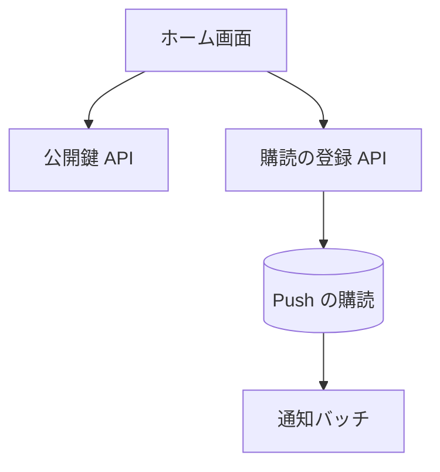

# Push 購読の API

ブラウザの Web Push の購読を登録する。登録のために、サーバーの VAPID 公開鍵を返す API とあわせて使う。

## エンドポイント

| メソッド | パス | 権限 |
|---|---|---|
| GET | `/api/push/vapid-public-key` | なし |
| POST | `/api/push/subscribe` | `livetalk:chat` |

## 入力と出力

- 公開鍵は `{ publicKey }` で、環境変数 `VAPID_PUBLIC_KEY` の値
- 購読の登録は `{ subscription: { endpoint, keys: { p256dh, auth } } }` を受ける。`endpoint` は URL、`keys` の 2 つは空でない文字列。成功は 201 `{ success: true, subscriptionId }`。`subscriptionId` は `endpoint` から決まるので、同じ端末の登録は同じ ID に上書きされる
- 購読は利用者に紐づけて保存する。通知バッチは、利用者の購読すべてに送る
- どの画面を開いても、通知を許可済みの利用者の購読を作り直して、この API へ送り直す。ブラウザ側で購読が失われることがあるため

## エラー

| 条件 | 状態 | `error` |
|---|---|---|
| 本文が JSON でない、`subscription` がない、形が不正 | 400 | `INVALID_REQUEST` |
| VAPID の鍵が設定されていない、保存の失敗 | 500 | `INTERNAL_ERROR` |
| 公開鍵が設定されていない | 500 | `INTERNAL_ERROR` |

- 権限の不足は 401 / 403。形は [API のエラー応答](../term/api-error.md)。これらの 500 は Admin へ報告する

## つながり

