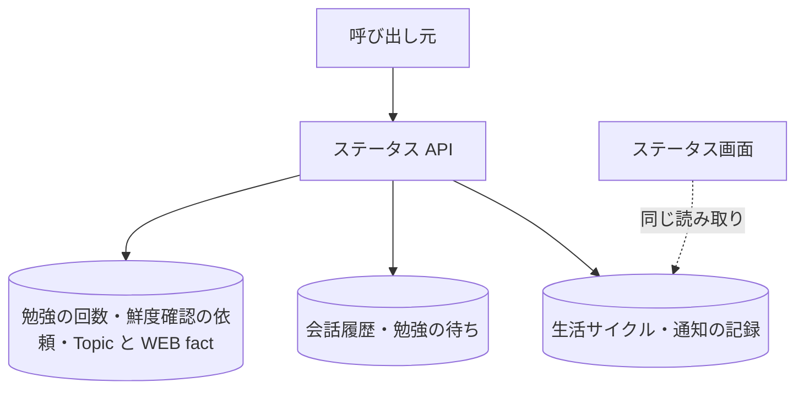

# ステータス API

管理者向けに、通知が来ない理由を見分けるための内部の状態をまとめて返す。ステータス画面は、この API を呼ばず、同じ読み取りをサーバーで直接行う。

## エンドポイント

| メソッド | パス | 権限 |
|---|---|---|
| GET | `/api/status` | `livetalk:admin` |

## 入力と出力

- 問い合わせ `characterId` は任意。省略または登録外のときは `hiyori`
- 出力は次のとおり

| 項目 | 内容 |
|---|---|
| `lifecycle` | `state`、`bedtime`、`wakeUpTime`、[活動時間プロファイル](../term/user-activity-profile.md) (なければ null) |
| `recentNotifications` | 直近 5 件の[通知の記録](../term/notification-event.md)。本文は 100 文字まで、消化の日時はなければ null |
| `notifyDecision` | 今この時刻に平常通知を出せるかの判定。出せないときは理由 (`not_due`、`outside_window`、`sleeping`、`daily_cap`、`inactive_stopped`、`no_content`)。`not_due` のときは、間隔が解ける目安の時刻 `nextEarliestAt` が付く |
| `studyTopicPendingCount` | 勉強の待ちの件数 |
| `studyState` | 勉強がいま止まっている理由の要約。取得バッチが確かめる順に、生活サイクルが未登録なら `no_lifecycle`、3 日ルールで止まっていれば `paused`、回数の上限なら `limit_reached`、どれでもなければ `studying` |
| `studyPause` | [勉強の停止](../term/study-pause.md)。`paused`、最後の発話の時刻 `lastUserMessageAt` と止まる (止まった) 時刻 `pausesAt` (最後の発話から 72 時間後)。直近 7 日に発話が無ければ、どちらも null |
| `studyUsage` | 日本時間のその日の勉強の回数。表示キャラクターの回数 `characterCount` と上限 `characterLimit`、利用者の合計 `totalCount` と上限 `totalLimit` (20)、勉強中のキャラクターの数 `studyingCharacterCount`、どちらかの上限に達しているか `limitReached` |
| `freshnessCheckRequests` | [鮮度確認の依頼](../term/freshness-check-request.md)の件数 `count` と、各依頼の `topicId` と `createdAt` |
| `criticalCandidates` | 重要通知の判定の手前。`evaluated` と判定しない理由 `skipReason` (生活サイクルが未登録なら `no_lifecycle`、勉強が止まっていれば `study_paused`、判定するときは null。判定しないときは話題を読まない)、判定に渡る候補 `candidates` と鮮度切れで外れた話題 `staleExcluded` (どちらも `topicId`、`subject`、`care`)、送り済みの重要通知 `sentCriticals` (`topicId` と `eventDate`。予定日が無ければ null) |

- 判定と `recentNotifications` は、表示キャラクターの通知の記録だけを使う。通知の記録は利用者の直近 60 件 (通知バッチと同じ件数) を読み、そこから表示キャラクターのものに絞る。他のキャラクターの通知は、1 日の上限・無視の回数・基準時刻にも一覧にも効かない
- 判定に使う会話は、通知バッチと同じ直近 7 日の分だけを読む。7 日より前の発話は、セッションの間隔にも最後の発話の時刻にも入らない
- 判定と間隔が解ける目安の時刻は、[通知バッチ](../batch/notify.md)の平常通知の判定と同じ関数で求める。画面とこの API は、読み取りと判定を同じ処理で行う。重要通知を出すかの判定 (LLM による話題の指定) と、複数のキャラクターの調停は含まない
- `studyState` から `criticalCandidates` までの求め方 (勉強中のキャラクターの数え方、候補の絞り方) は、[ステータス画面](../screen/status.md#勉強と重要通知)と同じ。この API も読むだけで、鮮度確認の依頼を記録しない

## エラー

| 条件 | 状態 | `error` |
|---|---|---|
| 読み取りの失敗 | 500 | `FETCH_FAILED` |

- 権限の不足は 401 / 403。形は [API のエラー応答](../term/api-error.md)

## つながり

