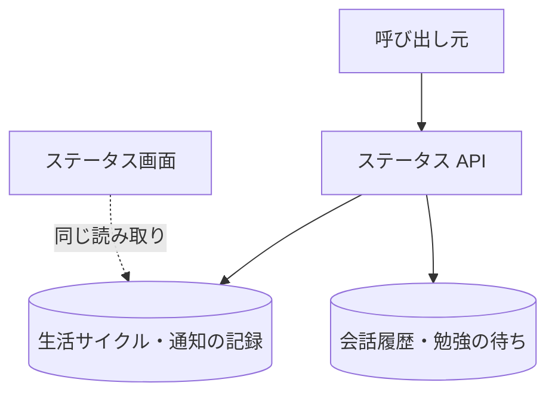

# ステータス API

管理者向けに、通知が来ない理由を見分けるための内部の状態をまとめて返す。ステータス画面は、この API を呼ばず、同じ読み取りをサーバーで直接行う。

## エンドポイント

| メソッド | パス | 権限 |
|---|---|---|
| GET | `/api/status` | `livetalk:admin` |

## 入力と出力

- 問い合わせ `characterId` は任意。省略または登録外のときは `hiyori`
- 出力は次のとおり

| 項目 | 内容 |
|---|---|
| `lifecycle` | `state`、`bedtime`、`wakeUpTime`、[活動時間プロファイル](../term/user-activity-profile.md) (なければ null) |
| `recentNotifications` | 直近 5 件の[通知の記録](../term/notification-event.md)。本文は 100 文字まで、消化の日時はなければ null |
| `notifyDecision` | 今この時刻に平常通知を出せるかの判定。出せないときは理由 (`not_due`、`outside_window`、`sleeping`、`daily_cap`、`inactive_stopped`、`no_content`)。`not_due` のときは、間隔が解ける目安の時刻 `nextEarliestAt` が付く |
| `studyTopicPendingCount` | 勉強の待ちの件数 |

- 判定は[通知バッチ](../batch/notify.md)の平常通知の判定と同じ関数を使う。重要通知の判定 (話題の指定) と、複数のキャラクターの調停は含まない

## エラー

| 条件 | 状態 | `error` |
|---|---|---|
| 読み取りの失敗 | 500 | `FETCH_FAILED` |

- 権限の不足は 401 / 403。形は [API のエラー応答](../term/api-error.md)

## つながり

