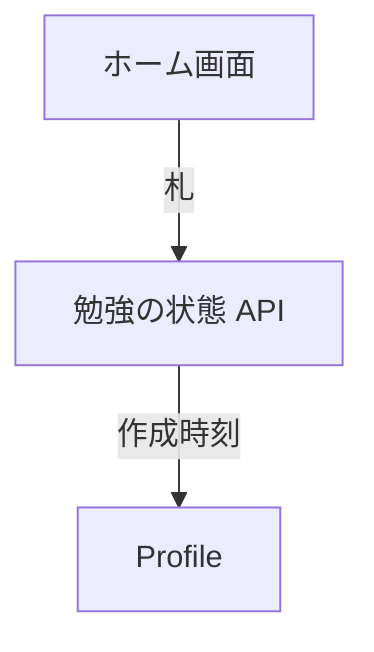

# 勉強の状態 API

無料のお試しの残りと、勉強が止まっていることを返す。ホーム画面が、上の段の札を出すために読む。区分とお試しの判定は、[勉強バッチ](../batch/acquire.md)と同じ関数で行う。

## エンドポイント

| メソッド | パス | 権限 |
|---|---|---|
| GET | `/api/study-status` | ログインしていること |

## 入力と出力

- 入力はない
- 区分はセッションの有効なロールで決める (`livetalk:operator` なら運営者、`livetalk:standard` ならスタンダード、それ以外は無料)。お試しは Profile の作成時刻から 7 日 (168 時間)

| 出力 | 条件 |
|---|---|
| `{ state: 'hidden' }` | 運営者・スタンダードのとき。無料で Profile がまだないとき (同意前など。お試しが始まっていない) |
| `{ state: 'trial', remainingDays }` | 無料でお試し中。`remainingDays` は残り時間を日に切り上げた値で、1 以上 |
| `{ state: 'ended' }` | 無料でお試しを過ぎた (勉強が止まっている) |

## エラー

| 状況 | 状態 | 応答 |
|---|---|---|
| 未ログイン | 401 | |
| Profile の読み取りの失敗 | 500 | `FETCH_FAILED`「勉強の状態の取得に失敗しました」。Admin へ報告する ([API のエラー応答](../term/api-error.md)) |

## つながり

