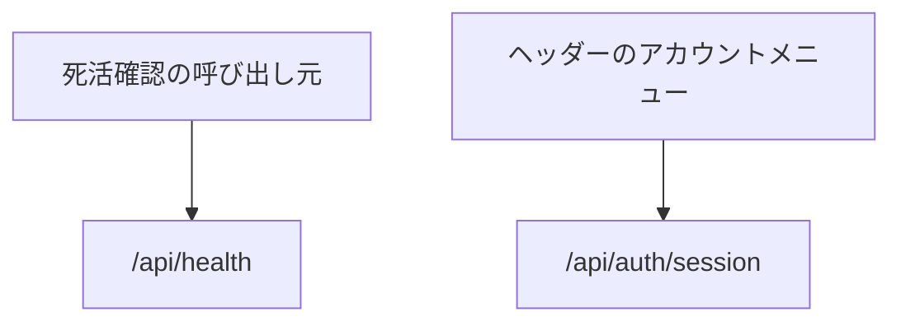

# システム系の API

業務の機能ではない 2 つの API。死活確認と、認証セッション。

## エンドポイント

| メソッド | パス | 権限 |
|---|---|---|
| GET | `/api/health` | なし |
| GET | `/api/auth/*` (画面が使うのは `/api/auth/session`) | なし (ログインの状態を返す) |

## 入力と出力

- 死活確認は `{ status: 'ok', version }` を返す。`version` は環境変数 `APP_VERSION`、なければ `unknown`
- 認証は next-auth の GET だけを公開し、POST は公開しない。サインアウトは Auth サービスで行う。環境変数 `SKIP_AUTH_CHECK` が `true` のテスト用の設定では、`/api/auth/session` が認証せずにテスト用のセッションを返す。ロールを指定しなければ `livetalk-user`

## エラー

- 死活確認は失敗しない。認証の GET の失敗は next-auth の既定に従う

## つながり

