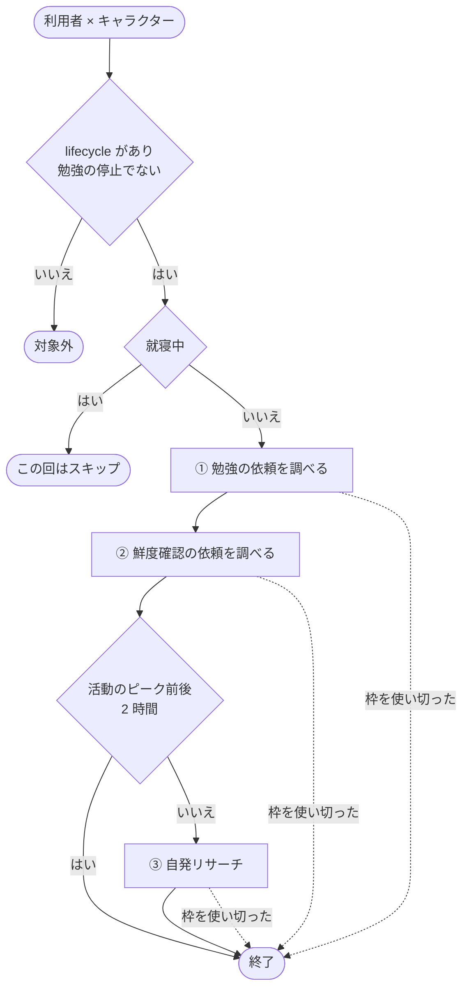
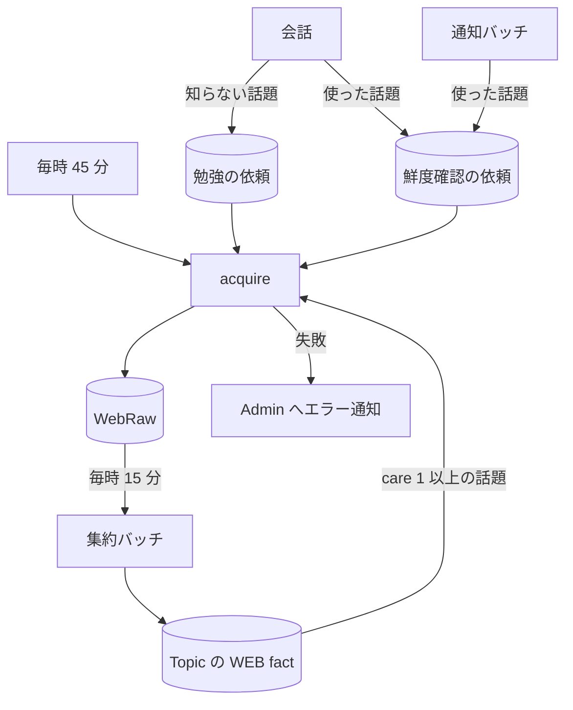

# 勉強バッチ (acquire)

キャラクターが Web で調べものをして、結果を [WebRaw](../term/webraw.md) に書くバッチ。[Topic](../term/topic.md) への畳み込みは[集約バッチ](./consolidate-conversations.md)が行う。

## 起点

- 毎時 45 分 (EventBridge: `cron(45 * * * ? *)`)
- 全利用者 × 全キャラクター (hiyori、ageha) を順に処理する
- Lambda は最長 15 分。時刻の判定は日本時間
- 会話から登録される勉強の依頼と鮮度確認の依頼は、[会話の経路](../flow/conversation.md)にある

## 対象から外れる条件

| 条件 | 外れる範囲 |
|---|---|
| [lifecycle](../term/lifecycle.md) がない (週次の活動時間学習バッチが作る) | 全部。勉強中の人数にも数えない |
| [勉強の停止](../term/study-pause.md) (利用者の最後の発話から 72 時間以上、または発話なし) | 全部。勉強中の人数にも数えない |
| キャラクターが就寝中 | その回の全部。勉強中の人数には数える |
| 利用者の活動のピーク (朝・夕) の前後 2 時間 ([活動時間プロファイル](../term/user-activity-profile.md)が学習済みのときだけ) | 自発リサーチだけ |

## 処理

利用者 × キャラクターごとに、次の流れで進む。

- 就寝中のキャラクターも、勉強中の人数には数える
- ピーク前後の判定は、活動時間プロファイルが学習済みのときだけ行う
- 調べた結果は WebRaw に書く。Topic への畳み込みは集約バッチが行う

| 段 | 対象 | 検索語 | 書くもの |
|---|---|---|---|
| ① | [勉強の依頼](../term/study-topic.md) (pending) を優先度の高い順、同じなら古い順に | 依頼の文言そのまま | WebRaw (origin: request)。依頼は done にする |
| ② | [鮮度確認の依頼](../term/freshness-check-request.md)を古い順に | 「{主題} 最新情報」。主題がすでに「最新情報」で終わるなら足さない | 変化があったときだけ WebRaw (origin: stale) |
| ③ | 自発リサーチ。[care](../term/care.md) 1 以上の Topic を高い順に、上位 20 件を候補に | LLM が作る探索の角度。作れなければ「{主題} 最新情報」 | WebRaw (origin: auto) |

- 依頼 (①): 失敗したときと、上限で止まったときは pending に戻して次の回に回す。依頼が消えていたら飛ばす
- 鮮度確認 (②)
    - Topic ごとに検索は 1 回にまとめる。対象は、その Topic の新しい側 20 件の [WEB fact](../term/web-fact.md) のうち確認が要るもの。対象がなければ依頼だけ消す
    - 既存の事実と取得結果を LLM で比べ、変化があったときだけ WebRaw を書く
    - 変化の有無や失敗にかかわらず、対象の WEB fact の再確認期限を延ばす (high 1 日、medium 7 日、low 30 日)。依頼も消す
    - 上限で止まったときは、依頼を消さずに残す
- 自発リサーチ (③)
    - [探索の記録](../term/exploration.md)の時刻、または起点の最新の WEB fact の観測日時が 24 時間以内なら飛ばす
    - 検索の成否にかかわらず、探索の記録を残す (時刻と、最近の角度 5 件)
    - 角度を作るのは、枠を使えると決まった後である

## 上限

| 上限 | 値 |
|---|---|
| 1 回の実行・1 キャラクターあたりの検索 | 3 回 (①②③の合計。失敗した検索も 1 回に数える) |
| 1 日・利用者 1 人あたり | 20 回 (日本時間の暦日。全キャラクターの合計) |
| 1 日・キャラクターあたり | 20 ÷ 勉強中のキャラクター数 (切り捨て) |

- 勉強中のキャラクターは、lifecycle があり、勉強の停止になっていないもの。就寝中も数える
- 枠は検索の直前に 1 回分ずつ数え、失敗しても戻さない。枠を使い切ったら、その組はその回の残りの検索を止める
- 回数の記録に失敗したときも、上限を守れないので勉強を止める
- キャラクターあたりの枠を数えたあとに 1 日・利用者の枠で断られたら、キャラクターあたりの 1 回を戻す。戻せなければ、その枠を 1 回多く数えたまま続け、報告する (warning、題名は「勉強回数のキャラクター別の回数を戻せませんでした (1 回分多く数えたまま)」)

## 失敗したとき

- 個々の検索の失敗は握って次へ進む。Lambda は失敗にしない
- キャラクターごとの処理が例外で終わったときと、回数の記録に失敗したときは、その利用者を失敗として数える。他のキャラクターと他の利用者は続ける
- 失敗した利用者が 1 人でもいると、最後に Lambda を失敗にする。1 日の上限に達しただけでは失敗にしない
- 失敗は Admin にエラーとして届く ([エラー通知の経路](../../admin/flow/error-notification.md))

## つながり

