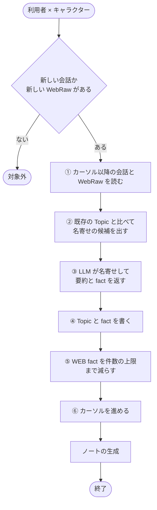
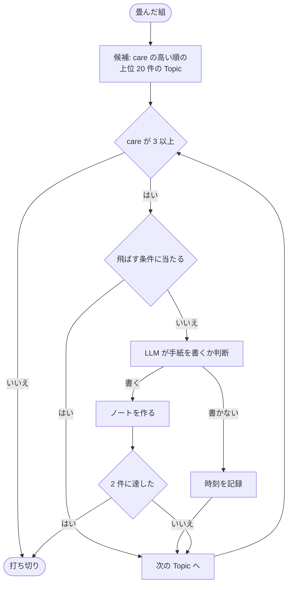
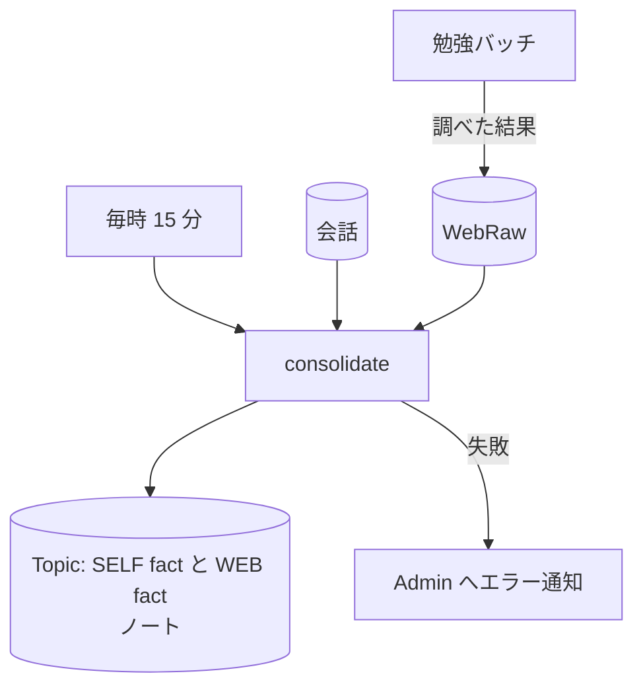

# 集約バッチ (consolidate-conversations)

まだ畳んでいない会話と [WebRaw](../term/webraw.md) を、[Topic](../term/topic.md) にまとめるバッチ。Topic を作る・更新するのは、このバッチだけである。畳んだ直後に、[ノート](../term/note.md)も作る。

## 起点

- 毎時 15 分 (EventBridge: `cron(15 * * * ? *)`)
- 全利用者 × 全キャラクターを処理する。Lambda は最長 15 分
- 畳む会話は[会話の経路](../flow/conversation.md)で保存される。結果は[記憶画面](../screen/memory.md)と[ノート一覧画面](../screen/notes.md)で見られる

## 対象から外れる条件

| 条件 | 外れる範囲 |
|---|---|
| 前回の続きから、新しい会話も新しい WebRaw もない | その組の全部 (ノートも作らない) |

勉強の停止、就寝中、lifecycle の有無は見ない。

## 処理

1 組ごとに、次の流れで進める。

- **①**: 会話用と WebRaw 用のカーソルを別々に持つ
- **②**: 新しい内容の末尾 2000 文字を埋め込み、類似度 0.4 以上の上位 8 件を候補にする。各候補の既存の WEB fact は、新しい側 20 件を番号付きで LLM に見せる
- **③**: 話題ごとに、既存の Topic へ名寄せするか、新しく作るかを決め、要約・[SELF fact](../term/self-fact.md)・[WEB fact](../term/web-fact.md) を返す
- **④**: Topic のヘッダを書き、SELF fact と WEB fact を足す
    - 既存の Topic の更新は楽観ロックで書く。同じ Topic を指す結果は 1 つにまとめる
    - [care](../term/care.md): その話題の結果に SELF fact があるときだけ上げる。新規は 1、名寄せは +1。なければ新規は 0、名寄せはそのまま
    - WEB fact は、既存の事実と見比べて、追加・置き換え (新しいものを足して古いものを消す)・重複 (観測日時と期限だけ更新) のどれかで入れる
    - 新しい WEB fact の再確認期限は、stable ならなし、それ以外は取得時刻から high 1 日、medium 7 日、low 30 日
    - 依頼由来の WebRaw があれば、Topic に依頼文と依頼日時を持たせる
- **⑤**: 触れた Topic だけが対象。stable 以外は 20 件、stable は 10 件で、観測日時の古いものから消す。失敗しても集約は止めない
- **⑥**: 会話と WebRaw を別々に、今回読んだ範囲の最後の時刻まで進める。条件付きの書き込みで、二重に処理しない

書き込みを先にしてカーソルを最後に進めるため、途中で落ちると次の回で同じ内容をやり直す。

### ノートの生成

畳んだ組ごとに、続けて実行する。

- 飛ばす条件は次のとおり
    - すでにノートがある
    - WEB fact がない
    - 前回「ノートにしない」と判断した後に、新しい WEB fact が増えていない
- LLM は、SELF fact (なぜ調べたか) と新しい側 10 件の WEB fact から手紙を書く。書かないと判断したら、その時刻を記録して次へ進む
- ノートの生成の失敗は握って続ける

## 上限

| 上限 | 値 |
|---|---|
| ノート | 1 回の実行・1 組あたり 2 件 |

## 失敗したとき

- 組ごとの処理が例外で終わったときは、カーソルを進めず、次の回で同じ内容をやり直す。その利用者を失敗として数え、他のキャラクターと他の利用者は続ける
- 失敗した利用者が 1 人でもいると、最後に Lambda を失敗にする。失敗は Admin にエラーとして届く ([エラー通知の経路](../../admin/flow/error-notification.md))
- WEB fact の件数削減の失敗と、ノートの生成の失敗は、ログに残して続ける

## つながり

