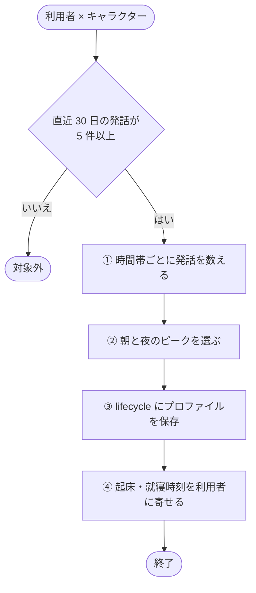
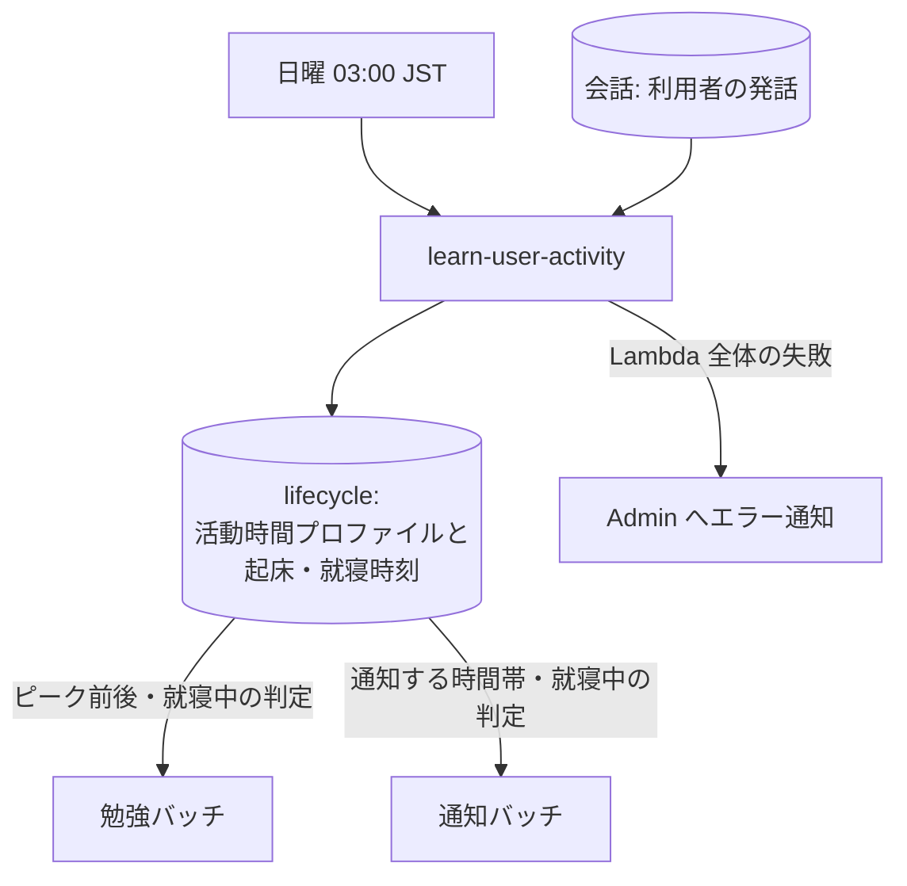

# 活動時間学習バッチ (learn-user-activity)

利用者がよく話しかける時間帯を過去の発話から求め、[活動時間プロファイル](../term/user-activity-profile.md)として保存し、キャラクターの就寝・起床時刻を少しずつ寄せるバッチ。[lifecycle](../term/lifecycle.md) を作るのも、このバッチだけである。

## 起点

- 週 1 回、日本時間の日曜 03:00 (EventBridge: `cron(0 18 ? * SAT *)`。UTC の土曜 18:00)
- 全利用者 × 全キャラクターを処理する。Lambda は最長 15 分

## 対象から外れる条件

| 条件 | 外れる範囲 |
|---|---|
| 直近 30 日の利用者の発話が 5 件未満 | その組の全部 (lifecycle も作らない) |

キャラクターの発話は数えない。学習に必要な最低発話数は 5 件、見る期間は直近 30 日である。

## 処理

1 組ごとに、次の流れで進める。

- **①**: 直近 30 日の利用者の発話を、日本時間の時 (hour) ごとに数える
- **②**: 同数なら範囲の早い時刻を選ぶ。範囲内に発話がなければ既定値にする

    | ピーク | 見る範囲 (日本時間) | 既定値 |
    |---|---|---|
    | 朝 | 5 時〜12 時 | 08:00 |
    | 夜 | 17 時〜翌 2 時 | 21:00 |

- **③**: プロファイルは朝、夜、発話数、学習日時。lifecycle がなければ、就寝 01:30・起床 09:30 の既定値で作る
- **④**: 目標は、起床 = 朝のピークの 1 時間前、就寝 = 夜のピークの 1.5 時間後
    - 現在の時刻から目標へ 3 割だけ近づける (0 時をまたぐ場合は短い側を回る)
    - 起床は 05:00〜12:00、就寝は 21:00〜翌 04:00 に収める

## 失敗したとき

- キャラクターごとの失敗は、他のキャラクターを続けながらログに残し、その利用者を失敗として数える
- 失敗した利用者がいても Lambda は失敗にしない
- Lambda 全体が例外で終わったときは、Admin にエラーとして届く ([エラー通知の経路](../../admin/flow/error-notification.md))

## つながり

