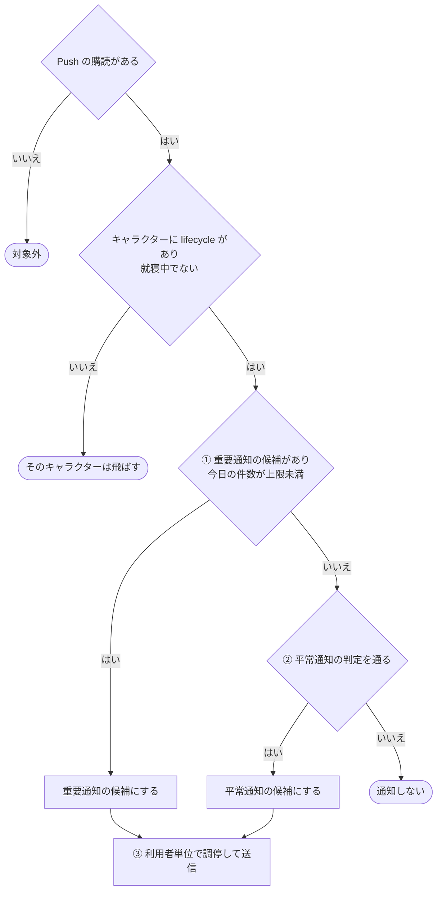
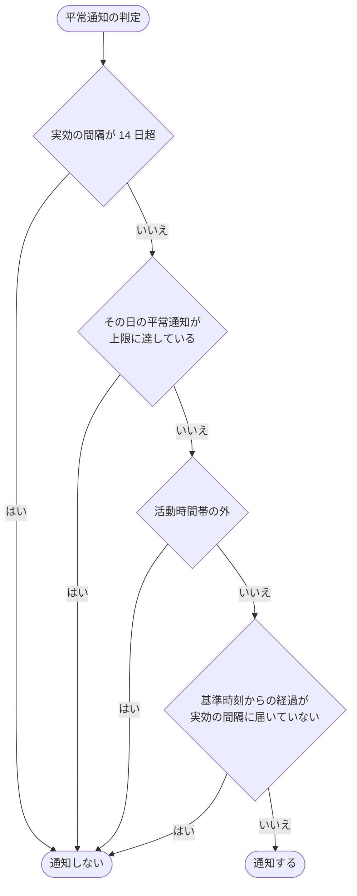
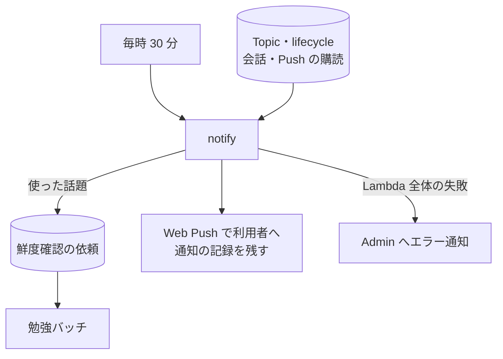

# 通知バッチ (notify)

キャラクターから利用者へ、Web Push で「話したい」と知らせるバッチ。通知は、日常の呼びかけ (平常通知) と、近い予定を知らせる (重要通知) の 2 種類ある。

## 起点

- 毎時 30 分 (EventBridge: `cron(30 * * * ? *)`)
- 全利用者 × 全キャラクターを処理する。Lambda は最長 15 分。時刻と日付の判定は日本時間。1 日の通知件数は、日本時間の 0 時から数える
- 送った[通知の記録](../term/notification-event.md)と、利用者が開くまでの流れは[通知から会話への経路](../flow/notification-open.md)にある

## 対象から外れる条件

| 条件 | 外れる範囲 |
|---|---|
| Push の購読がない利用者 | その利用者の全部 |
| [lifecycle](../term/lifecycle.md) がないキャラクター | そのキャラクターの全部 |
| キャラクターが就寝中 | そのキャラクターの重要通知・平常通知とも |
| [勉強の停止](../term/study-pause.md) | 話題を使う部分だけ。重要通知は出さず、平常通知は話題名のない文面になる |

## 処理

利用者ごとにキャラクターを順に判定して候補を作り、利用者単位で調停してから送る。

### ① 重要通知の候補

- 話題の候補は、[care](../term/care.md) の高い順の上位 10 件の [Topic](../term/topic.md) のうち、care が 3 以上の上位 3 件
- 候補の Topic が使われたとみなし、確認が要る [WEB fact](../term/web-fact.md) があれば[鮮度確認の依頼](../term/freshness-check-request.md)を記録する。確認が要る事実を持つ Topic は、その回の判定から外す
- 判定は LLM で行う。各 Topic の新しい側 3 件の WEB fact から、予定の日付を取り出す。その日付が今日から 14 日以内 (今日を含む) なら、緊急とみなす
- 送り済みの扱い
    - 同じ話題・同じ予定の日付は、再び選ばない。日付が変わった (延期など) ものは新しい予定として扱う
    - 予定の日付が記録にない古い通知は、話題ごと送り済みとして扱う
- 1 日 1 件まで (キャラクターごと)。上限に達していれば平常通知の判定に進む
- [勉強の停止](../term/study-pause.md)のときは、重要通知は出さない

### ② 平常通知の判定

| 判定 | 条件 |
|---|---|
| 停止 | 実効の間隔が 14 日を超えたら通知しない |
| 1 日の上限 | キャラクターごとにその日の平常通知が上限に達していたら通知しない |
| 活動時間帯 | [活動時間プロファイル](../term/user-activity-profile.md)があるとき、ピークの前後 90 分以外では通知しない |
| 間隔 | 基準時刻 (最後の利用者の発話と最後の平常通知の遅い方) からの経過が、実効の間隔に届いていなければ通知しない |

- 実効の間隔は、直近の会話セッション (60 分以上空いたら別セッション) の間隔の中央値を、会話の活発さの係数で割って、4 時間〜14 日に収めた値。サンプルがなければ 24 時間
- 反応のない平常通知を重ねるたびに、実効の間隔を 1.5 倍にする (最後の発話以降に送った件数だけ)
- 活発さの係数は、直近 7 日の 1 日あたりセッション数を 1.5 で割った値で、1〜3 の範囲。1 日の上限は、この係数を丸めた値で 1〜3 件

### 文面

- 重要通知は、題名に「(重要)」を付け、話題名を入れた固定の文面
- 平常通知は、基準時刻からの経過が 7 日以上、14 日以上かで口調を変える。話題は、未使用の care 最上位を選ぶ (なければ care 最上位)。勉強の停止のときは話題名のない文面になる。話題の WEB fact は鮮度確認を依頼するが、通知は待たずに送る
- 通知の記録には返信の下書き (「{話題}について教えて」。話題がなければ「話したいことってなに?」) を持たせ、タップして開いたときの入力欄に入れる
- 通知の URL は、そのキャラクターの画面を開く

### ③ 利用者単位の調停と送信

- 重要通知は、候補のキャラクターすべてに送る
- 平常通知は、1 回の実行で 1 キャラクターだけ。その日にその利用者へ送った平常通知の件数が、全キャラクターの係数の最大から決めた上限 (1〜3 件) に達していたら送らない。選ぶのは、最後の平常通知が最も古いキャラクター
- 購読すべてに送る。無効な購読 (404、410) は削除する
- 1 件でも送れたら、通知の記録を残す (30 日で自動削除)

## 上限

| 上限 | 値 |
|---|---|
| 重要通知 | キャラクターごとに 1 日 1 件 |
| 平常通知 | 利用者ごとに 1 日 1〜3 件。1 回の実行では 1 キャラクターだけ |

## 失敗したとき

- キャラクターごとの評価の失敗は、ログに残してそのキャラクターを飛ばす
- 利用者ごとの失敗は、ログに残して次の利用者へ進む。失敗した利用者がいても Lambda は失敗にしない
- LLM の判定に失敗した Topic は、緊急ではないものとして次へ進む
- Lambda 全体が例外で終わったときは、Admin にエラーとして届く ([エラー通知の経路](../../admin/flow/error-notification.md))

## つながり

