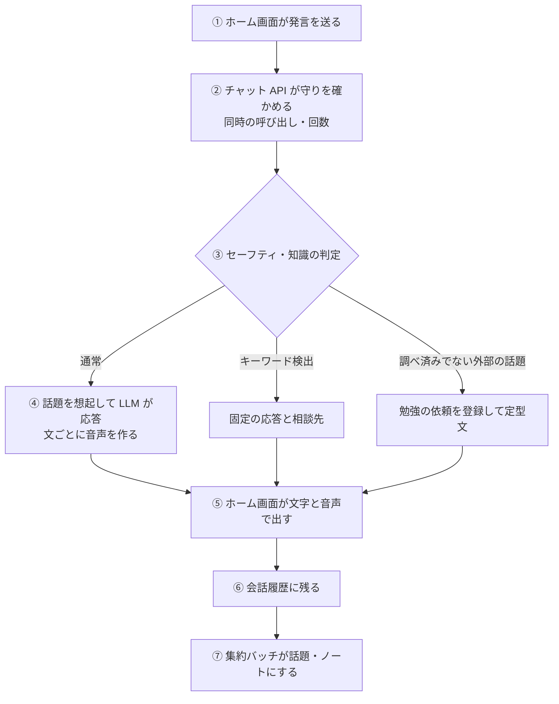
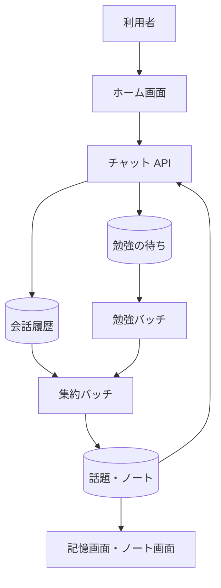

# 会話の経路

利用者が発言してから応答が返るまでと、その会話が記憶・ノート・勉強に変わっていくまでの流れ。応答は同期で返し、記憶への集約は別のバッチが後から行う。

## 起点

- 利用者が[ホーム画面](../screen/home.md)で発言を送る

## 経路

1. **送信**: 画面が `POST /api/chat` に発言と[キャラクター](../term/character.md)を送る
2. **守り**: 同じ利用者の同時の呼び出しは 1 本、回数は 1 分 10 回・1 時間 100 回まで。超えると 429 で、画面はやわらかい文言に置き換えて見せる ([チャット API](../api/chat.md))
3. **判定**: 発言を保存したあと、[セーフティ](../term/safety.md)のキーワードを見る。当たれば LLM を使わず固定の応答を返す。そうでなければ話題を想起し、調べ済みの話題がなく外部の知識が要ると判定されたときは、[勉強の依頼](../term/study-topic.md)を登録して「勉強しておくね」の定型文を返す
4. **応答**: 想起した[話題](../term/topic.md)と直近のノートを文脈に、LLM の応答を[チャットのイベント](../term/chat-event.md)として流す。文の区切りごとに音声を作り、LLM のあとに順に返す。応答を Moderation で検査し、止めたときは差し替える。想起した話題で期限切れの WEB fact があれば、[鮮度確認の依頼](../term/freshness-check-request.md)を記録する
5. **表示**: 画面が文字を逐次表示し、音声を順に再生する。再生が終わると待機に戻る
6. **保存**: 発言と応答を会話履歴に保存する (90 日で自動削除)
7. **その後**: 集約バッチが、未集約の会話から話題の事実を作り、ノートの元にする ([集約バッチ](../batch/consolidate-conversations.md))。勉強の依頼と鮮度確認の依頼は、勉強バッチが調べて話題へ返す ([勉強バッチ](../batch/acquire.md))。利用者は、集約された事実を[記憶画面](../screen/memory.md)で、贈られたノートを[ノート一覧画面](../screen/notes.md)で見る

## 届く先

- **ホーム画面**: 応答の文字と音声、キャラクターの口の動き、セーフティの相談先
- **会話履歴**: 以降の会話の文脈と、集約バッチの入力
- **勉強の待ち**: 勉強バッチの入力

## 失敗・取りこぼしのとき

- 想起・知識の判定・ノートの取得・Moderation・親密度の更新が失敗しても、会話は続ける
- 音声を作れなかった文は、文字だけが残る
- 守りの保存先が使えないときは、数えずに通す
- 通信の失敗や `error` は、画面が共通の文言を出し、入力欄の文章を残す。画面は失敗を Admin へ報告する ([エラー通知の経路](../../admin/flow/error-notification.md))
- 集約が追いつくまで、記憶画面とノートには反映されない

## つながり

