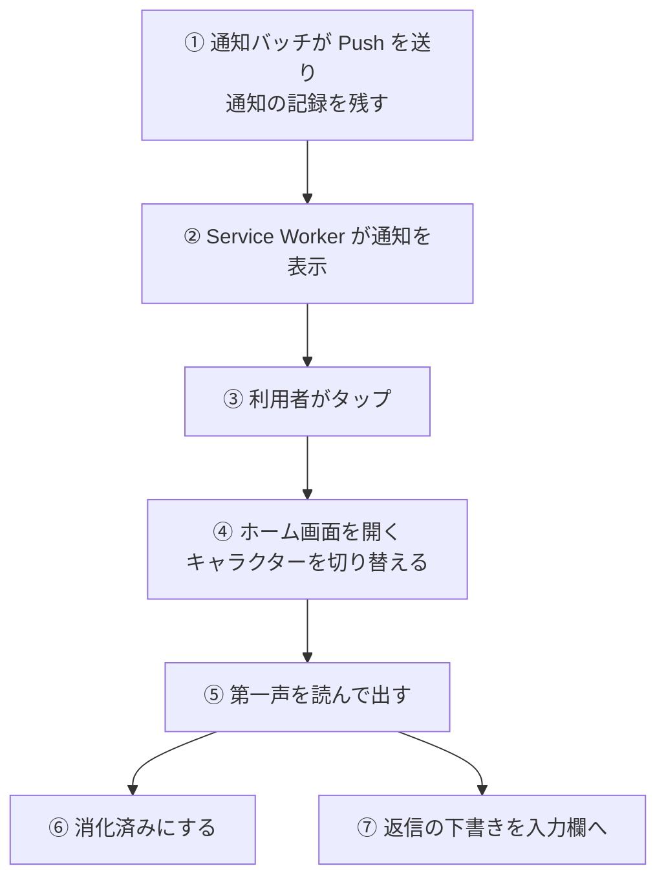
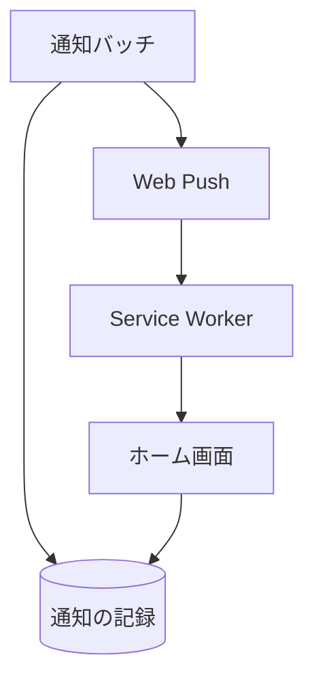

# 通知から会話への経路

キャラクターが送った Web Push を利用者がタップしてから、ホーム画面でそのキャラクターの第一声が出て、返信の下書きが入るまでの流れ。

## 起点

- 通知バッチが、利用者の購読すべてに Web Push を送り、[通知の記録](../term/notification-event.md)を残す ([通知バッチ](../batch/notify.md))
- 管理者がステータス画面からテスト通知を送る経路も、同じ形の記録を残す

## 経路

1. **送信**: Push の内容は題名と本文、開く先 `/?character={ID}&from=push`、キャラクターの ID。記録には、返信の下書き (`suggestedReply`) も持たせる
2. **表示**: Service Worker が通知を出す。同じ種類の通知は、1 つにまとまる (同じ `tag`)
3. **タップ**: 開いているリブトークの窓があればその窓を開く先へ移し、なければ新しく開く
4. **起動**: ホーム画面が `?character=` を読み、通知元のキャラクターに切り替える ([ホーム画面](../screen/home.md))
5. **第一声**: そのキャラクターの未消化の最新の通知を読み、本文を応答の欄に出す ([通知まわりの API](../api/push-notification.md))
6. **消化**: 読めたら、すぐ消化済みにする。次に開くときは、同じ第一声は出ない
7. **下書き**: `from=push` で、返信の下書きがあれば、入力欄へ入れる。送信は利用者が押す。自動で送らないのは、音声の再生が利用者の操作を要するため

## 届く先

- **ホーム画面**: 通知元のキャラクターの第一声と、入力欄の下書き
- 通知をタップせずに開いた場合も、そのキャラクターの未消化の通知は第一声になる。他のキャラクターの未消化の通知は、「{名前}から連絡が来てるよ」と知らせるだけで、消化はしない

## 失敗・取りこぼしのとき

- 購読が無効 (404、410) の宛先は、送信のときに削除される
- 消化済みにする呼び出しの失敗は、画面が無視する。次に開くときに、同じ第一声がもう一度出ることがある
- 通知の記録は 30 日で自動削除される。通知を見ないまま消えたものは、第一声にならない

## つながり

