# ホーム画面 (チャット)

[キャラクター](../term/character.md)と文字で話し、応答を文字と音声で受け取る、リブトークの主な画面。同意、通知の案内、相談先の表示、キャラクターの切り替え、退会もここから行う。

## 入口

- パスは `/`。サービスを開いたとき、ヘッダーのタイトル (「リブトーク」)、ノート一覧画面の「チャットに戻る」から来る
- 通知をタップして開くときは `/?character={ID}&from=push`。通知元のキャラクターに切り替わる ([通知から会話への経路](../flow/notification-open.md))

## 表示の条件

- `livetalk:chat` を持つ利用者だけ ([権限とロール](../term/permission.md))。権限がなければ[権限なし画面](./forbidden.md)へ移る
- [同意](../term/consent.md)がない間は、同意のダイアログを出し、入力欄を使えなくする

## 表示するもの

| 部分 | 内容 |
|---|---|
| ヘッダー (全画面共通) | タイトル「リブトーク」。メニューに「私が覚えていること」([記憶画面](./memory.md))、「ノート」([ノート一覧画面](./notes.md))、`livetalk:admin` を持つ利用者には「ステータス」([ステータス画面](./status.md))。右端のアカウントメニューに「ログアウト」と「退会・データ削除」 |
| キャラクター選択 | 「キャラ：{名前}」のボタン。応答中は押せない |
| キャラクターの描画 | 選んだキャラクターの Live2D か一枚絵。下に状態の文字 (待機中、考え中…、話している) |
| 会話の領域 | 利用者の発言と応答の吹き出し (ない間は「メッセージを入力すると、{名前}がお話しします。」)、エラー、案内、他のキャラクターからの知らせ。長くなると、この領域の中でスクロールし、新しい発言の位置へ移る |
| 入力欄 | 「メッセージ」。200 文字まで。「送信」ボタン。空白だけは送れない |
| お知らせの設定 | 「お知らせを受け取る」のボタン |
| フッター | バージョン、「プライバシーポリシー」と「利用規約」(ダイアログで開く。[規約](./terms.md)・[プライバシーポリシー](./privacy.md)と同じ内容)、キャラクターのライセンス表記 |

- 描画の方式は、キャラクターごとに決まる。ひよりは Live2D、アゲハは一枚絵で、音声に合わせて口が動く
- 就寝中のキャラクターは、Live2D の目が半開きになる。生活サイクルは画面を開いたときとキャラクターを切り替えたときに読み、応答の `lifecycle` でも更新する ([生活サイクル API](../api/lifecycle.md))。取得に失敗したときは、起きているものとして扱う

## 状態

- 同意を確かめている間は、入力欄が使えない。未同意のとき、同意の取得に失敗したときは、同意のダイアログを出す
    - 「利用規約に同意する」「プライバシーポリシーに同意する」「18 歳以上である (自己申告)」の 3 つにすべてチェックすると「利用開始」が押せる。規約とポリシーのリンクは別のタブで開く
    - 送信に失敗したときは、ダイアログの中に「同意の送信に失敗しました。時間を置いて再試行してください。」を出す
- 応答待ちのときは、状態が「考え中…」になり、入力欄と送信ボタンと、キャラクター選択が使えなくなる。応答が流れ始めると「話している」になり、音声の再生が終わると待機に戻る
- 送信に失敗したときは、会話の領域に文言を出し、入力欄の文章は残す

| 失敗 | 画面の文言 |
|---|---|
| 呼び出しが多すぎる (`RATE_LIMIT_EXCEEDED`) | 「たくさん話してくれてありがとう。ちょっとだけ休憩させてね。少し時間を置いてからまた話しかけてね」 |
| 別の応答を処理中 (`CONCURRENT_REQUEST`) | 「いま別のお返事を考えてるところだよ。終わるまで少し待ってね」 |
| それ以外 (通信の失敗、`error` イベントを含む) | 「ちょっとごめんね、今うまく話せないみたい。少ししてからもう一度話しかけてね」 |

- 音声の再生に失敗したときは「音声再生中にエラーが発生しました。」を出す
- 通知の案内は、同意のあとに出す。どちらも「あとでね」で閉じると 3 日は出さない (ローカルストレージに記録)。応答かエラーが画面に出た時点でも、その場の案内は閉じる (記録はしない)
    - ブラウザで開いているとき (ホーム画面に追加していない) は、ホーム画面に追加する案内を出す。iOS では共有ボタンからの手順、それ以外は「ホーム画面に追加する」のボタン
    - ホーム画面に追加した状態で、Push に対応し、通知が未許可のときは、「通知を許可する」のボタンを出す。許可できると「やった！これでいつでも話せるね」を 4 秒出す
- 「お知らせを受け取る」は、Push に対応するブラウザだけに出る。購読済みなら「お知らせを受け取る設定になっているよ」に変わる。ブラウザが通知を拒否しているときは「ブラウザの設定から通知を許可してね」、失敗したときは「通知の設定に失敗しちゃった。あとでもう一度試してね」を添える

## 操作

| 操作 | 結果 |
|---|---|
| 画面を開く | 同意 ([同意 API](../api/consent.md))、生活サイクル ([生活サイクル API](../api/lifecycle.md))、第一声と他のキャラクターの未読の知らせ ([通知まわりの API](../api/push-notification.md)) を読む |
| 送信 | 発言を[チャット API](../api/chat.md) へ送り、[チャットのイベント](../term/chat-event.md)を受けて、応答を文字と音声で出す。成功すると入力欄を空にする |
| 「キャラ：{名前}」 | 選択のダイアログを開く。登録のあるキャラクターを、名前、説明、モデル、音声とともにラジオボタンで並べる。「決定」で切り替え (ローカルストレージに残す)、「キャンセル」で閉じる |
| 利用開始 | 同意を[同意 API](../api/consent.md) へ保存し、ダイアログを閉じる |
| 「お知らせを受け取る」「通知を許可する」 | 通知を許可させ、購読を[購読の API](../api/push.md) へ登録する |
| メニューの項目 | 記憶画面、ノート一覧画面、ステータス画面を開く |
| ログアウト | Auth サービスのサインアウトへ移る |
| 退会・データ削除 | 確認のダイアログを開く。削除する範囲 (会話履歴、記憶データ、親密度、ノート、その他すべての個人データ) と、自傷・自殺に関する検出ログだけは匿名化して残すことを示す。「削除範囲を理解し、復元できないことに同意します」にチェックすると「退会・削除する」が押せる。押すと[アカウント API](../api/account.md) で削除し、成功したら Auth のサインアウトへ移る。失敗したときは、ダイアログの中に「退会処理に失敗しました。時間を置いて再度お試しください。」を出し、閉じない |

- 応答に `safety` があると、「相談できる場所があるよ」のダイアログを出す ([セーフティ](../term/safety.md))。相談先は名前、説明、電話 (`tel:` のリンク)、詳細のリンクで並べ、緊急時 (119) は赤い枠で別に出す。「閉じる」で会話に戻る。出力の検査で止めたときは、応答の文を差し替え文に置き換える
- 第一声: 画面を開いたとき、キャラクターを切り替えたときに、そのキャラクターの未消化の通知があれば、本文を応答の欄に出し、消化済みにする。`from=push` で開き、返信の下書きがあれば入力欄に入れる (送信は利用者が押す)。発言を送ると、第一声は消える
- 他のキャラクターに未消化の通知があるときは、画面を開いたときに 1 回だけ「{名前}から連絡が来てるよ」を出す。消化はしない
- 音声は、利用者の最初の操作で再生の準備をする。iOS Safari の自動再生の制限のため
- 送信や音声の失敗は、[クライアントログ API](../api/client-log.md) で Admin へ報告する

## 画面の見た目

画像は撮影用のデータで描いた例。撮影環境にはキャラクターの画像資材がないため、キャラクターの描画領域は空になる。

### 通常表示

同意済みで、案内を出していない状態。応答の欄は「メッセージを入力すると、桃瀬ひよりがお話しします。」。

| スマホ |
|---|
| 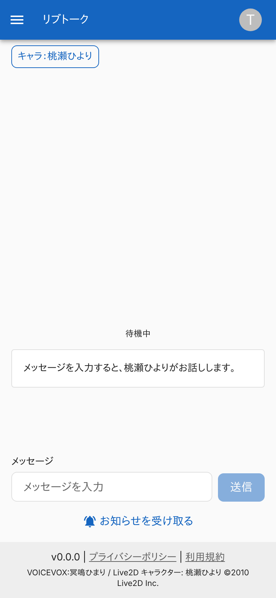 |

### 初回アクセス (同意のダイアログ)

3 つにチェックするまで「利用開始」は押せない。入力欄は使えない。

| スマホ |
|---|
| 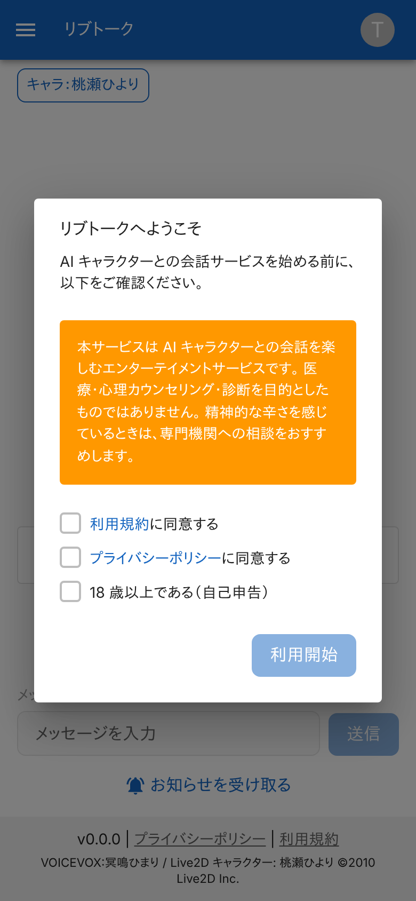 |

### 同意の送信に失敗したとき

3 つにチェックして「利用開始」を押したが、保存に失敗した例。

| スマホ |
|---|
| 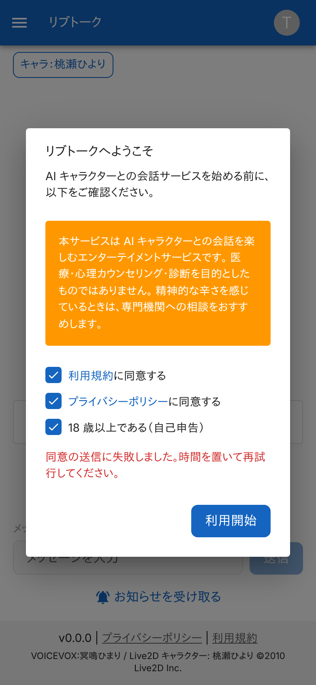 |

### ホーム画面に追加する案内

ブラウザで開いているとき。「あとでね」で 3 日は出さない。

| スマホ |
|---|
| 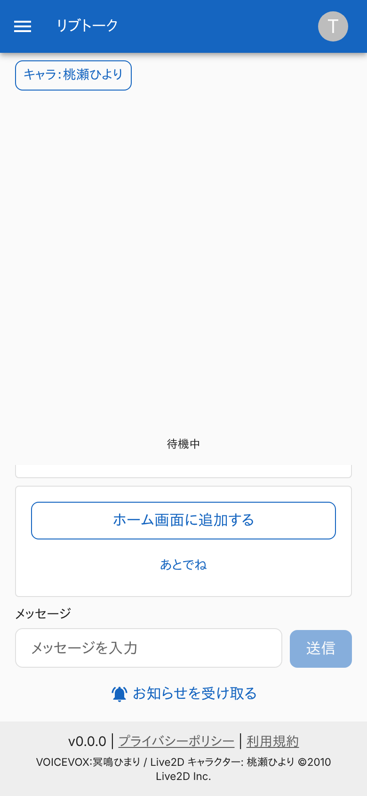 |

### 通知を許可する案内

ホーム画面に追加した状態で、通知が未許可のとき。

| スマホ |
|---|
| 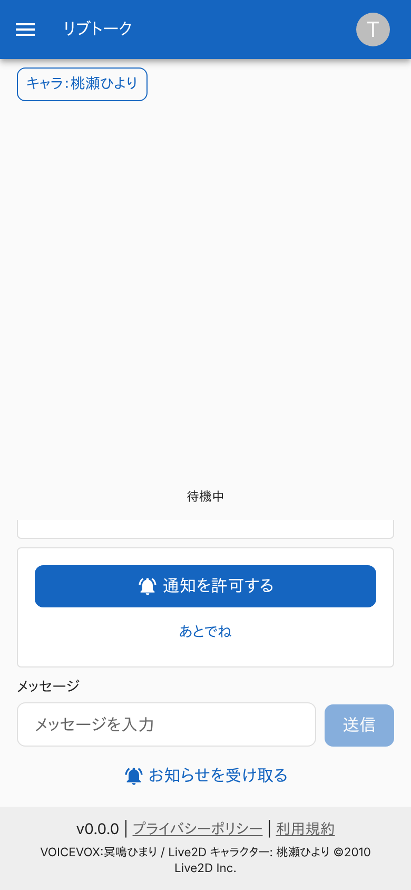 |

### お知らせを受け取る設定のとき

購読済みの表示。

| スマホ |
|---|
| 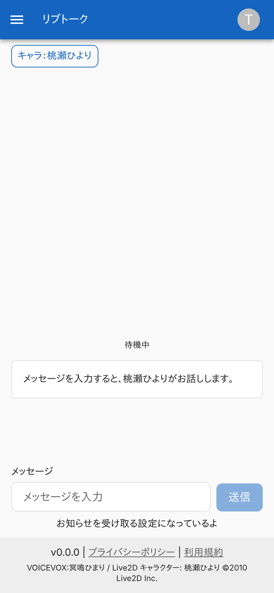 |

### ブラウザで通知を拒否しているとき

ボタンを押したあとの表示。

| スマホ |
|---|
| 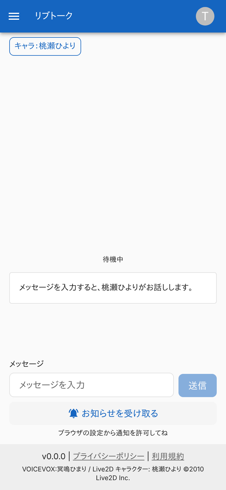 |

### 応答待ち

状態が「考え中…」になり、入力欄が使えない。

| スマホ |
|---|
| 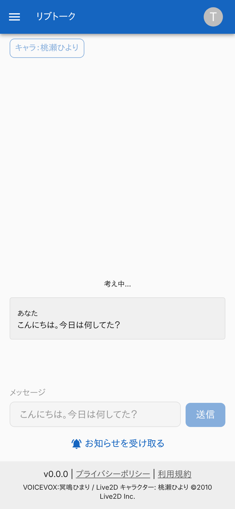 |

### 応答が届いたとき

発言と応答の吹き出しが並ぶ。会話の領域の中でスクロールし、最新の位置を見せる。

| スマホ |
|---|
| 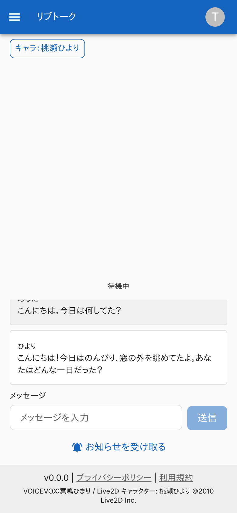 |

### 呼び出しが多すぎるとき

文言を出し、入力欄の文章は残る。

| スマホ |
|---|
| 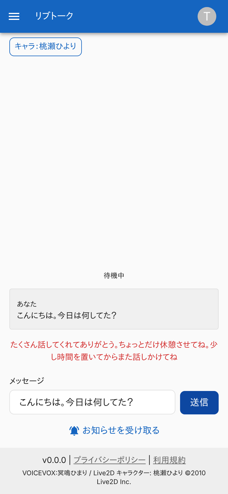 |

### 応答に失敗したとき

汎用の文言を出す。

| スマホ |
|---|
| 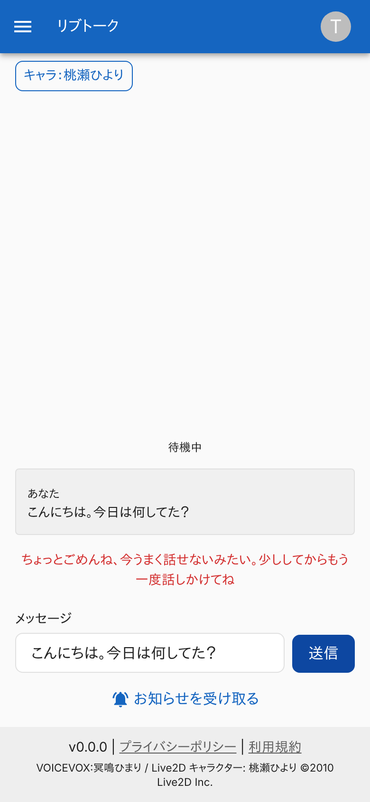 |

### セーフティの介入

発言に当たったとき。キャラクターの口調の応答のあと、相談先のダイアログを出す。

| スマホ |
|---|
| 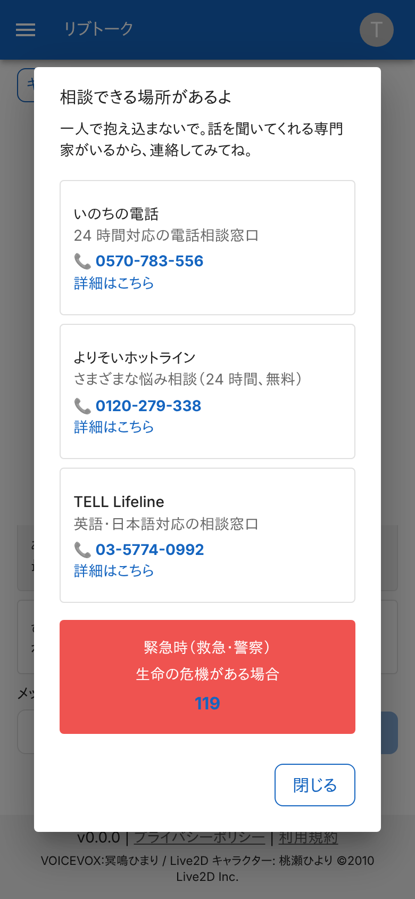 |

### 通知から開いたとき

通知の本文を第一声として出し、返信の下書きを入力欄へ入れる。

| スマホ |
|---|
| 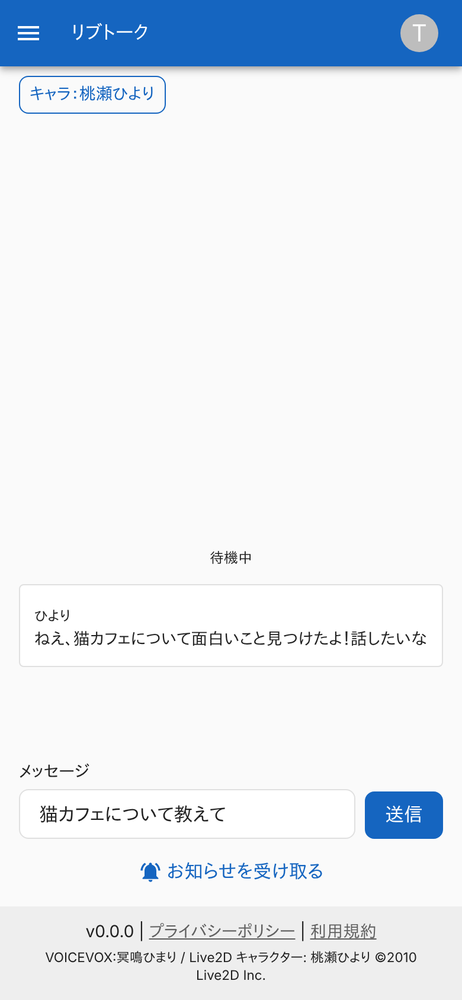 |

### 別のキャラクターから連絡が来ているとき

応答の欄の下に知らせを出す。

| スマホ |
|---|
| 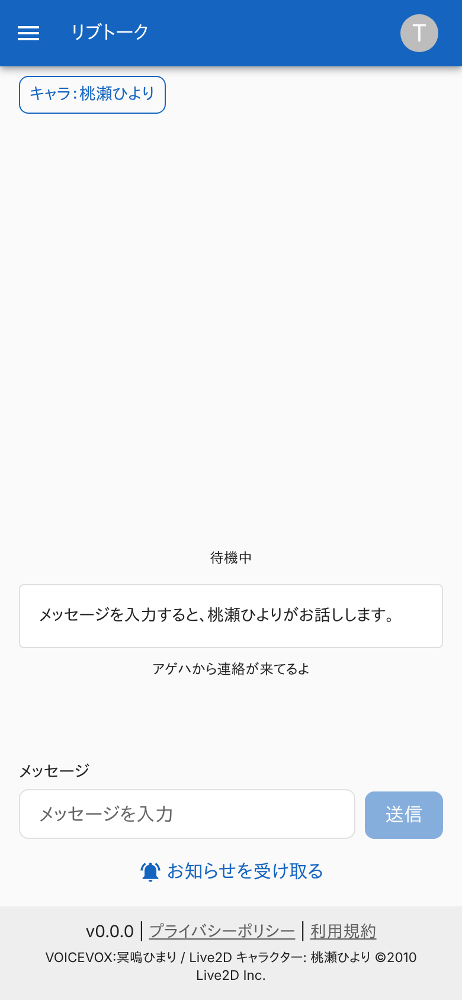 |

### キャラクターを選ぶダイアログ

2 人を、説明とモデル・音声の名前つきで並べる。

| スマホ |
|---|
| 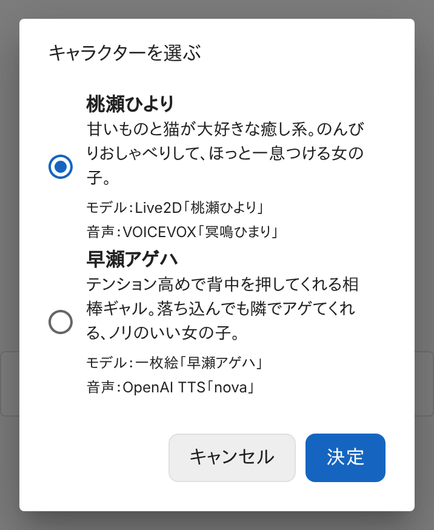 |

### ヘッダーのメニュー

`livetalk:chat` だけを持つ利用者。

| スマホ |
|---|
| 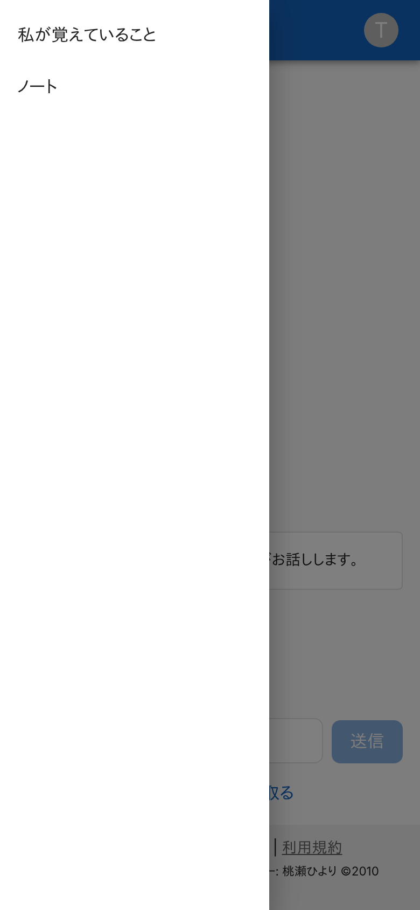 |

### ヘッダーのメニュー (livetalk:admin)

「ステータス」が加わる。

| スマホ |
|---|
|  |

### アカウントのメニュー

「ログアウト」と「退会・データ削除」。

| スマホ |
|---|
| 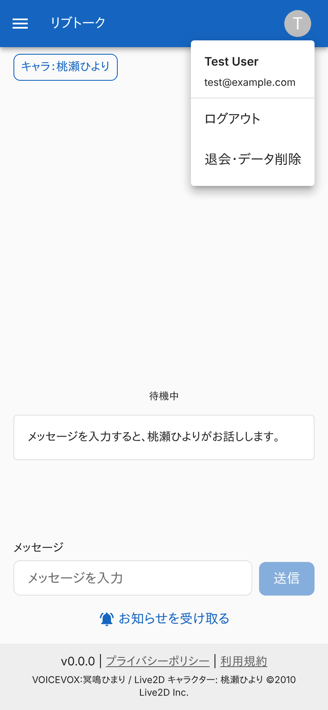 |

### 退会・データ削除の確認

チェックするまで「退会・削除する」は押せない。

| スマホ |
|---|
| 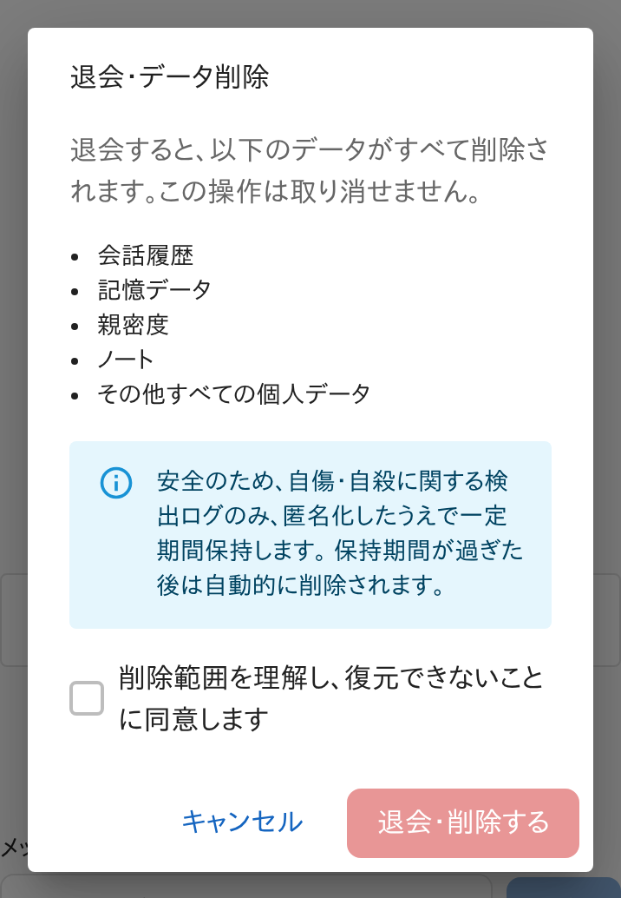 |

### 退会の処理に失敗したとき

ダイアログを閉じず、エラーを出す。

| スマホ |
|---|
| 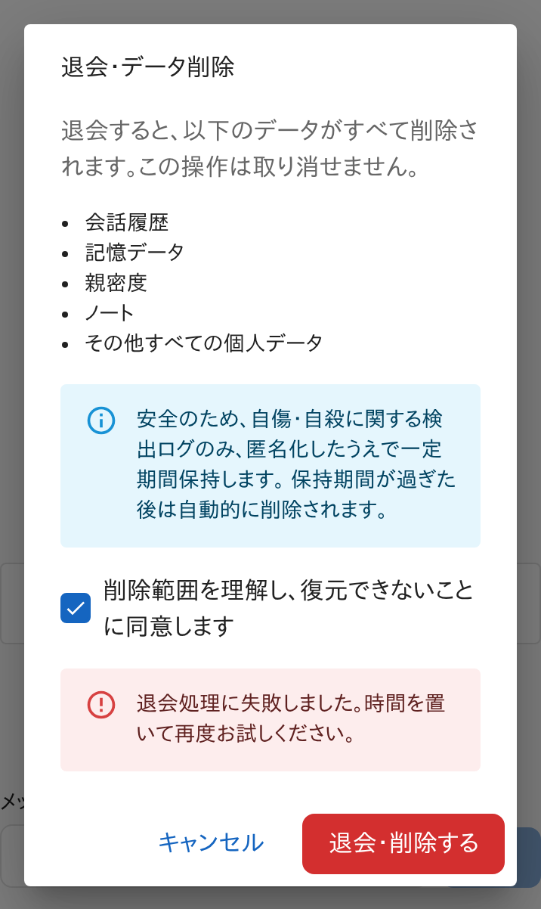 |

## つながり

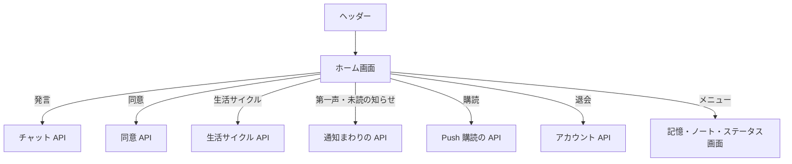
