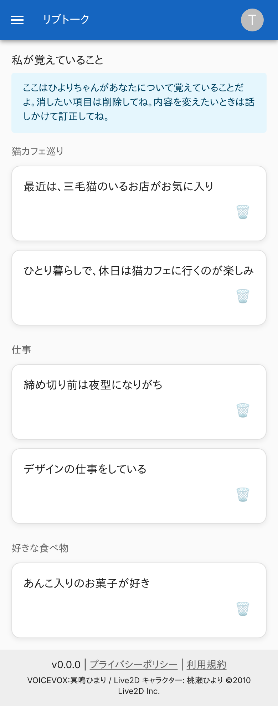
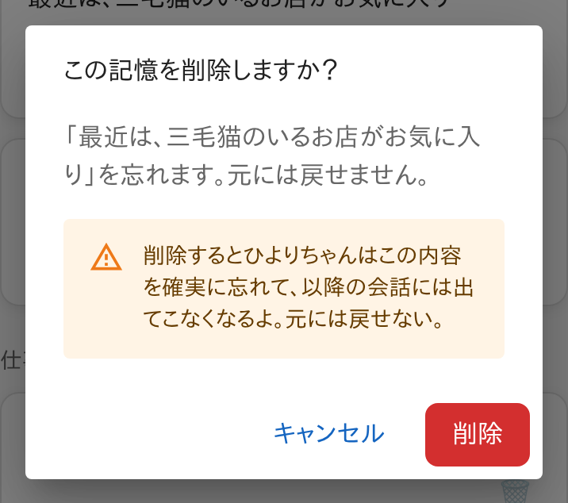
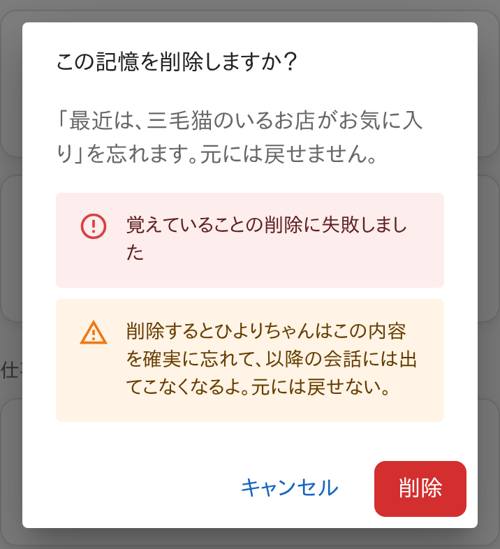
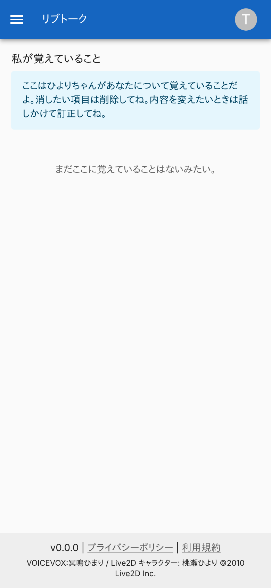
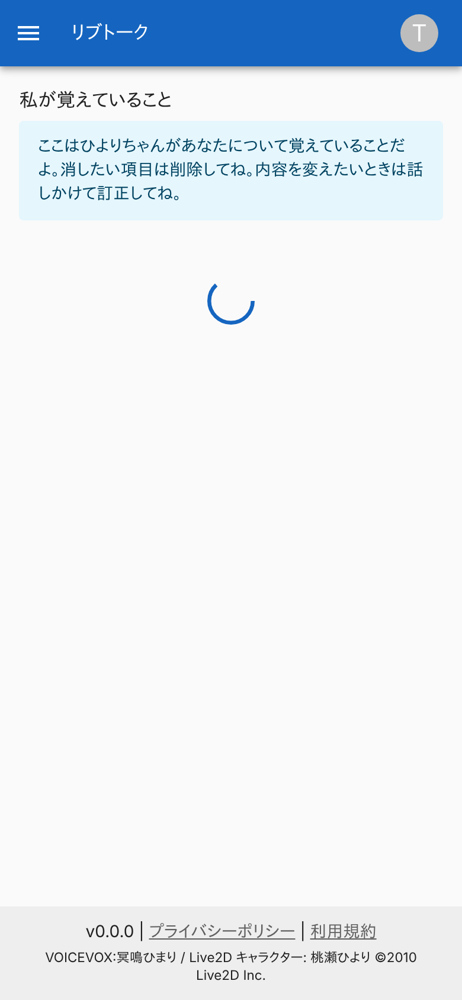
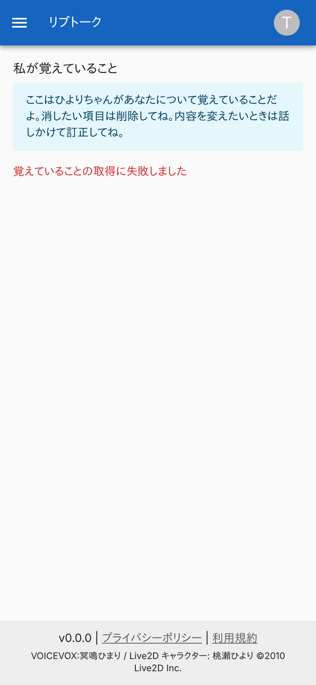
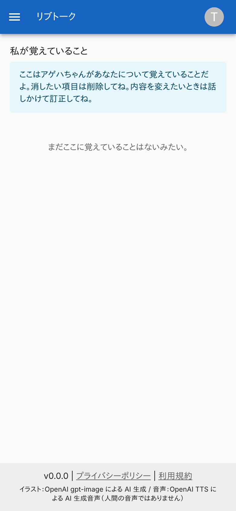
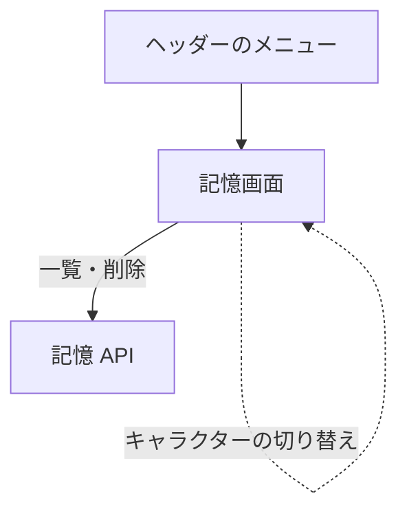

# 記憶画面

キャラクターが利用者について覚えていること ([SELF fact](../term/self-fact.md)) を、話題ごとにまとめて並べ、1 件ずつ削除できる画面。

## 入口

- パスは `/memory`。ヘッダーのメニューの「私が覚えていること」から来る

## 表示の条件

- `livetalk:chat` を持つ利用者だけ ([権限とロール](../term/permission.md))
- 選んでいる[キャラクター](../term/character.md)の記憶だけを出す。キャラクターを切り替えると読み直す

## 表示するもの

| 部分 | 内容 |
|---|---|
| 見出し | 「私が覚えていること」 |
| 案内 | 「ここは{名前}ちゃんがあなたについて覚えていることだよ。消したい項目は削除してね。内容を変えたいときは話しかけて訂正してね。」 |
| 一覧 | 話題の主題 ([Topic](../term/topic.md)) の見出しごとに、その SELF fact の文を並べる。作成日時の新しい順で、最初に出る項目の話題が先頭。各項目に削除のボタン |

- 編集の機能はない。内容を変えるときは、会話で訂正する
- 調べた内容 (WEB fact) は出さない

## 状態

- 読み込み中は、読み込みの表示を出す
- 0 件のときは「まだここに覚えていることはないみたい。」
- 取得に失敗したときは、赤い文字で「覚えていることの取得に失敗しました」を出し、空の文言は出さない

## 操作

| 操作 | 結果 |
|---|---|
| 削除のボタン | 確認のダイアログを開く。「この記憶を削除しますか？」「「{文}」を忘れます。元には戻せません。」と、削除すると以降の会話に出てこなくなり、元に戻せない旨の注意を出す |
| 確認の「削除」 | [記憶 API](../api/memory.md) で削除し、一覧を読み直してダイアログを閉じる。削除に失敗したときは、ダイアログの中に「覚えていることの削除に失敗しました」を出し、閉じない |
| 「キャンセル」 | 閉じる |

## 画面の見た目

### 通常表示

話題ごとにまとまる。

| スマホ |
|---|
|  |

### 削除の確認

削除の影響を注意として添える。

| スマホ |
|---|
|  |

### 削除に失敗したとき

ダイアログの中にエラーを出す。

| スマホ |
|---|
|  |

### 覚えていることがないとき

空の文言を出す。

| スマホ |
|---|
|  |

### 読み込み中

応答を待っている間。

| スマホ |
|---|
|  |

### 取得に失敗したとき

エラーだけを出す。

| スマホ |
|---|
|  |

### 別のキャラクターを選んでいるとき

案内の名前がキャラクターに合わせて変わる。

| スマホ |
|---|
|  |

## つながり

