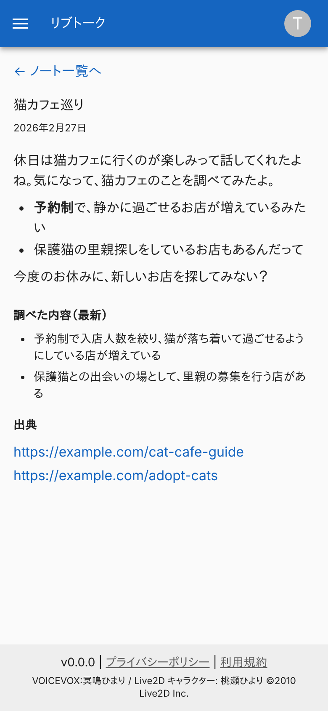
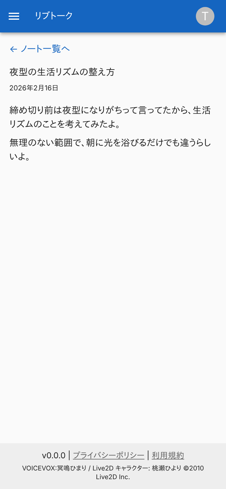
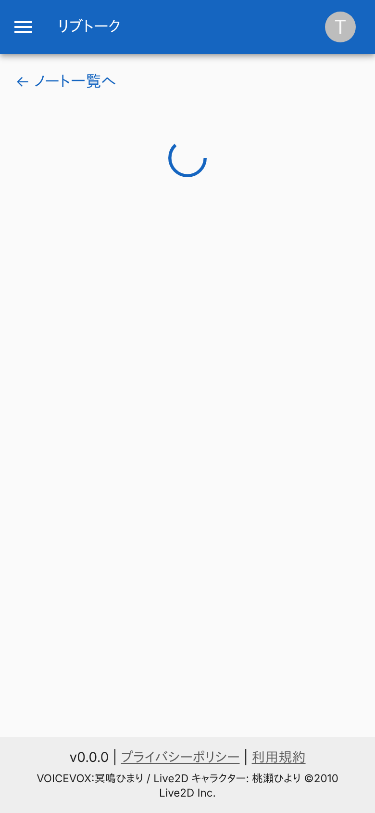
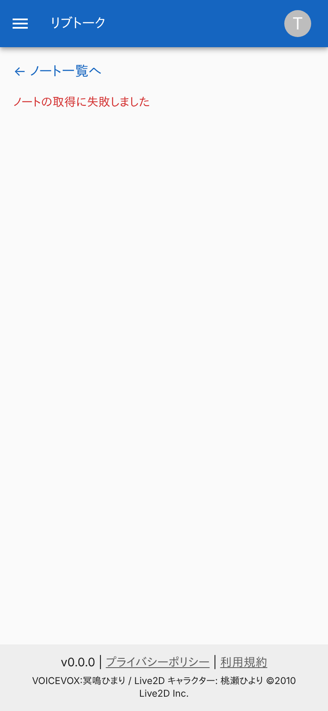
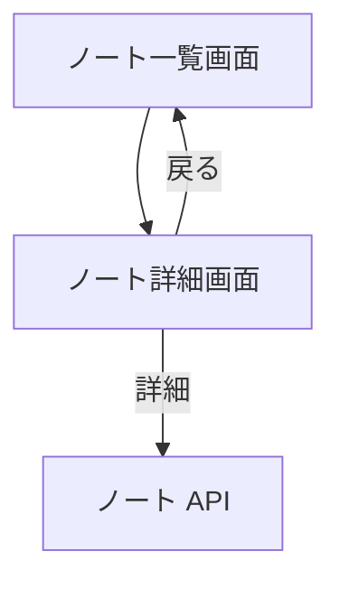

# ノート詳細画面

1 件の[ノート](../term/note.md)の、手紙の文面と、調べた内容、出典を見せる画面。

## 入口

- パスは `/notes/{ID}`。ノート一覧画面のカードから来る

## 表示の条件

- `livetalk:chat` を持つ利用者だけ ([権限とロール](../term/permission.md))

## 表示するもの

| 部分 | 内容 |
|---|---|
| 戻るリンク | 「← ノート一覧へ」 |
| 見出し | 主題 (贈った時点のもの) と、贈った日 |
| 手紙 | 贈った時点の文面。Markdown として描く (太字、リスト、リンクなど)。リンクは別のタブで開く |
| 調べた内容 (最新) | 参照先の[話題](../term/topic.md)の、今の [WEB fact](../term/web-fact.md)。箇条書き |
| 出典 | 上の調べた内容の出典の URL。リンク |

- 手紙は変わらないが、調べた内容と出典は、開くたびに参照先の話題の最新を読む
- 調べた内容と出典は、あるときだけ出す。参照先の話題を読めなかったときは、手紙だけになる

## 状態

- 読み込み中は、読み込みの表示を出す
- 取得に失敗したときは、赤い文字で「ノートの取得に失敗しました」を出す。ノートがない (404) ときも同じ文言になる

## 操作

| 操作 | 結果 |
|---|---|
| ← ノート一覧へ | [ノート一覧画面](./notes.md)を開く |
| 出典のリンク | 出典の URL を別のタブで開く |

- ノートは [ノート API](../api/notes.md) で読む

## 画面の見た目

### 通常表示

手紙、調べた内容、出典。

| スマホ |
|---|
|  |

### 手紙だけのとき

参照先の話題を読めなかったとき。調べた内容と出典は出ない。

| スマホ |
|---|
|  |

### 読み込み中

応答を待っている間。

| スマホ |
|---|
|  |

### ノートが見つからないとき

取得の失敗と同じ文言。

| スマホ |
|---|
|  |

## つながり

