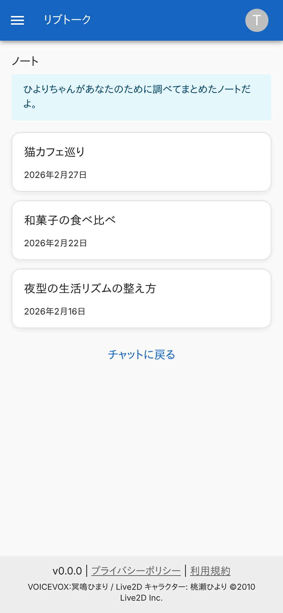
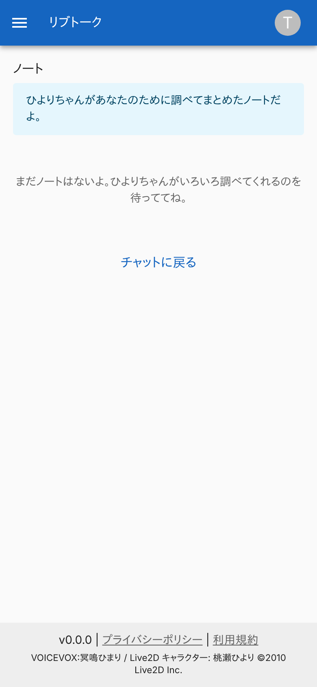
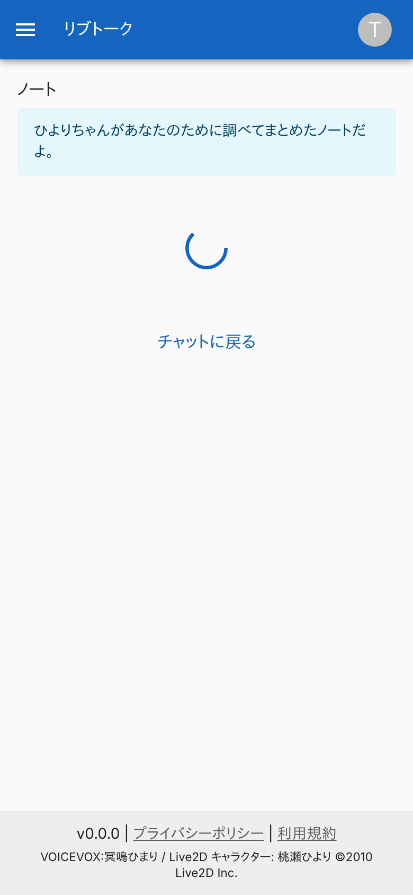
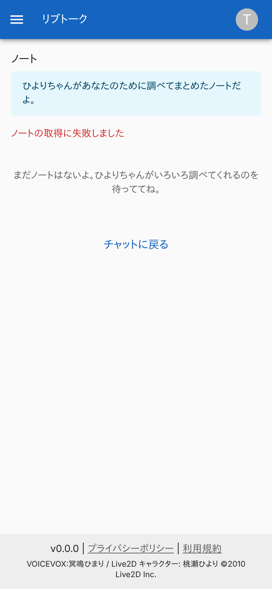
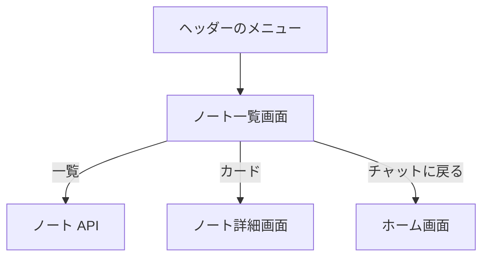

# ノート一覧画面

キャラクターが利用者のために調べてまとめた[ノート](../term/note.md)を、贈られた日の新しい順に並べる画面。

## 入口

- パスは `/notes`。ヘッダーのメニューの「ノート」から来る。ノート詳細画面の「← ノート一覧へ」からも戻る

## 表示の条件

- `livetalk:chat` を持つ利用者だけ ([権限とロール](../term/permission.md))
- 選んでいる[キャラクター](../term/character.md)のノートだけを出す。切り替えると読み直す

## 表示するもの

| 部分 | 内容 |
|---|---|
| 見出し | 「ノート」 |
| 案内 | 「{名前}ちゃんがあなたのために調べてまとめたノートだよ。」 |
| 一覧 | ノートごとのカード。主題 (贈った時点のもの) と、贈った日 (「2026年2月27日」の形) |
| 下部 | 「チャットに戻る」のリンク ([ホーム画面](./home.md)) |

## 状態

- 読み込み中は、読み込みの表示を出す
- 0 件のときは「まだノートはないよ。{名前}ちゃんがいろいろ調べてくれるのを待っててね。」
- 取得に失敗したときは、赤い文字で「ノートの取得に失敗しました」を出す。一覧は空として扱うので、空の文言も続けて出る

## 操作

| 操作 | 結果 |
|---|---|
| カード | [ノート詳細画面](./note-detail.md)を開く |
| チャットに戻る | [ホーム画面](./home.md)を開く |

- ノートは [ノート API](../api/notes.md) で読む。編集や削除の操作はない

## 画面の見た目

### 通常表示

贈られた日の新しい順。

| スマホ |
|---|
|  |

### ノートがないとき

空の文言を出す。

| スマホ |
|---|
|  |

### 読み込み中

応答を待っている間。

| スマホ |
|---|
|  |

### 取得に失敗したとき

エラーのあとに空の文言も出る。

| スマホ |
|---|
|  |

## つながり

