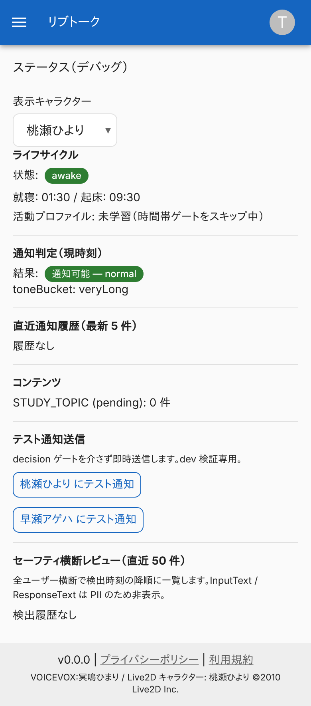
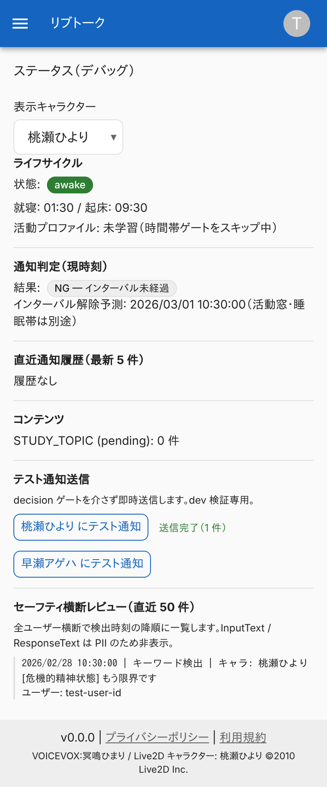
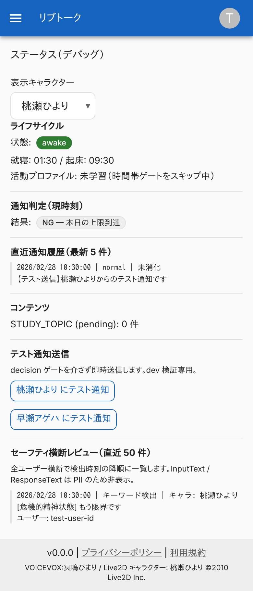
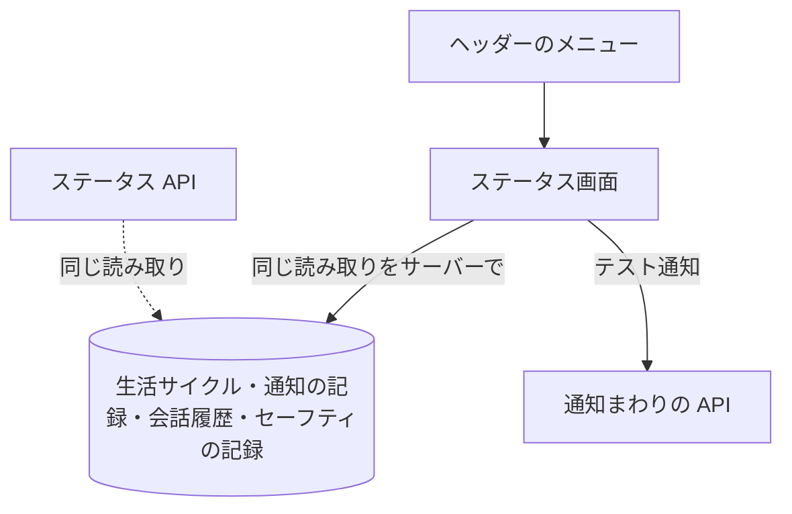

# ステータス画面

管理者向けに、キャラクターの生活サイクルと通知の判定、通知の履歴、テスト送信、セーフティの検出の横断レビューを 1 画面に並べる運用の画面。

## 入口

- パスは `/status`。ヘッダーのメニューの「ステータス」から来る (`livetalk:admin` を持つ利用者にだけ出る)
- 問い合わせ `characterId` で、見るキャラクターを決める。省略または登録外のときは `hiyori`

## 表示の条件

- `livetalk:admin` を持つ利用者だけ ([権限とロール](../term/permission.md))。持たなければ「アクセス権限がありません」を出し、何も読まない。「アクセスを更新」と「再ログイン」のボタンが付く (Auth サービスへ移る)
- 画面はサーバーで描く。[ステータス API](../api/status.md) は呼ばず、同じ読み取りをサーバーで直接行う

## 表示するもの

| 部分 | 内容 |
|---|---|
| 表示キャラクター | 選択。変えると `/status?characterId=` を開き直す |
| ライフサイクル | 状態 (`awake` か `sleeping`)、就寝と起床の時刻、[活動時間プロファイル](../term/user-activity-profile.md) (朝と夕のピーク、サンプルの件数、最終学習。なければ「未学習」) |
| 通知判定 (現時刻) | 今この時刻に平常通知を出せるか。出せるときは種別と口調の区分、出せないときは理由 (インターバル未経過、活動時間帯外、睡眠帯、本日の上限到達、長期不在 (通知停止)、コンテンツなし)。インターバル未経過のときは、解除される目安の日時 (活動時間帯と睡眠帯は別) |
| 直近通知履歴 | 最新 5 件の[通知の記録](../term/notification-event.md)。日時 (日本時間、秒まで)、種別、消化の有無、本文の先頭 100 文字 |
| コンテンツ | 勉強の待ちの件数 |
| テスト通知送信 | キャラクターごとのボタン。判定を介さず、その場で送る |
| セーフティ横断レビュー | 直近 50 件の検出を、全利用者を横断して新しい順に並べる。日時、トリガー (キーワード検出か Moderation)、キャラクター、検出したパターン、利用者の ID。入力の文と応答の文は出さない |

- 通知判定は、通知バッチの平常通知の判定と同じ関数を使う ([通知バッチ](../batch/notify.md))
- 日時は、サーバーが画面を描いた時刻を基準にする。画面を開き直すまで更新されない

## 状態

- 通知の履歴がないときは「履歴なし」、セーフティの検出がないときは「検出履歴なし」
- 読み込みはサーバーで済ませるので、読み込み中の表示はない

## 操作

| 操作 | 結果 |
|---|---|
| 表示キャラクターを選ぶ | `/status?characterId={ID}` を開く |
| 「{名前} にテスト通知」 | [通知まわりの API](../api/push-notification.md) の `test` を呼ぶ。送信中は「送信中…」。結果は「送信完了（N 件）」、購読がなければ「購読なし（送信されませんでした）」、失敗は「エラー: …」 |

- テスト送信をしても、通知の履歴は自動では更新されない。画面を開き直すと反映される

## 画面の見た目

### 履歴がないとき

通知もセーフティの検出も記録がない。就寝中でなければ、通知は出せる判定になる。

| スマホ |
|---|
|  |

### テスト通知を送ったが購読がないとき

何も送らず、記録も残さない。

| スマホ |
|---|
|  |

### テスト通知を送れたとき

送れた件数を、ボタンの横に出す。

| スマホ |
|---|
|  |

### 通常表示

通知の履歴とセーフティの検出が並ぶ。通知を送った日は、1 日の上限に達した判定になる。

| スマホ |
|---|
|  |

### 権限がないとき (`user-manager`)

画面の内容は何も読まない。

| スマホ |
|---|
|  |

## つながり

