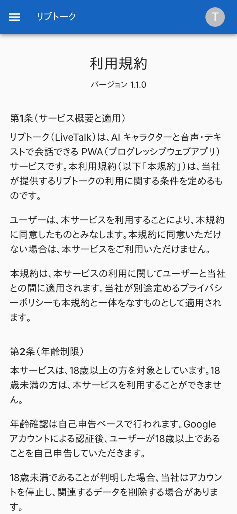
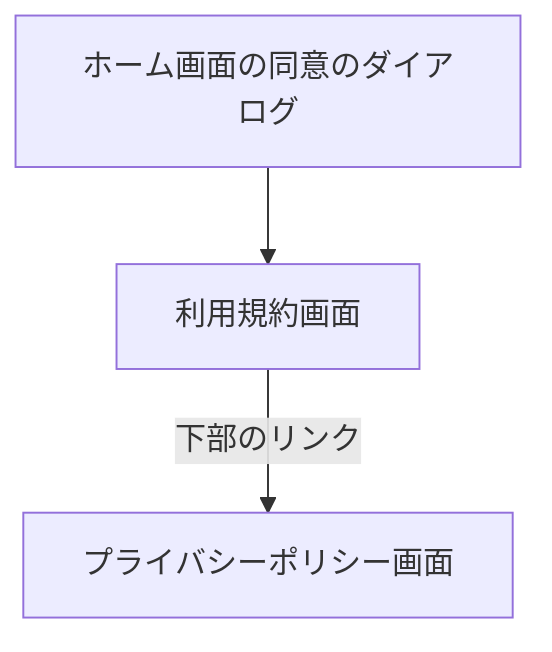

# 利用規約画面

リブトークの利用規約を載せた公開ページ。

## 入口

- パスは `/legal/terms`。ログインなしで開ける (ミドルウェアが `/legal/` 配下を通す)
- ホーム画面の同意のダイアログのリンク (別のタブで開く) から来る。もう一方のページの下部のリンクからも来る

## 表示するもの

- 見出し「利用規約」と「バージョン 1.1.0」
- 条文。利用規約は 12 条 (サービス概要と適用、年齢制限、利用登録・Google アカウント、AI の性質と医療目的でない旨、危機時の対応とリソース案内、禁止事項、データ取り扱い、データ削除請求、本サービスの提供停止・変更、免責事項、利用規約の変更、準拠法・裁判管轄)。条番号は並び順で振る
- 下部に、プライバシーポリシーへのリンク「プライバシーポリシーを見る」
- ホーム画面を含む全画面のフッターのリンクは、同じ内容を、このページへ移らずダイアログで開く

## 操作

| 操作 | 結果 |
|---|---|
| 「プライバシーポリシーを見る」 | [プライバシーポリシー画面](./privacy.md)を開く |

- バージョンは、[同意](../term/consent.md)で保存する版と同じ値

## 画面の見た目

### 通常表示

画面の上部。本文は長く、条文が続く。

| スマホ |
|---|
|  |

## つながり

