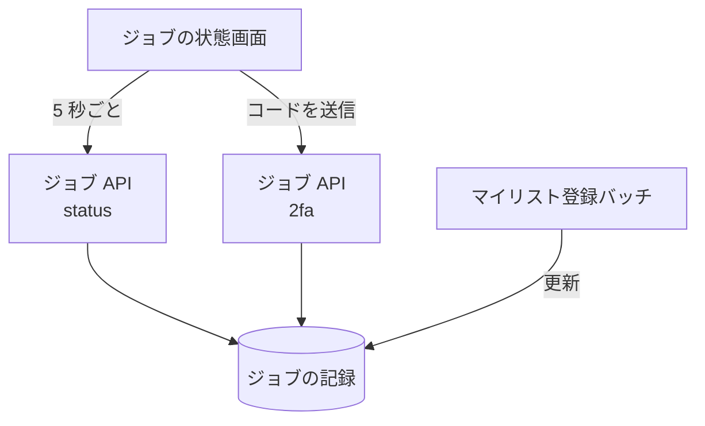

# ジョブ API

マイリスト登録の[ジョブ](../term/batch-job.md)の状態を読む API と、二段階認証のコードを登録する API。

## エンドポイント

| メソッド | パス | 権限 |
|---|---|---|
| GET | `/api/batch/status/{jobId}` | ログイン |
| POST | `/api/batch/2fa` | ログイン |

## 入力と出力

状態の取得 (`GET /api/batch/status/{jobId}`) は、自分が作ったジョブだけを返す。

- 応答は `{ jobId, status, createdAt, updatedAt, result?, completedAt? }`。日時は ISO 8601 の文字列。`result` と `completedAt` は、あるときだけ付く
- ジョブの記録は作成の 7 日後以降に消えるので、消えたあとは 404 になる

二段階認証コードの登録 (`POST /api/batch/2fa`) の入力は `{ jobId, code }`。

| 項目 | 条件 |
|---|---|
| `jobId` | 必須。文字列。自分のジョブ |
| `code` | 必須。6 桁の数字の文字列 (数値は受け付けない) |

- ジョブのステータスが `WAITING_FOR_2FA` のときだけ受け付け、ジョブの記録にコードを書く。ステータスは変えない。成功は `{ success: true, message }`
- コードを読んで使う処理は、今のバッチにはない。このため、通常はコードを送る場面がない (`WAITING_FOR_2FA` になるジョブがない)

## エラー

状態の取得。未ログインと想定外の失敗は形 C、ジョブがないときは形 A ([API のエラー応答](../term/api-error.md))。

| 条件 | 状態 | 応答 |
|---|---|---|
| 未ログイン | 401 | `error` が `UNAUTHORIZED`、`message` が「ログインが必要です」 |
| ジョブがない (ほかの利用者のジョブを含む) | 404 | `code` が `NOT_FOUND`、`message` が「バッチジョブが見つかりません」 |
| 想定外の失敗 | 500 | `error` が `INTERNAL_ERROR`、`message` が「内部エラーが発生しました」 |

二段階認証コードの登録 (形 A)。

| 条件 | 状態 | `code` |
|---|---|---|
| 未ログイン | 401 | `UNAUTHORIZED` |
| 本文が JSON のオブジェクトでない | 400 | `INVALID_REQUEST` |
| `jobId` か `code` がない | 400 | `INVALID_REQUEST` |
| `jobId` が文字列でない | 400 | `INVALID_REQUEST` |
| `code` が 6 桁の数字の文字列でない | 400 | `INVALID_CODE` |
| ジョブがない | 404 | `NOT_FOUND` |
| ステータスが `WAITING_FOR_2FA` でない | 400 | `INVALID_STATUS` |
| 想定外の失敗 | 500 | `DATABASE_ERROR` |

## つながり

