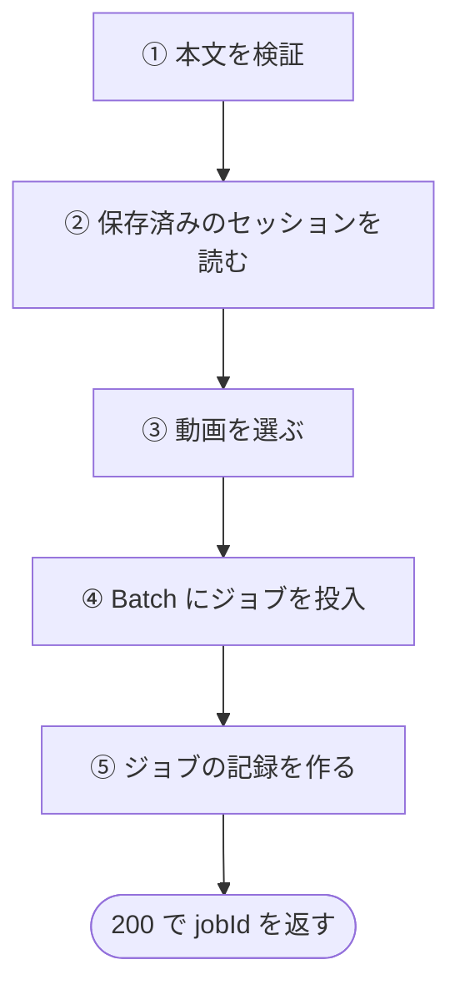
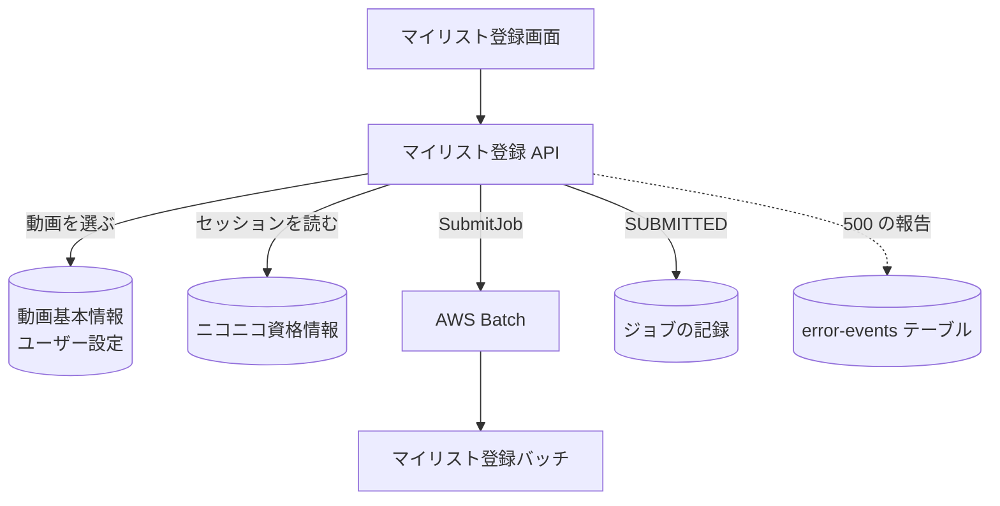

# マイリスト登録 API

登録する動画を条件に合わせてランダムに選び、AWS Batch にマイリスト登録のジョブを投入する。登録そのものはバッチが行い、この API は投入と記録の作成までで返る。

## エンドポイント

| メソッド | パス | 権限 |
|---|---|---|
| POST | `/api/mylist/register` | ログイン |
| POST | `/api/batch/submit` | ログイン (上と同じ処理。同じハンドラを再び公開している) |

## 入力と出力

| 項目 | 条件 |
|---|---|
| `maxCount` | 必須。1〜100 の整数 |
| `mylistName` | 必須。前後の空白を除いて 1〜50 文字 (コードポイントで数える) |
| `favoriteOnly` | 任意。真偽値。`true` ならお気に入りの動画だけを対象にする |
| `excludeSkip` | 任意。真偽値。`true` ならスキップの動画を対象から外す |
| `pushSubscription` | 任意。完了を知らせる Web Push の宛先。`endpoint` (URL)、`keys.p256dh`、`keys.auth` が要る |

- `favoriteOnly` と `excludeSkip` を省略すると、どちらも `false` と同じ (絞り込まない)。画面は `excludeSkip` を既定でオンにして送る
- 保存済みの[ニコニコセッション](../term/user-session.md)が要る。リクエストには含めず、サーバーが保存した値を使う。有効かどうかは、この API では確かめない (バッチの実行前に確かめる)
- 動画は、[動画 API](./videos.md) の一覧と同じ絞り込み (設定がない動画は、お気に入りでもスキップでもないとして扱う) の全件から、`maxCount` 件までを、偏りなくランダムに選ぶ (Reservoir Sampling)。対象が `maxCount` 件以下なら、全件を選ぶ
- 成功は 200 で、`{ jobId, status, message, estimatedVideos, selectedCount }`。`status` は `SUBMITTED`、`message` は「バッチジョブを投入しました」、`estimatedVideos` と `selectedCount` は選んだ件数

## 処理

| 手順 | 内容 |
|---|---|
| ④ 投入 | ジョブ名は `niconico-mylist-{利用者 ID}-{時刻}`。環境変数は `USER_ID`、`VIDEO_IDS` (選んだ動画 ID の JSON 配列)、`MYLIST_NAME` (前後の空白を除いた名前)、`ENCRYPTED_USER_SESSION` (保存済みの暗号化した値をそのまま)。キューと定義は Lambda の環境変数の値 |
| ⑤ 記録 | `jobId`、利用者、`SUBMITTED`、`pushSubscription` ([ジョブ](../term/batch-job.md)) |

- ⑤ の記録の作成に失敗しても、④ で投入したジョブは取り消さない。バッチは動き続けるが、記録がないので状態を更新できない。画面は 500 を受け取る

## エラー

形は C ([API のエラー応答](../term/api-error.md))。`error` にコード、`message` に日本語の文を返す。

| 条件 | 状態 | `error` |
|---|---|---|
| 未ログイン | 401 | `UNAUTHORIZED` |
| 本文が JSON のオブジェクトでない | 400 | `INVALID_REQUEST` |
| `maxCount` が数でない、整数でない、1〜100 の外 | 400 | `INVALID_REQUEST` |
| `mylistName` がない、文字列でない、空白だけ、50 文字を超える | 400 | `INVALID_REQUEST` |
| `favoriteOnly`、`excludeSkip` が真偽値でない | 400 | `INVALID_REQUEST` |
| `pushSubscription` の形が不正 | 400 | `INVALID_REQUEST` |
| セッションが保存されていない | 400 | `SESSION_NOT_REGISTERED` |
| 条件に合う動画が 0 件 | 400 | `NO_VIDEOS` |
| 動画の取得で DynamoDB のエラー | 500 | `DATABASE_ERROR` |
| 投入の結果にジョブ ID がない | 500 | `BATCH_ERROR` |
| ジョブの記録の作成に失敗 | 500 | `DATABASE_ERROR` |
| 投入の失敗などの想定外の失敗 | 500 | `BATCH_ERROR` |

- 500 は [ErrorEvent](../../platform/term/error-event.md) として Admin に報告する。題名は、動画の取得の失敗が「DynamoDB 動画取得失敗」、ジョブ ID がないときが「Batch ジョブ ID 未取得」、記録の作成の失敗が「DynamoDB バッチジョブレコード作成失敗」、それ以外が「Batch ジョブ投入エラー」 ([エラー通知の経路](../../admin/flow/error-notification.md))

## つながり

