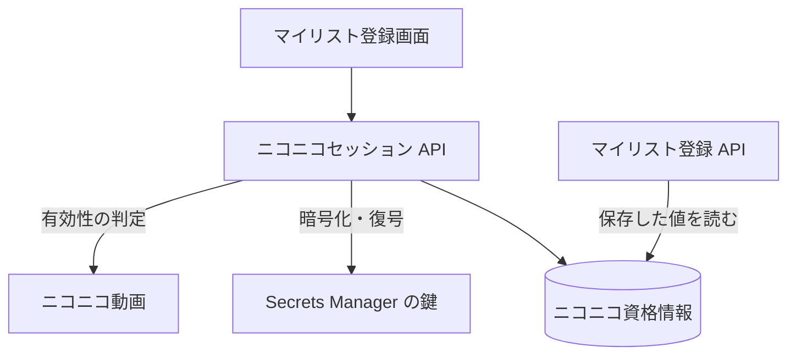

# ニコニコセッション API

利用者の[ニコニコセッション](../term/user-session.md)の状態を読み、検証して保存し、削除する。

## エンドポイント

| メソッド | パス | 権限 |
|---|---|---|
| GET | `/api/niconico/session` | ログイン |
| POST | `/api/niconico/session` | ログイン |
| DELETE | `/api/niconico/session` | ログイン |

## 入力と出力

状態の取得 (`GET`) は、保存したセッションを復号し、ニコニコ動画へ問い合わせて有効性を判定して返す。応答は `{ hasSession, validity, acquiredAt, estimatedExpiresAt }`。

| 項目 | 内容 |
|---|---|
| `hasSession` | 保存されているか |
| `validity` | `valid`、`invalid`、`unknown`。保存されていなければ付かない |
| `acquiredAt` / `estimatedExpiresAt` | 保存した日時と、推定有効期限 (保存の 30 日後)。epoch ミリ秒。保存されていなければ付かない |

- 呼ぶたびにニコニコ動画への問い合わせが走る。値は保存しておらず、毎回判定し直す
- 保存した値の JSON が読めない、復号できない場合は、失敗にせず `hasSession` を `true`、`validity` を `invalid` で返す

保存 (`POST`) の入力は `{ userSession }`。

| 項目 | 条件 |
|---|---|
| `userSession` | 必須。文字列 |

- 先にニコニコ動画で有効性を判定し、`valid` のときだけ暗号化して保存する (上書き)。`invalid` と `unknown` は保存しない
- 成功は `{ message, acquiredAt, estimatedExpiresAt }`。message は「ニコニコセッションを保存しました」

削除 (`DELETE`) は保存したセッションを消して、`{ message }` (「ニコニコセッションを削除しました」) を返す。保存されていなくても成功する。

- どの応答にも、セッションの値は含めない

## エラー

形 C ([API のエラー応答](../term/api-error.md))。`error` にコード、`message` に日本語の文を返す。

| 条件 | 状態 | `error` |
|---|---|---|
| 未ログイン | 401 | `UNAUTHORIZED` |
| 本文が JSON のオブジェクトでない (保存) | 400 | `INVALID_REQUEST_BODY` |
| `userSession` がない、または文字列でない (保存) | 400 | `INVALID_REQUEST` |
| セッションが無効 (保存) | 400 | `INVALID_SESSION` |
| 有効性を判定できない (保存) | 400 | `INDETERMINATE_SESSION` |
| 想定外の失敗 (状態の取得) | 500 | `SESSION_STATUS_ERROR` |
| 想定外の失敗 (保存) | 500 | `SESSION_SAVE_ERROR` |
| 想定外の失敗 (削除) | 500 | `SESSION_DELETE_ERROR` |

- 500 は Admin へ報告する。ログには、セッションの値を含みうる例外の内容ではなく、メッセージだけを出す

## つながり

