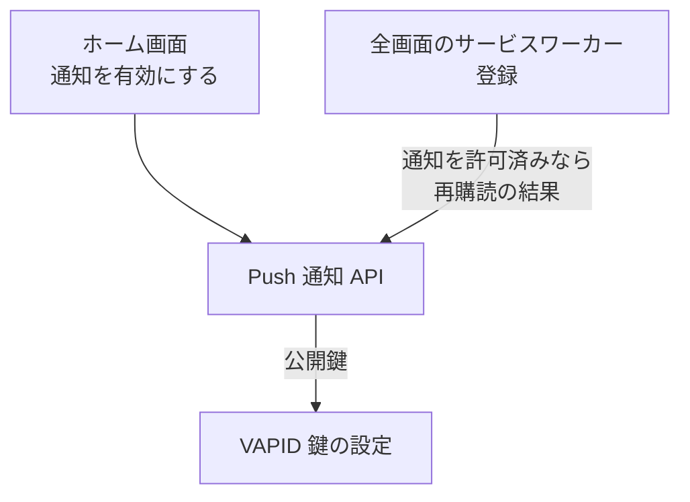

# Push 通知 API

マイリスト登録の完了通知を受け取るための Web Push の購読まわり。購読の情報は、サーバー側では保存しない。通知の宛先は、登録を依頼するときにジョブの記録へ書く ([マイリスト登録 API](./mylist-register.md))。

## エンドポイント

| メソッド | パス | 権限 |
|---|---|---|
| GET | `/api/push/vapid-public-key` | ログイン不要 |
| POST | `/api/push/subscribe` | ログイン |

## 入力と出力

- 公開鍵の取得は `{ publicKey }` を返す。ブラウザが購読を作るときに使う。値は環境変数 `VAPID_PUBLIC_KEY`
- 購読 (`POST /api/push/subscribe`) の入力は `{ subscription }`。`subscription` は `endpoint` (URL)、`keys.p256dh`、`keys.auth`。検証を通ると 201 で `{ success: true, subscriptionId }` を返す。`subscriptionId` は `endpoint` から決まる ID
- 購読の情報は保存しない。受け取って検証し、ID を返すだけ
- 権限 (ロール) は問わない。ログインしていれば呼べる

## エラー

形 C ([API のエラー応答](../term/api-error.md))。

| 条件 | 状態 | `error` |
|---|---|---|
| 未ログイン (購読) | 401 | `UNAUTHORIZED` |
| 本文が JSON でない | 400 | `INVALID_REQUEST` |
| `subscription` がない、または形が不正 | 400 | `INVALID_REQUEST` |
| 公開鍵が未設定 (公開鍵の取得) | 500 | `INTERNAL_ERROR` |
| VAPID 鍵が未設定 (購読) | 500 | `INTERNAL_ERROR` |
| 上記以外の失敗 | 500 | `INTERNAL_ERROR` |

- 500 を返す直前に、Admin へ報告する

## つながり

