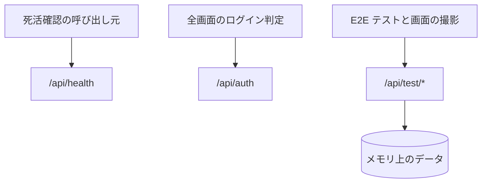

# システム系の API

業務の機能ではない API。死活確認、認証セッション、テスト用のデータの用意。

## エンドポイント

| メソッド | パス | 権限 |
|---|---|---|
| GET | `/api/health` | なし |
| GET | `/api/auth/*` (画面が使うのは `/api/auth/session`) | なし (ログインの状態を返す) |
| POST | `/api/test/videos` | ログイン (テスト用の設定のときだけ動く) |
| DELETE | `/api/test/videos` | ログイン (同上) |
| POST | `/api/test/session` | ログイン (同上) |
| DELETE | `/api/test/session` | ログイン (同上) |

## 入力と出力

- 死活確認は `{ status: 'ok', service: 'niconico-mylist-assistant', version, timestamp }` を返す。`version` は環境変数 `APP_VERSION`、なければ `1.0.0`
- 認証は next-auth の GET だけを公開する。サインアウトの POST は受け付けない (サインアウトは Auth サービスへ移す)。環境変数 `SKIP_AUTH_CHECK` が `true` のテスト用の設定では、`/api/auth/session` が認証せずにテスト用のセッション (利用者 ID、メール、名前は `TEST_USER_*` の環境変数。ロールは空) を返す
- テスト用の API は、環境変数 `USE_IN_MEMORY_DB` が `true` のときだけ動く。インメモリ DB を直接操作する
    - `POST /api/test/videos`: 本文は `{ count, startId?, favoriteCount?, skipUserSetting? }`。動画を `count` 件作る。動画 ID は `sm{startId + i}` (`startId` の既定は 50000000)、タイトルは「E2E動画 {番号}」、長さは `3:00`、サムネイルは `https://example.com/{動画 ID}.jpg`。先頭から `favoriteCount` 件 (既定 0) をお気に入りにする。`skipUserSetting` が `true` なら、ユーザー設定は作らない。成功は `{ success: true, count }`
    - `DELETE /api/test/videos`: 一覧に出るすべての動画 (全利用者の分) の動画基本情報と、自分の設定を消す。成功は `{ success: true, count }`
    - `POST /api/test/session`: ダミーの値でニコニコセッションを保存する (暗号化はしない。取得日時は今、推定有効期限は 30 日後)。成功は `{ success: true }`
    - `DELETE /api/test/session`: 保存したセッションを消す。成功は `{ success: true }`

## エラー

テスト用の API は形 B ([API のエラー応答](../term/api-error.md))。

| 条件 | 状態 | 応答 |
|---|---|---|
| テスト用の設定でない | 404 | 「このエンドポイントはテスト環境でのみ利用可能です」 |
| 未ログイン | 401 | 「認証が必要です」 |
| 失敗 | 500 | 「サーバーエラーが発生しました」 |

- ここの 500 は Admin へ報告しない
- 死活確認は、ここで返すエラーを決めていない

## つながり

