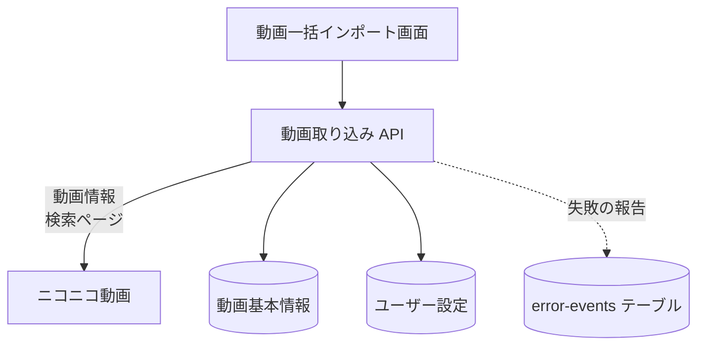

# 動画取り込み API

ニコニコ動画から動画の情報を取得して取り込む (一括インポート) API と、キーワードで動画を探す (検索) API。どちらもサーバーからニコニコ動画へ問い合わせる。

## エンドポイント

| メソッド | パス | 権限 |
|---|---|---|
| POST | `/api/videos/bulk-import` | ログイン |
| GET | `/api/videos/search` | ログイン |

## 入力と出力

一括インポート (`POST /api/videos/bulk-import`) の入力は `{ videoIds }`。

| 項目 | 条件 |
|---|---|
| `videoIds` | 配列。1〜100 件。要素は小文字の[動画 ID](../term/video-id.md) の形 (`/^[a-z]+\d+$/`) の文字列 |

- 件数の検査は、重複を除く前の配列に対して行う。そのあと、重複を除く (最初に出た順を残す)
- 自分のユーザー設定がすでにある動画は、スキップとして数え、取得しない
- 残りの動画の情報を、ニコニコ動画の動画情報 API (`ext.nicovideo.jp/api/getthumbinfo/{動画 ID}`) から 3 件ずつ並行して取得する。取得に失敗した動画は失敗として数え、続ける
- 取得できた動画ごとに、[動画基本情報](../term/video-basic-info.md)を作り (すでにあれば作り直さない)、自分の[ユーザー設定](../term/video-setting.md)を、お気に入りもスキップも `false` で作る。保存に失敗した動画は失敗として数える
- 応答は `{ success, failed, skipped, total, failedDetails? }`

| 項目 | 内容 |
|---|---|
| `success` | 取り込めた件数 |
| `failed` | 取得の失敗と保存の失敗の合計 |
| `skipped` | スキップした件数 |
| `total` | 重複を除いた件数 (スキップを含む) |
| `failedDetails` | 取得に失敗した動画の `videoId` と `error` (失敗の理由の文。ニコニコ動画 API が返した説明、HTTP の失敗、通信などの失敗のどれか)。なければ付かない。保存の失敗は含まない |

検索 (`GET /api/videos/search`) の入力は問い合わせの `q`。

| 項目 | 条件 |
|---|---|
| `q` | 必須。前後の空白を除いて 1〜100 文字 |

- ニコニコ動画の検索ページ (`https://www.nicovideo.jp/search/{キーワード}`) の HTML から、`sm`、`nm`、`so` で始まる動画 ID を、重複を除いて出た順に最大 10 件取り出す。それぞれの情報を、一括インポートと同じ方法で取得する。取得に失敗した動画は結果に入れない
- 検索ページが 404 を返したときは、0 件として扱う (ニコニコ動画は検索結果が 0 件のとき 404 を返す)
- 応答は `{ videos, total }`。`videos` の要素は、動画の情報 (`videoId`、`title`、`description`、`thumbnailUrl`、`duration` (秒)、`viewCount`、`commentCount`、`mylistCount`、`uploadedAt`、`tags`) に、`isRegistered` を足したもの
- `isRegistered` は、その動画の動画基本情報がサービスにあるか。1 回の問い合わせでまとめて確かめる。自分のユーザー設定があるかは見ない
- 並びは、取得が終わった順で、検索ページでの順位とは限らない

## エラー

形 B ([API のエラー応答](../term/api-error.md))。

| 条件 | 状態 | 応答 |
|---|---|---|
| 未ログイン | 401 | 「認証が必要です」 |
| 本文が JSON のオブジェクトでない (一括インポート) | 400 | 「リクエストボディが不正です」 |
| `videoIds` が配列でない | 400 | 「videoIds は配列である必要があります」 |
| `videoIds` が空 | 400 | 「videoIds を指定してください」 |
| `videoIds` が 100 件を超える | 400 | 「一度に登録できる動画は最大 100 件です」 |
| 形式が正しくない ID がある | 400 | 「不正な動画 ID 形式が含まれています」。`invalidIds` に不正だった要素を入力のまま付ける |
| `q` がない、または空白だけ (検索) | 400 | 「検索キーワードを入力してください」 |
| `q` が 100 文字を超える (検索) | 400 | 「検索キーワードは 100 文字以内で入力してください」 |
| 検索ページが 404 以外の失敗を返した、想定外の失敗 | 500 | 「サーバーエラーが発生しました」 |

- ニコニコ動画 API の取得に失敗した動画は、応答では `failedDetails` に入れ、1 件ずつ [ErrorEvent](../../platform/term/error-event.md) (「Niconico API エラー」) を Admin へ報告する。検索でも同じ報告が出る。一括インポートで保存に失敗した動画は「Web API: 動画一括登録の保存エラー」を報告する ([エラー通知の経路](../../admin/flow/error-notification.md))
- 一括インポートが `failed` を返しても、状態は 200。全件が失敗しても同じ

## つながり

