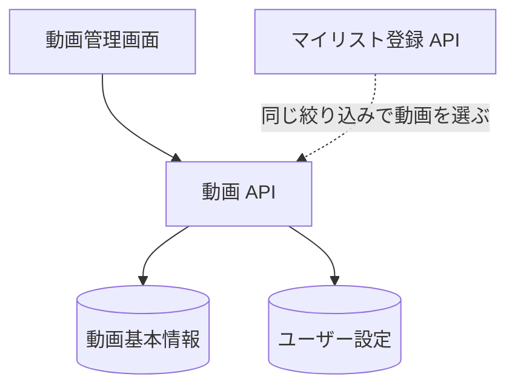

# 動画 API

取り込んだ動画の一覧、1 件の取得、ユーザー設定の更新、削除。動画そのもの ([動画基本情報](../term/video-basic-info.md)) は全利用者で共有し、お気に入り・スキップ・メモ ([ユーザー設定](../term/video-setting.md)) は利用者ごとに持つ。

## エンドポイント

| メソッド | パス | 権限 |
|---|---|---|
| GET | `/api/videos` | ログイン |
| GET | `/api/videos/{id}` | ログイン |
| DELETE | `/api/videos/{id}` | ログイン |
| PUT | `/api/videos/{id}/settings` | ログイン |

## 入力と出力

一覧 (`GET /api/videos`) の問い合わせ。

| 項目 | 条件 |
|---|---|
| `limit` | 1〜100。省略は 50 (画面は 20 を渡す) |
| `offset` | 0 以上の整数。省略は 0 |
| `isFavorite` | `true` か `false`。`true` はお気に入りのもの、`false` はそれ以外 (設定がない動画を含む) |
| `isSkip` | `true` か `false`。`true` はスキップのものだけ、`false` はスキップでないもの (設定がない動画を含む) |
| `search` | 前後の空白を除いたタイトルの部分一致。大文字と小文字は区別しない。空なら絞り込まない |

- 絞り込みはすべて満たすものだけ (AND)。並びは動画基本情報の登録日の新しい順。ページは `limit` と `offset` で切る
- 応答は `{ videos, total, limit, offset }`。`total` は絞り込み後の総件数。`videos` の要素は `videoId`、`title`、`thumbnailUrl`、`length`、`createdAt` と、自分の設定があれば `userSetting` (`isFavorite`、`isSkip`、`memo`、`createdAt`、`updatedAt`)
- 動画基本情報を全件読んでから、メモリ上で絞り込んでページを切る。件数が増えると遅くなる

1 件の取得 (`GET /api/videos/{id}`) は `{ video }` を返す。形は一覧の要素と同じだが、`createdAt` は自分の設定があればその作成日時、なければ動画基本情報の登録日になる (一覧は常に動画基本情報の登録日)。

設定の更新 (`PUT /api/videos/{id}/settings`) の入力。どの項目も省略できる。

| 項目 | 条件 |
|---|---|
| `isFavorite` | 真偽値 |
| `isSkip` | 真偽値 |
| `memo` | 文字列。1000 文字以内 |

- 設定がある動画は、送った項目だけを更新する (送った項目がなければ更新日時だけが変わる)。設定がなければ、送らなかった `isFavorite` と `isSkip` を `false` として新しく作る
- 応答は `{ video }`。動画基本情報と、更新後の設定を合わせたもの。この応答の `createdAt` は設定の作成日時

削除 (`DELETE /api/videos/{id}`) は動画基本情報と、自分の設定を消して `{ success: true }` を返す。

- 他の利用者の設定は消さない。動画基本情報がなくなれば、その動画は他の利用者の一覧にも出なくなるが、設定のデータは残る。同じ動画をあとで取り込み直すと、残った設定が復活する
- どちらか片方だけ残っている (動画基本情報がない、または設定がない) 場合も、あるほうを消して成功にする

## エラー

一覧 (形 A。[API のエラー応答](../term/api-error.md))。

| 条件 | 状態 | `code` |
|---|---|---|
| 未ログイン | 401 | `UNAUTHORIZED` |
| `limit` が 1〜100 の外 (数でない場合も) | 400 | `INVALID_REQUEST` (`details` に「limit は 1 から 100 の間で指定してください」) |
| `offset` が数でない、または負 | 400 | `INVALID_REQUEST` (`details` に「offset は 0 以上である必要があります」) |
| `isFavorite`、`isSkip` が `true` と `false` 以外 | 400 | `INVALID_REQUEST` (`details` にその旨) |
| 想定外の失敗 | 500 | `DATABASE_ERROR` |

取得・削除・設定の更新 (形 B)。

| 条件 | 状態 | 応答 |
|---|---|---|
| 未ログイン | 401 | 「認証が必要です」 |
| 本文が JSON のオブジェクトでない (更新) | 400 | 「リクエストボディが不正です」 |
| `isFavorite`、`isSkip` が真偽値でない (更新) | 400 | 「isFavorite は真偽値である必要があります」「isSkip は真偽値である必要があります」 |
| `memo` が文字列でない、または 1000 文字を超える (更新) | 400 | 「memo は文字列である必要があります」「memo は 1000 文字以内である必要があります」 |
| 動画基本情報がない (取得・更新) | 404 | 「動画が見つかりませんでした」 |
| 動画基本情報も自分の設定もない (削除) | 404 | 「動画が見つかりませんでした」 |
| 想定外の失敗 | 500 | 「サーバーエラーが発生しました」 |

## つながり

