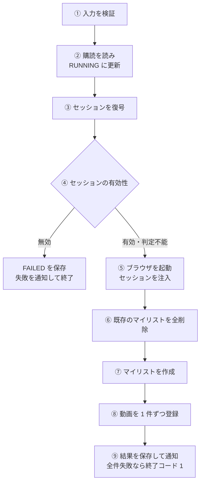
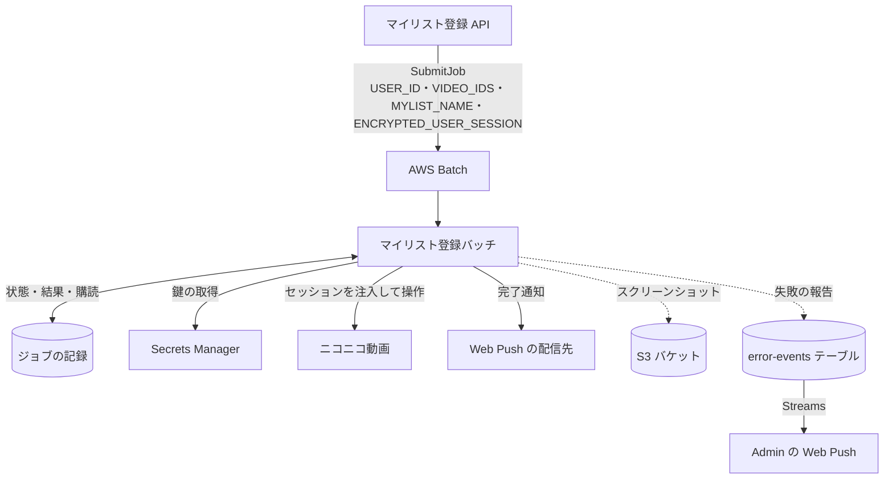

# マイリスト登録バッチ (mylist-register)

ニコニコ動画の既存のマイリストを全部消し、新しいマイリストを作り、選ばれた動画を 1 件ずつ登録するコンテナ。Playwright で実際のニコニコ動画の画面を操作する。1 回の起動で 1 つの[ジョブ](../term/batch-job.md)を処理する。

## 起点

- スケジュールはない。[マイリスト登録 API](../api/mylist-register.md) の投入 (SubmitJob) が、AWS Batch にジョブを 1 件投入して起動する
- 起動ごとに渡す値は、環境変数の 4 つ

| 環境変数 | 内容 |
|---|---|
| `USER_ID` | 利用者 ID。必須 |
| `VIDEO_IDS` | 登録する動画 ID の JSON 配列。必須で、空配列は不可 |
| `MYLIST_NAME` | マイリスト名。なければ「自動登録 {日本時間の YYYY/MM/DD HH:mm:ss}」 (API は必ず渡す) |
| `ENCRYPTED_USER_SESSION` | 暗号化した[ニコニコセッション](../term/user-session.md)。必須 |

- ジョブ ID は、AWS Batch が設定する `AWS_BATCH_JOB_ID` から読む。空なら、ジョブの記録の更新と完了の通知は行わない
- ジョブ定義が持つ環境変数

| 環境変数 | 内容 |
|---|---|
| `DYNAMODB_TABLE_NAME`、`AWS_REGION` | 必須。なければ起動直後に例外 |
| `ENCRYPTION_SECRET_NAME` | セッションの復号に使う鍵のシークレット名 (旧名 `SHARED_SECRET_KEY` でも読む) |
| `VAPID_PUBLIC_KEY`、`VAPID_PRIVATE_KEY` | 完了通知の署名鍵 |
| `ERROR_EVENTS_TABLE_NAME` | エラー履歴の報告先 |
| `SCREENSHOT_BUCKET_NAME` | あれば、デバッグ用のスクリーンショットを S3 にも置く |

- 実行基盤は Fargate の Batch。1 vCPU、メモリ 2,048 MB、パブリック IP あり。コンピュート環境の最大は 4 vCPU
- ジョブ定義名とキュー名は `nagiyu-niconico-mylist-assistant-{env}`。ログは CloudWatch Logs `/aws/batch/nagiyu-niconico-mylist-assistant-{env}` (保持 1 週間)

## 処理

| 手順 | 内容 |
|---|---|
| ① 検証 | 環境変数とジョブの入力を検証する。不正なら例外 (「ジョブパラメータが不正です」など)。この時点の失敗では、ジョブの記録を更新できない |
| ② 購読と状態 | ジョブの記録から、完了通知の宛先 (`pushSubscription`) を読む。読めなくても続ける。ステータスを `RUNNING` にする。更新に失敗しても続ける |
| ③ 復号 | 暗号化した値の JSON を読み、Secrets Manager の鍵で復号する |
| ④ 有効性 | 実行の直前に、[ニコニコセッション](../term/user-session.md)の有効性を判定する。`invalid` なら止める。`unknown` は、警告を出して続ける |
| ⑤ 起動 | ヘッドレスの Chromium を、`ja-JP` のロケールで起動する。`user_session` を、`.nicovideo.jp` のクッキー (secure、`SameSite=Lax`) として注入する。ログインや二段階認証の操作はしない。お知らせのバナー (`.OverlayBannerFrame`) が出たら閉じる |
| ⑥ 全削除 | マイリストのページを開き、先頭のマイリストを開いて、3 点メニューの 3 番目のボタン (削除) を押し、確認ダイアログを承認し、ページを開き直す。これをマイリストが 0 件になるまで繰り返す。繰り返しの回数に上限はない |
| ⑦ 作成 | 新規作成ボタンから、名前をキー入力して「作成」を押す。通常のクリックが効かないときは、スクリプトでクリックする |
| ⑧ 登録 | 動画ごとに、動画のページを開き (3 秒待つ)、「メニュー」、「マイリストに追加」、マイリスト名のテキストの順に押す。登録に成功したら、次の動画の前に 2 秒待つ (最後の動画のあとは待たない) |
| ⑨ 結果 | 成功した件数と失敗した件数から、ステータスを決めて保存し、完了を通知する (下) |

- 全削除は、そのアカウントのマイリストをすべて消す。既存のマイリストは 1 件も残らない
- 動画の間には、最低 2 秒の待ちを置く。登録に失敗した動画のあとには、この待ちを置かない
- ナビゲーションの待ちは 30 秒、動画ページでの 1 回の操作は 10 秒まで
- スクリーンショット (全削除のあと、作成のあと、登録のあと、各段階の失敗) を `/tmp` に撮る。`SCREENSHOT_BUCKET_NAME` があれば、`screenshots/{時刻}-{名前}.png` として S3 にも置く (バケットは 7 日で消す)。撮影の失敗は無視する
- ⑥〜⑧ のブラウザの処理で例外になった場合は、動画ごとの結果ではなく、全件の失敗として扱う (エラーの文は「マイリストの削除に失敗しました」「マイリストの作成に失敗しました」など)

結果の保存と通知 (⑨)。

| 項目 | 内容 |
|---|---|
| ステータス | 成功が 0 件で失敗が 1 件以上なら `FAILED`、それ以外 (全件成功、一部失敗) は `SUCCEEDED` |
| 結果 | `registeredCount` (成功)、`failedCount` (失敗)、`totalCount` (その合計)、`errorMessage` (あれば)。`completedAt` も保存する |
| 通知 | 宛先があるときだけ、Web Push を送る。ステータスの保存に成功したあとに送るので、保存が失敗すると通知も送らない |

完了通知は、題名が「マイリスト登録完了」で、本文は次のとおり。通知をタップすると、動画管理画面 (`/mylist`) が開く。

| 条件 | 本文 |
|---|---|
| 失敗が 0 件 | 全 N 件のマイリスト登録が完了しました |
| 成功が 0 件 | マイリスト登録に失敗しました (M 件) |
| 一部失敗 | X 件登録完了、M 件失敗 (成功率 P%)。P は四捨五入した整数 |

- 宛先が無効 (404 や 410) だと、警告を出すだけ。送信のほかの失敗も、ジョブの成否には影響しない

## 上限

- 動画ごとの再試行: 失敗してから最大 3 回。間隔は 2 秒で固定 (増やさない)。1 件につき最大 4 回試す。すべて失敗した動画は失敗に数え、次の動画に進む
- ジョブのタイムアウト: 1,800 秒。AWS Batch の試行は 1 回だけで、再試行しない
- 1 回の依頼で登録する動画は、API が選ぶ最大 100 件

## 失敗したとき

| 場面 | ジョブの記録 | Admin への報告 | 通知 | 終了コード |
|---|---|---|---|---|
| 環境変数や入力の不正 (① の失敗) | 更新しない (`SUBMITTED` のまま) | critical 「バッチジョブ全体の失敗」 | なし | 1 |
| 復号の失敗 | `FAILED`、`errorMessage` は「user_session の復号化に失敗しました: ...」 | critical 「user_session 復号化失敗」と、続けて critical 「バッチジョブ全体の失敗」 | なし | 1 |
| セッションが無効 | `FAILED`、`errorMessage` は「user_session が無効です。再取得してください」 | error 「user_session 無効」 | 送る。件数が 0 のため、本文は「全 0 件のマイリスト登録が完了しました」になる | 1 |
| ブラウザの処理の例外 (全削除・作成・起動の失敗) | `FAILED`、全動画を失敗として保存、`errorMessage` に原因 | error 「Playwright 自動化処理失敗」と、続けて critical 「バッチジョブ全失敗」 | 送る (失敗の本文) | 1 |
| 全動画の登録に失敗 | `FAILED` | critical 「バッチジョブ全失敗」 | 送る (失敗の本文) | 1 |
| 一部の動画の登録に失敗 | `SUCCEEDED` (`failedCount` が 1 以上) | なし | 送る (成功率の本文) | 0 |

- 終了コードが 1 のとき、AWS Batch はジョブを失敗にする。試行は 1 回なので、再実行はしない
- 1,800 秒を超えると Batch がジョブを止める。ワーカーは時間を見ておらず、ステータスを更新できないので、記録は `RUNNING` のまま残る。画面は 30 分で取得を打ち切る。Batch の失敗を拾う EventBridge のルールや CloudWatch Alarm は、niconico-mylist-assistant のインフラには定義されていない ([エラー通知の経路](../../admin/flow/error-notification.md)の `batch-event` の対象にならない)
- ジョブの記録の更新が失敗しても、バッチは警告やエラーのログを出して続ける (最終ステータスの更新が失敗すると、記録は `RUNNING` のまま残る)
- 報告は [ErrorEvent](../../platform/term/error-event.md) で、`serviceId` は `niconico-mylist-assistant`。報告の書き込みに失敗しても、例外は伝えない

## つながり

