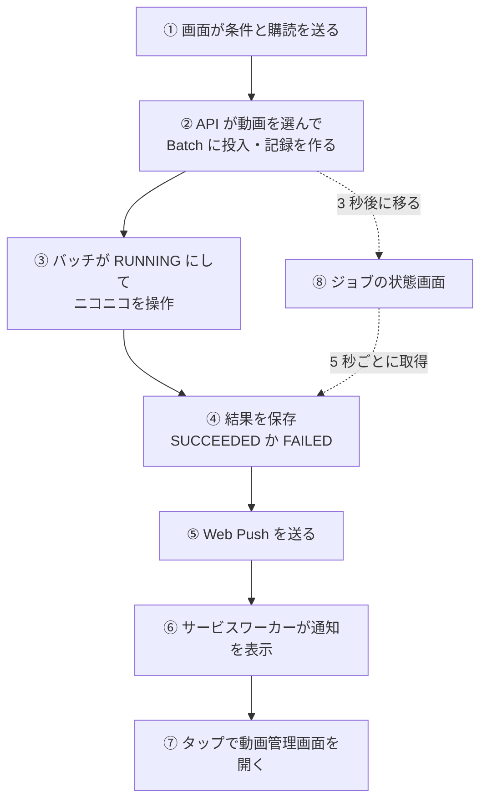
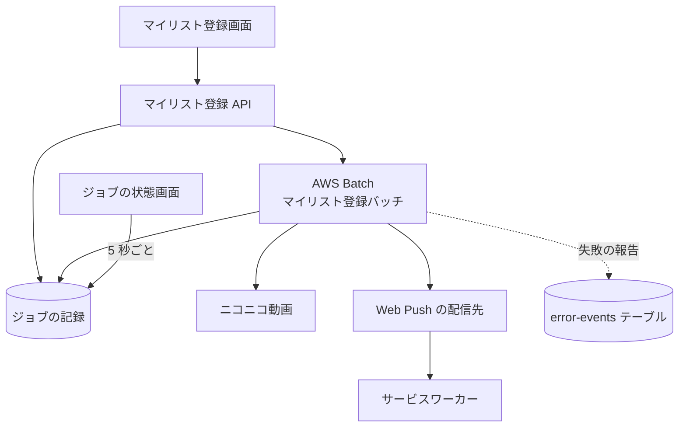

# マイリスト登録の経路

利用者がマイリスト登録を依頼してから、バッチがニコニコ動画のマイリストを作り直し、結果が画面と端末の通知に届くまでの流れ。

## 起点

- 利用者が[マイリスト登録画面](../screen/mylist-register.md)で「マイリストに登録」を押す。ニコニコの[セッション](../term/user-session.md)が保存済みでなければ押せない
- 通知を受け取るには、先に[ホーム画面](../screen/home.md)で通知を有効にして、ブラウザに Web Push の購読を作っておく

## 経路

1. **依頼**: 画面は、ブラウザがすでに購読を持っていれば、購読の情報 (`endpoint` と鍵) を添えて `POST /api/mylist/register` を呼ぶ。購読がなければ添えない。許可は求めない
2. **投入**: [マイリスト登録 API](../api/mylist-register.md) が、条件に合う動画を最大 `maxCount` 件選び、保存済みのセッションの暗号化した値と合わせて AWS Batch にジョブを投入し、ジョブの記録を `SUBMITTED` で作る。購読は、この記録に書く。成功すると `jobId` を返す
3. **実行**: [バッチ](../batch/mylist-register.md)は、記録から購読を読み (環境変数には載せない)、`RUNNING` にして、マイリストを全削除、作成、動画を 1 件ずつ登録する
4. **結果**: 成功と失敗の件数から `SUCCEEDED` か `FAILED` を決め、結果と完了日時を記録に書く
5. **通知**: 購読があれば、記録を更新したあとに Web Push を 1 件送る。題名は「マイリスト登録完了」で、本文は件数によって変わる ([バッチ](../batch/mylist-register.md))。ペイロードに遷移先の URL は含めない
6. **表示**: サービスワーカー (`/sw.js`、全画面で登録する) が通知を出す。通知は、同じタグで置き換わり、操作するまで消えない
7. **遷移**: 通知をタップすると、開いているタブがあればそれを、なければ新しいタブを、`/mylist` (動画管理画面) に移す。ジョブの状態画面は開かない
8. **状態の画面**: 依頼が成功すると、画面は 3 秒後に[ジョブの状態画面](../screen/job-status.md)へ移る。状態画面は、5 秒ごとに[ジョブ API](../api/batch-jobs.md) を呼び、結果を見せる。通知がなくても、ここで結果を見られる

## 届く先

- **ジョブの状態画面**: ステータスと結果 (成功・失敗の件数、エラーの文)。完了 (`SUCCEEDED`) になると、画面の下にも完了の通知を出す
- **端末の通知**: 依頼を出したときのブラウザの購読 1 件だけ。ほかの端末や、あとから有効にした購読には届かない
- **Admin のエラー履歴**: バッチの失敗は [ErrorEvent](../../platform/term/error-event.md) として届く ([マイリスト登録バッチ](../batch/mylist-register.md)、[エラー通知の経路](../../admin/flow/error-notification.md))

## 失敗・取りこぼしのとき

- 購読がない、または購読が無効 (宛先が 404 や 410 を返す) と、通知は届かない。記録は更新されているので、画面で結果を見られる。通知は再送しない
- 通知の送信に失敗しても、ジョブの結果は変わらない
- 記録の更新に失敗すると、通知も送らない。ジョブの記録の作成が API で失敗したときは、ジョブは動くが、記録がないので状態も通知も出ない ([マイリスト登録 API](../api/mylist-register.md))
- バッチが時間切れで止められると、記録は `RUNNING` のまま残り、通知も出ない。画面は 30 分で取得を打ち切る
- 実行の直前にセッションが無効と分かると、ジョブは `FAILED` になり、通知は出るが、件数が 0 のため本文は「全 0 件のマイリスト登録が完了しました」になる

## つながり

